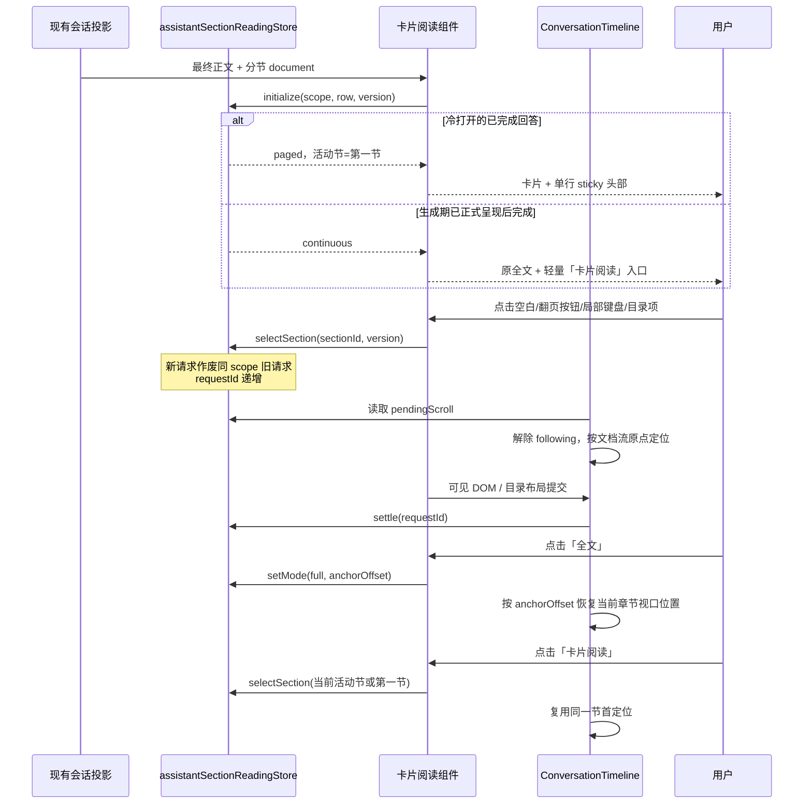

# Spec：AI 最终回答卡片分节阅读

状态：2026-10-27 新版规范。本文替代旧版「三排头部 / tab 列表 / 正文后翻页」交互；历史交付记录保留在文末并标注为旧版。代码现状与本文冲突时，以本文为准。

## 目标与范围

在 AI 正常完成的最终回答中，按 Markdown 章节提供卡片式分页阅读：一屏只读一节，章节之间横向切换；完整全文仍然只有一份 Markdown 语义。

- 设置沿用现有「实验特性」中的「AI 回答分节阅读」，默认值不变，仍为关闭。
- Desktop、桌面 Web、手机远控 Web 共用同一阅读语义，兼容现有主题、中英文和 `--ui-font-size`。
- 只处理当前 product turn 的最终 Assistant 正文；不处理推理、过程消息、工具结果、计划卡、预览卡或代码评论卡。
- 不改写原始消息、提示词、Agent 运行状态、Host attachment、队列或协议完成语义。
- 复制、分享、导出和搜索始终以全文为准；第一版分享只读时间线继续使用连续阅读。
- 阅读状态、Timeline 纵向滚动所有权、设置持久化和协议边界均不因卡片外观改变。

## 交互模型

### 分页态：统一卡片

首次打开已完成回答，或用户通过「卡片阅读」主动进入分页时，显示一张统一卡片：

```text
┌──────────────────────────────────────────────────────────────┐
│ 当前章节标题……                          2 / 5   [目录] [‹] [›] [全文] │ ← 紧凑单行 sticky
├──────────────────────────────────────────────────────────────┤
│                                                              │
│  当前章节 Markdown（自然高度，长正文向下增长）                │
│                                                              │
└──────────────────────────────────────────────────────────────┘
```

- 卡片外壳：`bg-card`、细边框 `border-card-border`、轻阴影 `shadow-sm`、`rounded-xl`。这是回答内容的第一层圆角容器；内部控件按 `DESIGN.md` 的嵌套圆角规则降级。
- 头部只有一排，不再拆成「模式行 / 章节 tab 行 / 翻页行」三排。同一排依次承载：当前章节标题、页码、目录入口、上一节、下一节、全文入口。
- 头部在卡片范围内吸顶；`top` 继续扣除 Timeline 的 56px 顶栏避让常量和历史虚拟行位移变量 `--timeline-virtual-row-offset`。不得另建第二套吸顶或滚动协调。
- 桌面端头部保持紧凑高度；`pointer: coarse` 下所有可点击目标至少 44px 高。按钮使用现有 `Button`、语义颜色与 `text-ui-*` 字号。
- 当前章节标题在头部内单行显示，占弹性宽度并使用 `min-w-0`；超长时允许局部横向滚动/渐隐，不得只靠省略号。完整长标题必须在目录中换行可读。
- 页码使用 `tabular-nums`，并保留总页数的宽度占位，避免切换章节时按钮横向跳动。
- 目录按需展开：点击「目录」打开锚定在头部下方的浮层/菜单（复用现有菜单表面 `bg-menu`、`rounded-lg`、`shadow-md`），列出全部章节完整标题（换行，不省略），当前项标记 `aria-current`。目录不常驻、不占用正文高度；关闭后焦点回到目录按钮。章节很多时浮层可在自身范围内滚动，正文仍不得出现第二个纵向滚动容器。
- 「上一节 / 下一节」始终存在；首节禁用上一节，末节禁用下一节。末页不循环。
- 「全文」切回连续全文，使用现有 `setAssistantReadingMode` 锚点请求恢复当前章节在视口中的位置。

### 全文态与 live 完成态：无壳，仅轻量入口

- 用户展开全文、搜索命中展开全文、以及「生成期已正式呈现、完成后进入 continuous」的回答，一律移除卡片外壳、目录、tab 列表、页码和翻页行。
- 这些状态只保留一个轻量「卡片阅读」文字入口：`variant="ghost"`、`text-ui-sm`、弱前景色，不吸顶、不加边框/背景/阴影、不进入 `[data-conversation-selectable]`，也不参与查找命中计数。
- 原 Markdown 全文不改：继续使用原 `MessageResponse` / Streamdown 和原消息内容，不套卡片最小高度，不改变正文排版。
- 入口放在回答正文之前；若在 live 完成时插入会改变高度，继续复用既有 Timeline 头部布局交接补偿，保证用户正在阅读的正文位置不动。不得为入口新增状态所有者或滚动写入路径。
- 点击「卡片阅读」进入分页态：优先定位到 store 中记录的活动章节；没有活动章节时定位第一节。进入分页和切页都复用同一 `pendingScroll` 请求与 Timeline 定位。

### 点击与键盘

- 点击卡片空白区域（卡片背景/补足最小高度的留白）或显式的翻页区域，进入下一张卡片；末页不循环、不回到首页。
- 以下操作绝不触发翻页：
  - 存在非折叠文本选区；
  - 指针移动超过拖选阈值（拖选、滑动、滚动）；
  - 点击链接、代码、表格、折叠控件（`details/summary`）、表单控件、按钮、菜单、目录项或任何 `[contenteditable]`；
  - 事件目标位于 Markdown 正文内容中，而不是卡片空白。
- 空白点击只在事件目标就是卡片/留白容器本身时生效（例如 `event.target === event.currentTarget`），并同时检查 `window.getSelection()?.isCollapsed`；不得通过全局长按/点击监听推测。
- 保留「上一节 / 下一节」按钮及局部键盘翻页：焦点在卡片头部、翻页按钮、目录入口或卡片空白上时，`ArrowLeft` / `ArrowRight`（以及等价的 `PageUp` / `PageDown`）可切节。
- 键盘监听只挂在卡片局部，不得拦截正文控件键盘：来自链接、代码、表格、`details`、输入框、可编辑区域或其它交互元素的事件直接放行；不注册 `window`/`document` 级快捷键。
- 目录打开时：`ArrowUp` / `ArrowDown` 移动焦点，`Enter` / `Space` 选节，`Escape` 关闭并归还焦点到目录按钮。
- 动画保持短淡入并尊重 `prefers-reduced-motion`；关闭动画时状态与定位顺序不变。

### 自适应高度与排版

- 卡片最小高度随容器可视区域缩放并设上限：桌面建议 `min-height: clamp(220px, 46dvh, 480px)`；手机/窄屏建议 `min-height: clamp(160px, 40dvh, 320px)`。具体数值可微调，但必须同时满足「随视口增长」和「有上限」。
- 长正文自然向下增长，卡片和正文都不设置 `overflow-y`；对话纵向滚动仍只有 Timeline 一个容器。
- 极短纯文字或仅标题的页面可使用既有 `text-ui-lg` / `text-ui-xl` 层级强调，但不能按字符长度放大结构化内容：
  - 只有解析器给出 `presentation` 的页面才可强调。
  - 强调只作用于普通段落文字；`pre`、`code`、`table`、列表、引用、标题层级仍使用各自既有字号。
  - 结构化内容（代码、表格、列表、引用、图片、可视 HTML）即使很短也保持正文 `text-ui-base`。
- 空白点击区域在视觉上保持安静：不增加提示文案、渐变或装饰性底纹。

## 分节算法

实现入口：`packages/ui/src/lib/assistantSectionReading.ts`。使用 `marked.lexer` 的根级 block token 识别边界，不使用按行匹配 `##` 的正则切字符串。

### 切分层级

- 只在根级 `heading` token 中选择出现至少两次的最浅层级作为 `splitHeadingDepth`。
- 代码块、引用、列表、表格或更深标题中的 `#` 样式不单独切页。
- 单一 H1 总标题 + 多个 H2 时按 H2 切；只有多个 H3 时可按 H3 切；不满足至少两个同层标题时返回 `undefined`，显示全文。
- 每页包含本章标题，直到下一个同级切分标题之前结束。

### 总标题前缀合并

设首个切分标题之前的根级 token（排除引用定义 `def`）为前缀。按可见性分类：`space`、`def` 和仅含 HTML 注释的 `html` 不可见。

- **合并进首节**：前缀中恰好只有一个可见 token，且该 token 是比切分层级更浅的根级 heading。此时不生成独立 intro 页：
  - 第一节 `markdown` 从文档偏移 0 开始，包含总标题、空白、不可见注释与引用定义；
  - 第一节 `title` 仍是首个切分标题文案；
  - 第一节 `startOffset` 为 `0`，覆盖前缀；
  - 原始总标题文本必须保留，不得丢 token。
- **独立 intro 页**：前缀存在真实导语、多个 heading、代码、列表、表格、引用或可视 HTML 等任何其它可见内容时，生成 `title: ""`、`startOffset: 0` 的 intro 页，并保留原总标题在内的全部前缀 Markdown。
- **无 intro 页**：前缀没有任何可见内容时，直接从第一个章节开始。

示例：

| 输入前缀                                | 结果                      |
| --------------------------------------- | ------------------------- |
| `# 总标题`                              | 合并进首节，无空 intro 页 |
| `<!-- meta -->` + 引用定义 + `# 总标题` | 合并进首节                |
| `# 总标题` + 导语段落                   | 独立 intro 页，含总标题   |
| `# 总标题` + `### 更深标题`             | 独立 intro 页             |
| `# 总标题` + 代码块/列表/表格           | 独立 intro 页             |
| 直接 `## 第一节`                        | 无 intro 页               |

### 偏移、ID 与回退

- `startOffset` 是该节在完整 Markdown 中的精确源偏移：合并前缀的首节为 `0`，其余为切分标题 token 的起始偏移。
- `startOffset: 0` 的首节在全文中以正文面板起点作锚点，不再给内部切分标题重复打首节锚点。这样从含总标题的首张卡片展开全文时，保留的是总标题位置，而不是将总标题滚到视口上方。
- 章节 ID 使用文档内稳定位置（序号 + 源偏移）；重复标题允许存在，不能只以标题文字作唯一 key。
- 不含引用定义的文档，按顺序拼接各页 `markdown` 必须与原文完全一致；含引用定义时，每个页面继续附加全部引用定义以维持跨页语义。
- 以下情况返回 `undefined`，保留连续全文：
  - 根级同层 HTML heading 与 Markdown 切分层级混用，导致全文标题锚点无法唯一对应；
  - 回答内存在 `#` 局部链接或 GFM 脚注，页面级渲染无法证明跨页语义一致；
  - tokenizer 消费长度与源字符串不一致，存在静默丢字节风险。
- 标题文案使用实体解码后的可见文本，并按与 DOM 标题相同的空白规范化规则处理（含 NBSP）。

### 纯短内容 presentation

解析器可返回纯派生字段：

```ts
interface AssistantReadingSection {
  // ...
  presentation?: {
    emphasis: "lg" | "xl";
  };
}
```

- 仅当整页只由 heading/paragraph 及其纯文本内联内容（text、escape、br、strong、em、del、link）构成时才算纯文本。
- 出现 fenced/inline code、table、list、blockquote、image 或可视 HTML 时不得返回 `presentation`，与字符数无关。
- 可见文本不超过 120 个字符才可返回；不超过 40 个字符为 `xl`，否则为 `lg`。
- `presentation` 只表达「可选强调」提示，不改变 Markdown、正文长度、章节资格或复制内容。

## 状态所有者与事件时序

### 所有者

| 状态或事实                              | 唯一所有者                                                                                 | 其它层职责                                                 |
| --------------------------------------- | ------------------------------------------------------------------------------------------ | ---------------------------------------------------------- |
| 正文、最终目标、整轮状态                | 现有 CLI/runtime product projection，经 UI conversation projection 消费                    | 阅读层只读；不以文字停顿或单段 `complete` 判整轮结束       |
| `assistantSectionReadingEnabled`        | 现有 `ISettingService` / AppSettings                                                       | 默认值与协议范围不变；UI 经 `useSettings` 读取             |
| 章节结构、`startOffset`、`presentation` | 最终可见 Markdown 的纯派生结果                                                             | 依正文版本缓存；主题、页码、tick 不重新解析                |
| 连续/分页/全文、活动章节、定位请求      | `packages/ui/src/store/assistantSectionReadingStore.ts`，按阅读 scope 隔离的内存外部 store | 卡片组件只订阅并发送类型化意图；行卸载不清理，视图结束清理 |
| 卡片结构、目录展开、局部键盘            | 卡片组件局部状态                                                                           | 不写消息、不写设置、不直接写 `scrollTop`                   |
| 纵向定位、following、锚点、头部交接     | `ConversationTimeline`                                                                     | 卡片只报告布局和定位意图                                   |
| 搜索命中                                | 现有 Find hook / 索引                                                                      | 先请求展开全文，再等待可见正文提交后高亮                   |

- 阅读 key 继续包含阅读视图实例、`workspaceIdentity?.trim() || workspacePath`、远端 `remoteSessionId`、`sessionId`、`turnId`、最终 `rowId` / `entityId`。
- 不同窗口、不同 Host attachment、同路径不同 identity 不共享活动页。
- 设置关闭时不解析章节、不构建卡片 DOM、不挂章节专用 observer，也不补拉历史。

### 事件顺序



- 只允许当前 scope、正文版本和最新请求提交；提交后结算一次。
- 连续点击、用户主动滚动、切会话、正文换代、远端 attachment 改变时，旧定位请求失效。
- 卡片切换先提交新内容与定位，再短淡入；不做长距离平滑纵向滚动。
- 完成时插入轻量入口或切换卡片必须保持正文锚点；布局补偿仍由 Timeline 按 scope 与完整 row key 结算，不能重复补偿。

## 验收矩阵

| ID     | 前置与操作                                                            | 必须断言                                                                                            | 证据                |
| ------ | --------------------------------------------------------------------- | --------------------------------------------------------------------------------------------------- | ------------------- |
| ASR-01 | 设置缺字段、关闭、开启后重读                                          | 默认值不变；只接受布尔 patch；关闭态无额外章节工作                                                  | shared/service 单测 |
| ASR-02 | 冷打开已完成回答                                                      | 直接显示卡片，默认第一节；无全篇闪现后收起                                                          | 状态 + 隔离渲染     |
| ASR-03 | 生成期已正式呈现，正常完成后                                          | continuous 无卡片、无目录、无页码/翻页；只出现轻量「卡片阅读」入口；正文位置稳定                    | 状态 + 隔离组件     |
| ASR-04 | 主动展开全文、搜索展开全文                                            | 无卡片外壳、目录、tab、页码、翻页；原 Markdown 全文不变；展开锚点恢复                               | 状态 + 隔离组件     |
| ASR-05 | 分页态结构                                                            | 统一卡片壳；头部只有一排，含当前节、页码、目录、上一节、下一节、全文；不存在独立 tab 行或第二翻页行 | 结构回归            |
| ASR-06 | `# 总标题` + 多个 `##`                                                | 不生成空 intro 页；首节含总标题且 `startOffset=0`；拼接后无 token 丢失                              | 纯函数              |
| ASR-07 | 总标题 + 真实导语                                                     | 独立 intro 页且包含总标题；切分节 `startOffset` 精确                                                | 纯函数              |
| ASR-08 | 直接 `##` 开头、只有多个 H3、重复标题、无可分页结构                   | 层级稳定、ID 不冲突、无空页；不满足条件保留全文                                                     | 纯函数              |
| ASR-09 | 注释/引用定义前缀；前缀含代码、列表、更深 heading                     | 不可见前缀可合并；真实可见内容生成 intro                                                            | 纯函数              |
| ASR-10 | 代码/引用/列表中的假标题；同层 HTML；局部链接/脚注                    | 不误切；歧义结构回退全文                                                                            | 纯函数 + renderer   |
| ASR-11 | 极短纯文字、较短纯文字、短结构化内容、长纯文字                        | 纯短内容返回 `xl`/`lg`；代码/表格/列表等永不返回；长文不返回                                        | 纯函数              |
| ASR-12 | 桌面/手机、短页/长正文                                                | 卡片 min-height 随视口且封顶；长正文自然增长；Timeline 是唯一纵向滚动                               | 隔离渲染            |
| ASR-13 | 点击卡片空白、翻页区域、末页；选框、拖选、链接、代码、`details`、表单 | 空白/显式区域下一张；交互元素和选区不翻页；末页不循环                                               | 隔离组件            |
| ASR-14 | 头部局部键盘、目录键盘、正文控件键盘                                  | 局部方向键可翻页；正文控件不被拦截；目录方向键/Enter/Escape 正常                                    | 隔离组件            |
| ASR-15 | 超长章节标题、390px 窄屏、触控、明暗主题                              | 头部不因长标题破坏单行；目录完整可读；触控目标 ≥44px；焦点可见                                      | 隔离渲染            |
| ASR-16 | 连续切节、用户中途滚动、图片加载、重复完成事件                        | 只提交最新定位；用户滚动接管；完成幂等；无定时器拉回                                                | 状态 + 隔离 E2E     |
| ASR-17 | 分页态复制整条回答、分享、导出、查找隐藏章节词                        | 复制/分享/导出为全文；查找先展开再高亮；导航文字不计入命中                                          | Find + 回归         |
| ASR-18 | 虚拟列表卸载重挂、主题/宽度/字号/工时 tick、历史前插                  | 阅读模式、活动节、目录状态不重置；不重复解析稳定正文                                                | 状态/锚点回归       |
| ASR-19 | 同路径不同 identity、相同 sessionId 不同 Host/远端会话                | 阅读状态隔离；旧 scope/版本/请求失效                                                                | 状态 + 远端集成     |
| ASR-20 | `prefers-reduced-motion`、Zai Light/Dark、中英文、手机 Web            | 关闭动画仍正确定位；文案不裁切；核心入口可触达                                                      | 隔离渲染            |

- 未加载历史仍按现有按需查询加载，不以章节功能为由全量 hydration。
- 分享只读分页、跨窗口实时设置广播、持久化阅读进度、多级嵌套分页、AI 生成章节摘要和重新排版不在本期范围。

## 回归约束

- 分节必须使用 `marked` 根级 token，不新增正则切章；`startOffset` 必须与源 Markdown 精确对应。
- 总标题合并只处理「唯一更浅根级 heading + 不可见前缀」；任何真实导语、多个 heading 或结构化内容仍生成 intro，且不得丢失总标题。
- 既有全文回退保持不变：同层 HTML、局部锚点、脚注、tokenizer 长度不一致。
- 重复标题的 ID、实体解码后的标题匹配、NBSP 空白规范化、代码/引用/列表中的假标题行为不得回退。
- `presentation` 是纯派生可选字段；不得以字符长度放大结构化内容，不得影响复制、分享、查找和 Markdown 正文。
- 状态所有者、store 模式、Timeline 唯一纵向滚动、`pendingScroll` 最新请求规则不变。
- 不发往 Host/CLI，不新增共享协议字段，不改设置默认值。
- 复制、分享、导出、搜索始终使用全文；会话查找仍先展开再定位。
- UI 结构调整后，现有断言三排头部（`data-assistant-section-header`、`data-assistant-section-nav`、`data-assistant-section-pagination` 的独立顺序）的回归测试需要由接线方同步更新为新单行头部；解析器测试不得因此回退。
- 保留工作区中与本任务无关的本地改动；不自动提交、不新建分支、不操作运行中的 YCode。

## 验证入口与执行约束

当前仓库没有统一 UI E2E runner；隔离组件夹具、store bridge 和 coverage 工具不能算真实交互覆盖。未实际执行的 E2E 不得写成通过。未经用户明确允许，不连接、注入、重启或自动化操作正在运行的 YCode。

已核验的命令：

```sh
# 本功能纯函数与 store 测试
pnpm --filter @zcode/ui exec tsx --import ./test/helpers/registerAssetStubs.mjs \
  --test test/assistantSectionReading.test.ts

# UI 包测试入口（实际执行 test/**/*.test.ts）
pnpm --filter @zcode/ui test

pnpm typecheck
pnpm lint
pnpm architecture:check --changed
```

受影响的既有回归文件：

- `packages/ui/test/assistantSectionReading.test.ts`
- `packages/ui/test/assistantSectionReadingRender.test.ts`
- `packages/ui/test/assistantSectionReadingHeadingAnchors.test.ts`
- `packages/ui/test/conversationTurnUnitReuse.test.ts`
- `packages/ui/test/timelineScrollAnchor.test.ts`
- `packages/ui/test/timelineToggleAnchor.test.ts`
- `packages/ui/test/timelineUserScrollAnchorWiring.test.ts`
- `packages/ui/test/timelineStagedTurnDom.test.ts`
- `packages/ui/test/taskFindUpdateDepthRegression.test.ts`
- `packages/ui/test/sessionCitationExport.test.ts`

### 本轮解析器改动（2026-10-27）

- 实现「唯一更浅根级总标题合并进首节」：`# 总标题` + 多个 `##` 不再生成空 intro 页；首节 `startOffset=0`，Markdown 保留总标题，其余章节偏移不变。
- 前缀存在真实导语、多个 heading、代码等可见内容时仍生成独立 intro 页，并保留总标题。
- 新增可选 `presentation: { emphasis: "lg" | "xl" }`：仅短纯文本页面返回；代码、表格、列表、引用、图片、可视 HTML 永不返回。120 字符内为 `lg`，40 字符内为 `xl`。
- 新增纯函数测试覆盖：总标题合并、真实导语、直接 `##`、注释/引用定义、更深 heading/代码前缀、重复标题、HTML/局部链接/脚注回退、全文 `startOffset`、纯短/结构化内容 `presentation`。
- 实际执行：
  - `pnpm --filter @zcode/ui exec tsx --import ./test/helpers/registerAssetStubs.mjs --test test/assistantSectionReading.test.ts`：23 项通过、0 失败。
- 本轮未运行隔离组件或 E2E；卡片结构、空白点击、局部键盘、自适应高度、目录浮层等 UI 验收仍待接线与隔离环境验证。

## 历史交付记录（旧版，已被本文替代）

以下记录保留用于追溯，其中的三排头部、常驻 tab 行、正文后/顶部独立翻页行等交互已被 2026-10-27 卡片规范替代；解析稳定性、状态所有权、Timeline 锚点、搜索展开和复制/分享边界仍然有效。

### 2026-10-22 初版与缺陷修复

- 实验设置 `assistantSectionReadingEnabled` 默认关闭，经现有 AppSettings / Settings 页面持久化；只读时间线不启用。
- 仅在整轮正常完成、目标是最终 Assistant 正文且正文具备至少两个可分页同级标题时解析；使用 `marked.lexer` 识别根级块边界，页面继续交给原 `MessageResponse` / Streamdown 渲染。
- 冷打开的已完成回答从导语或第一章开始；生成期已呈现的回答完成后保留全文。查找和全局搜索在高亮前展开目标正文；复制、分享和导出沿用全文路径。
- 修复：手动切节不重放旧搜索展开；完成时插入头部不推动正文；HTML 注释不可见、代码中注释保留；实体/NBSP 标题匹配；同层 HTML 标题歧义回退；同 scope 只保留最新定位请求。
- 自动化覆盖：Markdown 分节与状态测试、冷打开 SSR 渲染、设置默认值/校验。全量 UI 测试通过（当时 1720 项）。`pnpm typecheck`、架构检查通过；`pnpm lint` 0 errors。
- 仓库当时没有可用 UI E2E runner，未对运行中的 YCode 做 UI 自动化。

### 2026-10-22 三排头部原型（旧版）

- 曾将模式行、独立章节行、顶部翻页行和正文组成四层结构，章节栏复用 `ScrollFadeViewport`，头部在回答范围内吸顶。
- 独立 Vite 夹具验证过桌面、390px、中英文、暗色及大字号；切节原点约 56px，全文展开锚点误差不超过 0.5px，完成时新增 93px 头部后视口位置不变。
- 该布局已被 2026-10-27 单行 sticky 头部与卡片规范替代。

### 2026-10-23 顶部翻页及完成交接（旧版）

- 曾把翻页入口移入吸顶头部，正文后不再重复显示；连续态禁用翻页，主动选节后才分页。
- 修正 Live 正文移入历史虚拟行时局部 ref 重置、漏掉完成补偿的问题；Timeline 按 scope 和完整 row key 保存已结算记录，跨重挂保留且只消费一次。
- 目标渲染、状态和 Timeline 回归共 46 项通过；隔离夹具验证跨容器完成和虚拟位移下的吸顶位置。
- 当时全量 UI 测试为 1851 项通过、3 项失败，失败位于无关的 `responsesThinkingPhaseRender.test.ts`；`pnpm typecheck`、架构检查通过，`pnpm lint` 0 errors、80 warnings。
