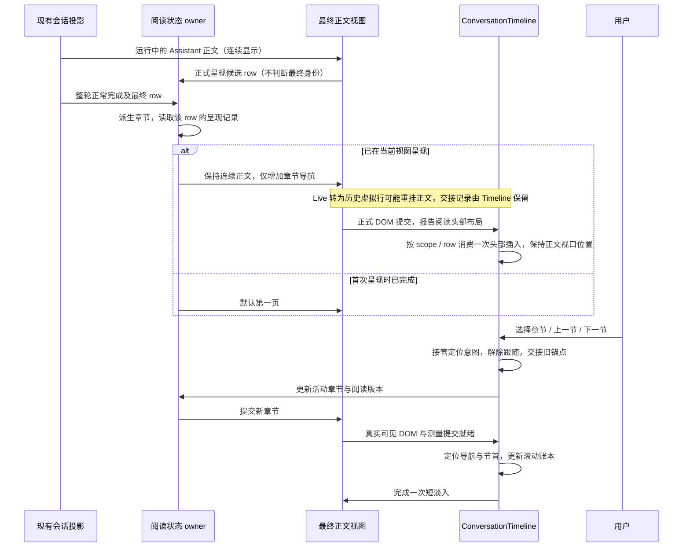

# Plan：AI 最终回答分节阅读（实验）

状态：代码已实现，交互 E2E 待验证。本文记录产品规则、实现边界、原验收计划及本轮实际交付证据。

## 目标与范围

在 AI 正常完成的最终回答中，按 Markdown 章节提供分页阅读：页内自然纵向阅读，章节之间横向切换，减轻一次面对长篇回答的压力。

- 设置位于现有「实验特性」，名称为「AI 回答分节阅读」，默认关闭。
- Desktop、桌面 Web、手机远控 Web 使用同一套阅读语义，兼容现有主题和中英文。
- 只处理当前 product turn 的最终 Assistant 正文，不合并整轮全部 Assistant 段落，不处理推理、过程消息、工具结果、计划卡、预览卡或代码评论卡。
- 不改写原始消息、模型提示词、Agent 运行状态、Host attachment、队列或协议完成语义。
- 分享内容和导出 Markdown 保留全文；第一版分享只读时间线继续使用现有连续阅读。

## 已确认的交互

1. 有前导正文时，前导部分作为「导语」首页；没有前导正文时，从第一个章节开始。
2. 切换章节，包括「上一节」「下一节」，自动定位到该条回答的章节导航和新章节开头。
3. 章节栏为单行横向滚动。存在被遮住的内容时，对应边缘逐渐透明，适配背景及主题；不固定渐变到白色。
4. 不能在生成中猜测某一段是最终正文。最终目标与结束时机来自现有整轮投影。
5. 当前阅读视图已经呈现过的生成中正文，在整轮完成后保持连续阅读，只增加章节导航；用户点击章节后才进入分页。
6. 首次呈现时已经完成的回答，默认第一页。
7. 用户可以随时展开全文；展开时尽量保留当前章节在视口中的位置。
8. 回答级复制、分享、搜索覆盖全文，不能因为分页丢失内容。

### 第一版补充决策

| 问题             | 本计划采用的规则                                                                                                                                                                    |
| ---------------- | ----------------------------------------------------------------------------------------------------------------------------------------------------------------------------------- |
| 分节资格         | 至少能识别两个同级主章节才启用；不设字数阈值，不对短回答强制凑页。                                                                                                                  |
| 标题层级         | 只考虑 Markdown 文档根级的 heading 节点，选择出现至少两次的最浅层级。例如单一 H1 总标题加多个 H2 时按 H2 分；只有多个 H3 时可按 H3 分。更深标题留在所属页内。结构有歧义时保留全文。 |
| 前导内容         | 首个切分标题前存在可见内容才生成导语页；空白和仅引用定义不生成空页。可见总标题仍按原顺序保留。                                                                                      |
| 章节边界         | 每页包含本章标题，直到下一个同级切分标题前结束。代码块、引用、列表和 HTML 内容中的标题样式不单独切页。                                                                              |
| 重复标题         | 标题文案允许重复；章节 ID 使用文档内稳定位置和正文版本，不用标题文字作唯一 key。                                                                                                    |
| 中断或失败       | 第一版保留连续全文及异常上下文，不自动分页；不能把 `!isRunning` 当作正常完成。                                                                                                      |
| 搜索隐藏章节     | 会话查找或全局搜索命中分页正文时，先把该条回答展开全文，再定位命中；搜索结束不自动折回第一页。                                                                                      |
| 开关在阅读中变化 | 开启不突然收起已呈现正文；关闭恢复全文并保留阅读锚点。以后首次呈现的已完成回答才按默认第一页初始化。                                                                                |
| 阅读状态寿命     | 当前会话阅读视图内保留，跨虚拟列表卸载、宽度变化和普通重渲染不重置；离开并重新打开会话或重载应用时重新初始化，不写入消息或设置文件。                                                |
| 设置同步范围     | 沿现有设置服务持久化并刷新当前服务实例的消费者，重新加载可重读。第一版不承诺其它已打开窗口或手机立即跟随，不借用 CLI runtime-preference 广播传递展示偏好。                          |

## 当前源码依据与改动入口

下列为当前检出中已存在的入口。后文标为「拟新增」的名称是实施建议。

| 优先级 | 入口                                                                                                                                        | 本功能的关系                                                                                                 |
| ------ | ------------------------------------------------------------------------------------------------------------------------------------------- | ------------------------------------------------------------------------------------------------------------ |
| 必查   | `packages/ui/src/v4/conversationTurnRenderUnits.ts`：`buildConversationTurnRenderUnitFrame`、`resolveTurnRunning`、`latestAssistantTextRow` | 现有最终正文目标和整轮状态；`assistantTextRows` 是整轮聚合，不能误作本功能分页输入。                         |
| 必查   | `packages/ui/src/v4/ConversationTurnGroup.tsx`、`ConversationTurnRow.tsx`                                                                   | 将最终正文资格传给行；继续保留整轮复制、卡片及操作栏的所有权。                                               |
| 必查   | `packages/ui/src/v4/ConversationRowView.tsx`：`AssistantTextRowView`                                                                        | 代码评论投影后的可见正文入口；提供阅读容器，维持原 row 身份和可选择正文包装。                                |
| 必查   | `packages/ui/src/components/ai-elements/message.tsx`：`MessageResponse`、`messageResponsePropsAreEqual`                                     | Markdown、引用、数学、代码块及文件链接渲染；增加可选展示能力时同步维护 memo 比较。不得让所有复用面默认分页。 |
| 必查   | `packages/ui/src/v4/ConversationTimeline.tsx`                                                                                               | 滚动、following、虚拟列表、首绘 staging、测高和锚点的唯一协调者。                                            |
| 必查   | `packages/ui/src/v4/useConversationTimelineFind.ts`、`conversationFindIndex.ts`、`conversationFindHighlightDom.ts`                          | 全文索引与可见 DOM 的命中定位，需要在高亮前展开目标正文。                                                    |
| 必查   | `packages/ui/src/settings/ExperimentalFeaturesSection.tsx`、`SettingsPage.tsx`                                                              | 实验开关展示和受控提交。                                                                                     |
| 必查   | `packages/shared/src/protocol.ts`、`validationAppSettings.ts`                                                                               | `AppSettings` 类型、默认值和 patch 校验。                                                                    |
| 必查   | `packages/ui/src/hooks/useSettingService.ts`、`packages/services/src/setting/settingService.ts`                                             | 复用当前设置快照、校验、串行更新与文件持久化，不新增设置事实源。                                             |
| 应查   | `packages/ui/src/v4/SessionPane.tsx`、`conversationRowContext.ts`                                                                           | 注入展示偏好和阅读意图接口，保持上下文引用稳定。                                                             |
| 应查   | `packages/ui/src/components/ui/scroll-fade-viewport.tsx`：`ScrollFadeViewport`                                                              | 已支持横向左右渐隐及尺寸变化，复用其滚动节点，不另造常驻遮罩。                                               |
| 应查   | `packages/ui/src/v4/timelineStagedTurnDom.ts`、`timelineScrollAnchor.ts`、`timelineToggleAnchor.ts`                                         | 只定位真实可见副本，避免与折叠、前插、恢复或跟随滚动竞争。                                                   |
| 应查   | `packages/ui/src/v4/ConversationSelectionTooltip.tsx`、`conversationShareMarkdown.ts`、`ConversationShareReadonlyTimeline.tsx`              | 框选引用只读可见正文；复制、分享和只读展示维持既有边界。                                                     |

相关已有规范：`conversation-timeline-user-scroll-anchor.md`、`conversation-timeline-collapsible-anchor.md`、`conversation-turn-frame-incremental-reuse.md`、`assistant-preview-cards.md`、`conversation-share-ui.md`。UI 遵守根目录 `DESIGN.md`。

功能边界以本文 spec、当前源码和架构上下文为准。

## 状态所有者与接口

| 状态或事实                                 | 唯一所有者                                                                                  | 其它层的职责                                                                                 |
| ------------------------------------------ | ------------------------------------------------------------------------------------------- | -------------------------------------------------------------------------------------------- |
| 正文、最终目标、整轮状态                   | 现有 CLI/runtime product projection，经 UI conversation projection 消费                     | 阅读层只读，不创造完成事件，不以文字停顿或单段 `complete` 判整轮结束。                       |
| `assistantSectionReadingEnabled`（拟新增） | 现有 `ISettingService` / AppSettings                                                        | schema 默认 `false`、patch 可选布尔；UI 经 `useSettings` 更新，不访问文件或 `window.zcode`。 |
| 章节结构                                   | 最终可见 Markdown 的纯派生结果                                                              | 依正文版本缓存；主题、页码、工时 tick 不重新解析；生成中不建立完整章节目录。                 |
| 连续/分页、活动章节、生成期呈现记录        | `packages/ui/src/store/assistantSectionReadingStore.ts`，按阅读视图实例隔离的内存外部 store | 组件按 row 订阅状态；行卸载不清理，视图结束清理。                                            |
| 章节栏滚动及左右溢出                       | `ScrollFadeViewport` 和章节栏局部控制器                                                     | 只滚动自己的横向节点，确保活动标题可见，不改聊天纵向滚动。                                   |
| 纵向定位、following、锚点、头部布局交接    | `ConversationTimeline`                                                                      | 正文组件只报告布局并发送有类型意图，不直接写 `scrollTop` 或调用 `scrollIntoView`。           |
| 搜索命中                                   | 现有 Find hook / 索引                                                                       | 先请求阅读 owner 展开，再等待可见正文提交，沿用现有命中高亮和滚动路径。                      |

### 身份与生命周期

- 阅读 key 包含阅读视图实例、`workspaceIdentity?.trim() || workspacePath`、远端 `remoteSessionId`（上下文中为 `workspaceRemoteSessionId`）、`sessionId`、`turnId`、最终 `rowId` / `entityId`。复用现有身份构造工具，不手写远端 identity 格式。
- 不同窗口、不同 Host attachment、同路径不同 workspace identity 不能共享活动页。
- 记录候选 Assistant row 在运行期是否由当前活动阅读视图的正式可见渲染通道呈现。此时不判断它是否最终正文；结束后只读取最终目标的记录。排除 staging、预测量、暗处前插副本和分享视图。
- 不以是否滚动、停留时长或是否聚焦推测用户读过。保守保留已经正式呈现的正文即可。
- 最终目标变化或正文版本变化时失效旧章节结构与旧定位请求；原有连续阅读选择继续保留。活动章节失效时，保持全文等待用户选择，不自动收起。
- 设置关闭时不解析章节、不挂章节专用 observer、不构建章节 DOM；不因本功能拉取更多历史。

### 拟新增接口意图

通过 `ConversationRowRenderContext` 注入可选的阅读 controller，而不是把 store 和滚动容器下放给 `MessageResponse`。接口至少区分：

- `selectSection`：目标 scope / turn / row / section、正文版本、递增请求 ID；进入分页并请求定位到节首。
- `showFull`：展开全文并以当前章节内容作阅读锚点。
- `revealForSearch`：展开指定 row 的全文，返回或发布可见正文的提交版本；不同时发节首定位。
- `presentedDuringRun`：只由正式阅读通道登记候选 row 的呈现，幂等且不触发业务写入。

具体类型在实现前按模块上下文收敛；以上接口不进入共享会话协议，不发往 Host 或 CLI。

## 事件顺序与动画



- 完成资格复用 `latestAssistantTextRow` 和权威 turn 状态；正常完成以 `completedSuccess` 配合最终正文 `complete` 为准。冷恢复缺 header 时复用现有投影边界，无法证明正常完成则保留连续阅读。
- 导航插入不得改变用户正在阅读的正文块在屏幕中的位置。优先利用既有可复用空间；需要增加高度时由 Timeline 捕获内容锚点并在同一布局提交链补偿。不为每条过程 Assistant 段预留一排空白。
- 初始建议：章节导航淡入 `160ms`，切页正文淡入 `110ms`；尊重 `prefers-reduced-motion`，关闭动画仍保持同样状态和定位顺序。
- 不给整篇长文做高度收缩动画；不在流式每个 token 到达时重做分节，不用定时器猜完成，不用固定延时等待测高。
- 切页先提交新内容和定位，再淡入；不做跨越长距离的平滑纵向滚动。短页面受原生滚动范围限制时，保证导航和节首可见，不新增内部滚动框或大块空白撑高。
- 对话纵向滚动仍只有现有 Timeline 一个容器；每节正文按内容自然增长。可视化演示中的有限视口只是对话窗口，不是新增的回答内滚动区。
- 分节按钮不复用折叠触发器的 `data-slot`，避免“点哪留哪”的补偿把主动节首定位撤销。
- 连续点击、用户主动滚动、切会话、正文换代、远端 attachment 改变时，旧定位请求失效；只允许当前 scope、正文版本和最新请求提交，提交后结算一次。

### 章节栏

#### 已确认原型的布局约束

以本次对话中的 `section-reading.html` 和后续 `reading-timing-demo.html` 为布局依据，并按后续确认将翻页入口移到顶部。集成到现有回答正文时，保留下面四层结构；不能把所有操作合并成一排工具栏：

| 顺序 | 位置与内容                                                                                    |
| ---- | --------------------------------------------------------------------------------------------- |
| 1    | 顶部模式行：左侧「AI 回答」及「分节阅读 / 连续阅读」，右侧文字入口「展开全文 / 按章节阅读」。 |
| 2    | 独立章节行：完整章节标题横向滚动，不与翻页按钮争用横向滚动区域。                              |
| 3    | 顶部翻页行：左侧「上一节」、中间页码、右侧「下一节」；使用文字按钮，与模式和章节行一起吸顶。  |
| 4    | 正文：沿用现有 Markdown 排版和会话纵向滚动，不加回答内滚动框、固定卡片宽度或人为最小高度。    |

- 长标题保持完整，不设置单个标题宽度上限或省略号；超出章节栏的内容只由整个横向视口裁切和边缘渐隐提示。
- 非活动章节、阅读模式及全文入口使用弱前景色；活动章节使用中性选中表面和清晰文字。窄屏仍保留模式入口与顶部翻页文字；触控按钮至少 44px 高。
- 顶部模式行、章节行和翻页行作为一个阅读头部，在当前回答范围内吸顶；复用 Timeline 的 56px 顶栏避让常量和对话背景。正文底部不再重复翻页入口，不因章节长短改变顶部按钮的位置。
- 分页与全文模式保留相同翻页行结构：分页时显示当前页码并按首尾禁用按钮；连续或全文模式显示「共 N 节」，禁用翻页按钮。用户通过「按章节阅读」或章节名主动进入分页，不在完成时自动收起正文。
- 历史虚拟行保留既有 `translateY` 定位，由 Timeline 在行上发布局部 CSS 位移变量，阅读头部从吸顶偏移中扣除该位移；实时正常流默认位移为零。该值只表达布局坐标，不新增阅读状态或滚动写入路径。
- 吸顶元素的视口坐标不是回答起点。切章节仍由 Timeline 定位到独立的文档流原点；完成时导航插入补偿读取整个头部实际高度，不能用已吸顶的 top 坐标相减。
- 左右键、Home/End 移动章节焦点，Enter/Space 确认切节；焦点和活动章节进入未被渐隐遮住的区域。章节栏溢出且对应方向可移动时，将纵向鼠标滚轮用于横向滚动，边缘处释放给会话滚动。

结构回归测试必须断言模式行、章节行、顶部翻页行和正文的顺序及归属，确认正文后无翻页入口。隔离组件交互场景覆盖长短章节连续点击、390px 窄屏、明暗主题、吸顶后切节回顶及实时完成位置稳定；不操作运行中的 YCode。

#### 流式完成后的布局交接

- 正式视图已显示过的生成中正文，在整轮正常完成后保留连续全文；只淡入顶部导航。首次打开已完成回答才直接分页，不先展示全文再收起。失败、中断和没有可分页标题的正文继续原样阅读。
- 阅读状态和运行期呈现记录仍由现有阅读 store 持有；头部布局及滚动补偿由 Timeline 唯一协调。Timeline 按阅读 scope 与完整 row key 保存头部布局交接记录，跨 Live 子树转入历史虚拟行的重挂保留，离开该阅读 scope 后清理。
- 正文组件在布局提交时只报告真实头部布局；Timeline 排除 staging、暗处测量和过期 scope，只对正式行消费一次新增占位。正在视口中阅读时按整个头部的实际新增高度补偿；已在视口外完成的布局只登记，不在以后滚回时补做旧补偿。
- 不以组件局部 ref 的初始值判断是否已经完成交接；重复完成、普通重渲染、已消费布局的卸载再挂载不能重复补偿。冷打开分页也不能误补偿。
- 从连续阅读主动进入分页时，先提交目标章节，再由既有 Timeline 定位到文档流原点，顶部翻页行保持位置；继续复用最新请求、用户滚动接管和减少动态效果规则，不使用延时等待布局。

- 文案保留标题中的可读文本，不把 Markdown 标记或内部协议文本作为 tab 标题。
- 仅右侧有隐藏内容时右侧渐隐；中间位置两侧渐隐；最右端仅左侧渐隐；无溢出时不渐隐。复用组件当前约 `24px` 的遮罩宽度。
- 支持触控横滑、触控板和键盘；切换活动章节或键盘焦点后，使对应标题进入可见区域，不滚动对话正文作为副作用。
- 桌面和手机均保留章节名、页码、上一节/下一节和全文入口；导航文字不进入 `[data-conversation-selectable]`，也不参与正文高亮计数。
- 采用现有 Button、语义颜色和 `text-ui-*` 字号；活动态、焦点、禁用态和长翻译文案遵守 `DESIGN.md`。

## Markdown、搜索和现有能力的兼容

### Markdown 只有一份文档语义

在当前可见正文投影之后识别章节：代码评论、遗留会话指令、文件/会话引用和其它现有投影的顺序不能改变。

- 使用 Markdown 结构识别根级标题，不使用按行匹配 `##` 的正则切字符串。
- `packages/ui/package.json` 已声明 `marked` 和 Streamdown。先验证现有解析/渲染扩展点，优先复用同一文档解析结果分组；如利用现有 tokenizer，必须用兼容用例验证其结构与最终 renderer 一致。
- 不把每页当作互不相关的独立 Markdown 文档。跨章节引用定义、脚注、锚点、图片、数学、代码块和列表在分页与全文下应保持相同语义。
- 实施选型：`marked.lexer` 只读取根级 block token 的边界和标题文案，页面仍用现有 `MessageResponse` / Streamdown 渲染；所有根级引用定义会附加到每页以维持跨节引用。脚注和指向本回答标题的片段链接暂时使正文回退连续全文，因为现有页面级 renderer 无法证明它们的目标语义与全文一致。
- 页内链接指向隐藏章节时，先显示目标章节再定位，复用同一阅读请求协调；若当前渲染链不能证明该定位正确，则对此正文保留全文，而不是留下失效链接。
- 分页资格和章节展示能力为最终 Assistant 正文显式开启；工具、文件预览和分享等 `MessageResponse` 复用点维持现状。
- 实施阶段先验证以上解析扩展点；若需要改变 renderer 的文档所有权或新增解析依赖，先补充本文的选型依据和架构上下文，再继续接线。

### 搜索先展开再定位

当前 `ConversationFindMatch.rowMatchIndex` 是整行全文的命中序号，DOM 高亮从挂载 row 中找相同序号。仅渲染当前页会让重复词的全文序号与页内序号错位；保留隐藏 DOM 也不能直接解决无布局 Range 的定位。

因此第一版采用以下顺序：

```text
会话查找 / 全局搜索选中命中
  → Find 请求阅读 owner 展开目标 row 的全文
  → 等待该 row 的可见正文版本提交（rowId 列表不变也必须通知）
  → 沿用全文索引、高亮和命中定位
  → 本次只执行命中定位，不另发节首回顶
```

- 高亮只扫描 selectable 正文，排除章节名、页码和操作按钮；不因新增导航改变全文命中计数。
- 手动切页先清理旧 DOM Range / 选区浮层，不重放旧搜索的定位请求；下次显式切换搜索命中再展开全文。
- 复制继续调用 `resolveAssistantCopyText` 及其现有投影；不能从当前页 DOM 获取“复制整条回答”的文本。
- 预览卡、代码评论卡、文件变化摘要和动作栏继续由原 owner 生成，不按当前页过滤，不因切页重复自动打开。

## 实施步骤

| 阶段                  | 工作与拟落点                                                                                                                             | 完成条件                                                                             |
| --------------------- | ---------------------------------------------------------------------------------------------------------------------------------------- | ------------------------------------------------------------------------------------ |
| 1. 规范与边界         | 本文先行；实现前读取 architecture-governance skill，运行架构基线检查，获取实际受影响模块的受控上下文。                                   | 产品规则、所有者、事件顺序和验收矩阵明确，不能先改 UI 再补规范。                     |
| 2. 分节模型与解析验证 | 拟新增 `packages/ui/src/lib/assistantSectionReading.ts` 及对应纯函数测试；验证现有 Markdown 解析扩展点及跨章节定义。                     | 先补可执行用例，再实现资格判断、标题层级、稳定 ID 和章节结构；不支持的结构保留全文。 |
| 3. 阅读状态           | 拟新增 `packages/ui/src/store/assistantSectionReadingStore.ts`；以正式视图为 scope，处理首次呈现、完成、选节、全文、设置变化与失效。     | 状态转移用例通过；虚拟行生命周期、后台副本和协议恢复不产生第二个状态 owner。         |
| 4. 最终正文接线       | `ConversationTurnGroup` → `ConversationTurnRow` → `AssistantTextRowView`；拟新增 `AssistantSectionReading.tsx`，复用 `MessageResponse`。 | 非最终正文无分页；原 row/selectable 边界、引用投影、卡片和复制链保持。               |
| 5. 滚动与搜索协调     | 扩展 row context 的类型化意图；由 Timeline 消费节首定位，Find 先 reveal 全文再高亮。                                                     | 完成时阅读位置不动，切节回顶；测高、跟随、前插、staging 和搜索请求不会相互撤销。     |
| 6. 设置与可访问性     | AppSettings/schema/patch、SettingsPage、实验分区、SessionPane 注入、中英文和测试 ID；横向栏复用 `ScrollFadeViewport`。                   | 默认关闭、关闭态无额外章节工作；键盘、手机、主题和减少动态效果可用。                 |
| 7. 集成验证与交付     | 执行单测、类型/Lint/架构及隔离交互验收；更新相关 spec 和已落地的特性种子。                                                               | 报告真实执行结果与未完成证据；只提交本次改动，沿用当前分支，不自动推送。             |

## 验收矩阵

下面是原定验收矩阵；各场景的实际覆盖情况见文末交付记录。

| ID    | 前置与操作                                                                 | 必须断言                                                                       | 证据                   |
| ----- | -------------------------------------------------------------------------- | ------------------------------------------------------------------------------ | ---------------------- |
| SR-01 | 设置缺字段、关闭、开启后重读                                               | 默认 `false`；只接受布尔 patch；当前设置服务快照和持久化一致。                 | shared/service 单测    |
| SR-02 | 开关关闭，持续输出及浏览历史                                               | 与现有正文一致；不解析章节、不挂章节 observer、不补拉历史。                    | 门控测试 + 集成        |
| SR-03 | 导语 + 两个 H2 + 嵌套 H3，首次打开完成回答                                 | 导语第一页；H2 各一页；H3 留在所属页；无导语时直接第一章节。                   | 纯函数 + 渲染          |
| SR-04 | 单 H1 + 多 H2、只有多 H3、重复标题、空白/引用定义前缀、无可分页结构        | 层级规则稳定、无空页、ID 不冲突；不满足条件保留全文。                          | 纯函数                 |
| SR-05 | fenced code / 引用 / 列表中的假标题、跨节引用定义及脚注                    | 不误分；分页与全文的链接、脚注和代码语义一致。                                 | 纯函数 + renderer 集成 |
| SR-06 | 当前正文已连续展示，滚到中间，再收到正常完成                               | 仅出现导航，正文保持展开；当前正文块视口位置稳定，动画结束无二次跳动。         | 状态/接线 + 隔离 E2E   |
| SR-07 | 多段 Assistant、文字暂停后继续工具；单段 complete 但整轮仍 running         | 不提前分页；结束时仅选最终目标，过程段和卡片保持原位。                         | 投影夹具 + 集成        |
| SR-08 | 后台完成或首次打开历史完成回答                                             | 默认第一页；无全篇闪现后再收起；暗处测高不把它误记成 live 已展示。             | 状态 + 隔离 E2E        |
| SR-09 | 长章节滚到底，点击上一节、下一节或章节名                                   | 新节导航和开头可见；不被吸底/旧折叠锚点拉走；短页不人为撑高。                  | 接线 + 隔离 E2E        |
| SR-10 | 初始/中间/末端横向滚动，调整宽度，手机横滑或键盘选最后一节                 | 渐隐方向反映真实溢出，完全可见时无遮罩；活动标题可见、焦点可辨。               | 渲染/测量 + 隔离 E2E   |
| SR-11 | 手动展开全文、再次选章节；设置开关在阅读中变化                             | 按上述规则保持当前节锚点；开启不突然收起；关闭回全文且不抢位置。               | 状态 + 隔离 E2E        |
| SR-12 | 同词在首页出现两次，在隐藏章节出现第三次；查找第三次及全局搜索跳入         | 先展全文，命中序号与高亮正确；导航不计入匹配；无需 rowId 列表变化也能刷新。    | Find 测试 + 隔离 E2E   |
| SR-13 | 当前页框选引用、复制整条回答、分享和导出                                   | 引用只含可见正文及原 row 身份；复制/分享包含完整既有内容；切页不保留失效选区。 | 回归测试 + 交互        |
| SR-14 | 虚拟列表卸载再挂载、主题/宽度变化、工时 tick、历史前插                     | 阅读模式和活动节不重置；不重复解析稳定正文；不定位到 staging 副本。            | 状态/性能与锚点回归    |
| SR-15 | 同路径不同 identity、相同 sessionId 不同 Host/远端会话、切会话后旧回调返回 | 阅读状态隔离；旧 scope/版本/请求无效；不改业务 owner/lease。                   | 状态 + 远端集成        |
| SR-16 | 连点换节后立即手动滚动，等待测高或图片加载                                 | 只提交最新有效定位，用户新滚动接管；无定时器延后拉回。                         | 接线 + 隔离 E2E        |
| SR-17 | 中断/失败、原文换代、重复完成事件、正常完成后后台工具继续                  | 异常内容连续可读；换代失效；正常完成幂等；后台工具不把主轮重新当作生成中。     | 状态/投影              |
| SR-18 | 减少动态效果、Zai Light/Dark、窄屏及中英文                                 | 关闭动画仍正确定位；操作和文本不裁切，手机可触达核心入口。                     | 渲染 + 隔离 E2E        |

### 组合取舍

- Desktop `desktop-continuous` 重点覆盖 SR-06/07/09/14/16；手机 `web-remote-replayable` 覆盖 SR-08/10/12/15/17 的快照及补流恢复。两者只共享渲染规则，不混淆恢复语义。
- 每种主题不重复穷举全部同步时序；同步/身份用代表性桌面与手机组合，外观和可访问性单独覆盖。
- 未加载历史仍按现有按需查询加载，不以章节功能为由全量 hydration。
- 分享只读分页、跨窗口实时设置广播、持久化阅读进度、多级嵌套分页、AI 生成章节摘要和重新排版不在本期范围。

## 验证入口与执行约束

当前仓库没有统一 UI E2E runner 或 Playwright 配置；E2E store bridge、coverage 工具和测试 ID 不能算已存在的交互覆盖。实施时先确定隔离 Web/组件夹具或另行获准的桌面测试环境，再补对应交互场景和真实执行证据。未经用户明确允许，不连接、注入、重启或自动化操作正在运行的 YCode。

已核验的现有命令：

```sh
# UI：tsx + node:test + 资源 stub
pnpm --filter @zcode/ui test

# shared/services 没有统一 test script，按实际文件调用根目录 tsx
pnpm exec tsx --test packages/shared/test/dynamicWorkflowSettings.test.ts packages/services/test/ycodeSettingsIsolation.test.ts

pnpm typecheck
pnpm lint
pnpm architecture:check --changed
```

新增测试文件落地后使用相同真实入口；不把尚不存在的文件名写成已可执行测试命令。受影响的既有回归文件包括：

- `packages/ui/test/conversationTurnUnitReuse.test.ts`
- `packages/ui/test/timelineScrollAnchor.test.ts`
- `packages/ui/test/timelineToggleAnchor.test.ts`
- `packages/ui/test/timelineUserScrollAnchorWiring.test.ts`
- `packages/ui/test/timelineStagedTurnDom.test.ts`
- `packages/ui/test/taskFindUpdateDepthRegression.test.ts`
- `packages/ui/test/sessionCitationExport.test.ts`

代码实现前后执行架构检查，读取真实 module ID 的受控上下文；不预设模块 ID。按照现有边界，UI 通过 hooks 读设置，服务持久化配置，业务投影只读，平台操作走公开接口。

### 本轮实现与验证（2026-10-22）

- 实验设置 `assistantSectionReadingEnabled` 默认关闭，经现有 AppSettings / Settings 页面持久化；只读时间线不启用。
- 仅在整轮正常完成、目标是最终 Assistant 正文且正文具备至少两个可分页同级标题时解析。使用 `marked.lexer` 识别根级块边界，页面继续交给原 `MessageResponse` / Streamdown 渲染；引用定义随页保留，脚注和本回答片段链接回退连续全文。
- 冷打开的已完成回答从导语或第一章开始；当前视图已呈现的生成中回答完成后继续显示全文，导航出现但不自动收起。用户选章后 Timeline 定位到导航和新章节开头；展开全文时通过同一定位交接恢复当前章节的视口位置。章节栏复用 `ScrollFadeViewport` 按真实溢出渐隐。
- 查找和全局搜索在高亮前展开目标正文；整条复制、分享及导出仍沿用现有全文路径。阅读状态只保存在当前 Timeline 的内存 scope。
- 自动化覆盖：新增 Markdown 分节与状态测试、冷打开 SSR 渲染测试、设置默认值/校验测试；`pnpm --filter @zcode/ui test` 全部 1720 项通过，设置测试通过。
- `pnpm typecheck` 通过；`pnpm architecture:check --changed` 通过，0 violations；`pnpm lint` 退出码 0，0 errors、80 warnings。
- 目标文件 `oxfmt --check` 通过；全仓 `pnpm fmt:check` 仍失败，报告 227 个既有/未触及格式文件，并包含历史格式不符合当前 formatter 的 `SettingsPage.tsx`、`SessionPane.tsx`。为避免大范围无关重排，本轮保留了这两个文件的局部改动。
- 仓库没有可用的 UI E2E runner。本轮未对运行中的 YCode 做 UI 自动化；SR-06、SR-08 至 SR-11、SR-13、SR-16、SR-18 的真实交互证据仍待隔离测试环境补齐。

### 后续缺陷修复（2026-10-22）

快速代码审查发现分页阅读与既有查找、Markdown 和滚动协调之间有几处边界遗漏。本轮修复遵循以下规则：

- 手动切节造成的阅读状态更新不能重放先前搜索的全文展开请求；只有新的显式搜索命中或跳转请求可以展开并定位全文。
- 最终回答完成时新增章节栏不得把用户正在阅读的正文向下推。使用 Timeline 已有的纵向滚动协调路径，在同一次布局提交中保持正文锚点；不为非最终过程消息预留空导航。
- 根级 HTML 注释不作为可见前导内容；代码块内与其它可见 Markdown 内容中的注释文本必须原样保留。章节标题文案以解码后的可见文本呈现，并能匹配 Streamdown 输出的标题文字用于全文展开锚点。
- 标题中的实体解码后与 DOM 标题使用同一空白规范化规则，包含不换行空格的标题也必须能恢复展开锚点。当前渲染器没有区分 HTML 与 Markdown 标题的来源标记；HTML token 含与切分层级相同的标题标签时视为结构有歧义，保留连续全文，避免同名 HTML 标题占用章节锚点。代码和 HTML 注释不触发这一规则，其它层级的 HTML 标题保持原有语义。
- 一个阅读 scope 内只允许最新的章节定位请求有效。新请求使旧请求失效，即使旧请求属于另一条回答；过期请求结算后不得重新出现。

以上行为由搜索触发、解析内容、导航状态和 Timeline 接线回归测试覆盖。现有隔离 UI E2E 限制不变；无法在未获授权的运行中 YCode 上补做真实交互验证。

### 原型布局对齐（2026-10-22）

- 修正原实现将模式入口、章节、页码和翻页操作压成同一排的问题，恢复顶部模式行、独立章节行、正文及底部文字翻页四层结构。移除单章节标题的宽度上限和省略号，继续由 `ScrollFadeViewport` 提供整体横向溢出渐隐。
- `AssistantSectionReading` 继续持有阅读状态订阅、完成时的头部插入补偿和模式切换意图；`AssistantSectionReadingNavigation` 只负责头尾展示、章节横向滚动及键盘焦点。纵向滚动仍由 Timeline 唯一协调，不新增状态所有者或平台接口。
- 阅读头部在回答范围内吸顶；Timeline 的切节定位改读独立文档流原点。补偿使用头部实际高度，避免吸顶坐标被钳位后导致回顶失效或完成时正文移动。
- 新增结构回归断言模式行、章节行、正文、footer 的顺序及操作归属；覆盖全文模式、完整长标题和无标题正文。实际执行 Timeline 定位回调，验证吸顶后仍能定位文档流原点。
- 独立 Vite 夹具使用真实阅读组件、`MessageResponse`、主题样式和阅读 store，验证桌面、390px 中英文、暗色及大字号；切节原点距滚动容器顶约 56px，全文展开锚点误差不超过 0.5px，完成时新增 93px 头部后当前段落视口位置不变。虚拟行位移 2240px 时吸顶仍为 56px，并在回答底部随正文离开视口。键盘 End 只移动焦点、Enter 选节，章节渐隐随真实横向溢出更新。
- 隔离夹具的滚动容器与 Timeline 导航消费桥为简化实现，不算完整产品或远端链路 E2E；原生滚轮工具事件落点受限，只验证了可取消滚轮事件处理器及渐隐变化。未操作运行中的 YCode，夹具浏览器与自建服务已关闭。
- 最终 `pnpm --filter @zcode/ui test` 为 1873 项通过、0 失败；`pnpm typecheck` 通过；`pnpm lint` 为 0 errors、80 warnings；`pnpm architecture:check --changed` 为 0 violations；本轮 11 个文件的目标格式检查和 `git diff --check` 通过。

### 顶部翻页及完成交接（2026-10-23）

- 将翻页入口移入吸顶头部，正文后不再重复显示。上一节、计数、下一节始终占用同一行；连续态禁用翻页，主动选节后才分页。计数同时为总章节数和最大页码保留宽度，模式文案使用单行辅助文本，避免中英文及大字号切换模式时按钮换行移位。
- 修正 Live 正文移入历史虚拟行时局部 ref 重置、漏掉完成补偿的问题。正文提交类型化布局报告；Timeline 按 scope 和完整 row key 保存已结算记录，跨重挂保留，只消费一次头部新增占位。未正式挂载的后台完成也先结算，回滚到该回答时不补做旧位移。
- 目标渲染、状态和 Timeline 回归共 46 项通过；新增完成交接测试覆盖真实回调、重挂幂等、冷打开、后台未挂载完成、旧 scope、staging、失败和无标题路径。
- 独立真实组件夹具中，Live 与 History 使用不同父容器，挂载 ID 发生变化；完成后头部新增 133px，`scrollTop` 从 500 到 633，同一段正文的视口 top 保持 144.6875px。再次历史重挂不改变正文位置，也不重复记录布局滚动。
- 390px、19px 字号下，中文分页与全文头部均为 133px，英文均为 158px；英文翻页文字自然换行，但两种模式占位相同且无横向溢出。2240px 虚拟位移下跨容器完成，`scrollTop` 从 3000 到 3133，同段正文 top 保持 357.4375px，吸顶为 56px；减少动态效果时头部和正文动画均关闭。
- 有足够滚动范围时，连续态、导语、长章和短章的翻页行视口位置误差不超过 0.1875px；普通短页若原生滚动范围不足，会自然回到 `scrollTop=0`，只保证入口在正文之前，不通过大块留白强行锁住视口绝对坐标。隔离夹具执行真实 Timeline 布局回调，仍不等同完整产品或远端链路 E2E；未操作运行中的 YCode。
- `pnpm typecheck` 通过；`pnpm lint` 为 0 errors、80 warnings；架构检查 0 violations。全量 UI 测试为 1851 项通过、3 项失败，失败全部位于另一个未提交的 `responsesThinkingPhaseRender.test.ts`，断言空思考阶段的固定耗时展示，与本功能无关；本轮未改动该测试及思考阶段实现。全量检查未通过，按仓库规则保留改动而不自动提交。
