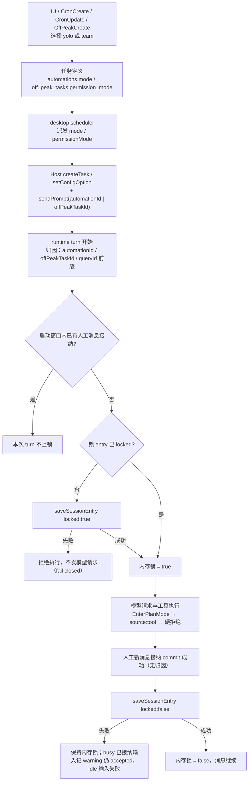

# Spec: 自动化执行档位与无人值守锁

## 目标

自动化任务（定时、周期、自定义间隔、延时与闲时）在创建时可以选择 **Agent（`yolo`）** 或 **Team（`team`）**，运行期间以所选档位执行；同时由 runtime 持有唯一的「无人值守锁」，禁止模型在自动化执行中自行切换档位。锁只能由之后真正被接受的人工新消息解除，不能由任务结束、重试、队列升格或系统续跑解除。

本规格只覆盖上述两点；自动化任务的调度、生命周期、工具门与 Team 提示词分别以 [`delayed-automation.md`](./delayed-automation.md)、[`automation-tool-gate.md`](./automation-tool-gate.md)、[`team-mode.md`](./team-mode.md) 为准。

## 产品规则

### 可选档位

- 自动化任务只提供 **Agent（`yolo`）** 与 **Team（`team`）** 两档。**不提供 Ask（`readonly`）与 Plan（`plan`）**，新建默认 Agent。
- 所有现有创建与更新入口都支持显式选择：
  - UI 定时 / 周期 / 延时：`AutomationEditView` 的 `mode`。
  - UI 闲时：`OffPeakEditView` 的 `permissionMode`。
  - 模型工具 `CronCreate` / `CronUpdate`：新增可选 `mode`。
  - 模型工具 `OffPeakCreate`：可选 `permissionMode`。
- **新建省略即 Agent**。省略时在服务端落盘为 `yolo`，不是空值。
- **更新省略即保留**。更新载荷不带档位时沿用任务已存值；显式值只接受 `yolo` / `team`，其它值（含 Ask / Plan）一律拒绝，不静默降级。
- **列表必须保留 Team**。自动化列表 / `CronList` 返回的 `mode` 与闲时列表返回的 `permissionMode` 必须原样带出 `team`，不得在协议出口归一成 `yolo`。
- UI 只显示 Agent / Team 两项，沿用现有模式选择控件、身份色与 `Agent` / `Team` 显示名；不新增说明行。

### 历史兼容

- `automations.mode` 与 `off_peak_tasks.permission_mode` 是任务定义档位的唯一持久化位置。新写入只产生 `yolo` / `team`；读取路径继续容忍历史 `NULL` 与旧值（`plan` / `readonly` / `bare` / `build` / `edit` / `auto` / `autoEdit`）。
- **不迁移历史数据。** 历史 `mode = NULL` 或旧值不改写、不批量回填；执行时继续沿用既有 `normalizeLegacyExecutionMode` 派发语义（无法判定时为 Agent），本次变更不做额外归一，也不改写任务定义。`NULL` 仍表示「未指定」，调度时不传 mode，由工作区默认档位决定。
- 历史空值在表单中展示为 Agent 只是**展示回退**，不代表实际执行档位被迁移，也不是写入。只有用户显式改动档位选择器时，更新载荷才携带 `mode` / `permissionMode`；仅编辑标题、提示词、时间等字段不得把历史空值顺手迁成 `yolo`。
- 历史 Team 值本身就是 `team`，读取后原样保留；旧 `bare` 仍按既有规则归一为 Team。
- **新建与显式修改只开放两项，与历史兼容分开。** 只有新任务和用户显式改档会产生 `yolo` / `team`；历史任务的实际派发档位保持原语义，UI 的两项回显不参与运行时决策。

### 无人值守锁

- **唯一所有者是 runtime**。锁是会话级运行时状态，不写进任务定义，不由 UI、Desktop Host、调度器或 services 维护第二份；任务定义里的 `mode` 只决定加锁期间可用的档位，不等于锁。
- **持久化形态**：通过 session entry 保存，新增类型 `runtime/unattended_execution_lock`，稳定 id 为 `<sessionId>:runtime-unattended-execution-lock`，数据为 `{ locked: boolean }`。读取最后一条；无 entry 视为未锁定（覆盖升级前会话）。
- **加锁时机是自动化输入真正开始执行时**，不是创建任务、入队或调度认领时。每个带自动化归因的 turn 在第一次模型请求之前确认锁，并且必须在 `beginActiveTurn` 暴露可 steer 状态之前完成：
  - 已锁定：幂等通过，不重复写盘。
  - 未锁定：先写 `locked: true` 的 session entry，成功后才置内存锁；**写盘失败则拒绝本次自动化执行（fail closed）**，不发起任何模型请求，不回退为仅内存锁，错误上报给派发方。
  - **启动窗口不锁回**：automation turn 的 admission 在第一个 await 之前记录「人工消息接纳计数」。初始化、会话落库与加锁写盘期间，如果有真正被接纳的人工输入（inline steer 或 busy queue 的 deferred 输入）推进了该计数，本次 turn 不再上锁。判定覆盖所有人工接纳路径，不能只把 `steerable` 置 false 来规避 deferred 输入。
- **持久化能力**：加锁与解锁要求 store 同时具备 `saveSessionEntry` 与 `sessionEntries`。只能写不能读的 store 会让锁在冷恢复时静默丢失，因此在该 store 上拒绝自动化执行（fail closed）。未使用锁、或升级前没有锁 entry 的历史会话不受影响。
- **归因信号**：`automationId` / `offPeakTaskId` 为主信号；`traceContext.queryId` 的 `automation-` / `offpeak-` 前缀是既有兜底。工具 denylist 仍只用于工具门，不作为加锁依据。
- **锁与档位相互独立**。锁不冻结 `AgentRuntimeConfig.mode`，也不阻止用户通过 UI 命令切档；它只阻止 `source: "tool"` 的档位写入。用户在锁定期间手动切档会生效，但锁保持。
- **模型工具硬拒绝**：锁定期间任何 `source: "tool"` 的档位变更在 runtime 写入点直接抛错，不落盘、不改内存、不发 `SessionModeChanged`。`EnterPlanMode` 因此失败；错误文案说明自动化执行中不能切换模式。
- **子代理无需额外锁**：所有子代理工具面已在 `buildSubagentChildDisallowRules` 中剔除 `EnterPlanMode` / `CreatePlan`，不存在子代理自行切档的入口；本规格不新增子代理锁或归因传播。
- **人工命令不解除锁**：`source: "command"` 的模式切换（UI 选择器、`/mode`）可以改档，但不写 `locked: false`。只要没有新的人工消息，模型工具仍被拒绝。

### 解锁

- 只有**真正被接受的人工新消息**解除锁，包括用户编辑历史消息后重新发送。判定发生在该人工输入的接纳边界，且该输入不得带 `automationId` / `offPeakTaskId`。
- **接纳 commit 与解锁同一受控顺序**：先完成该输入的接纳 commit，再写 `locked: false`，写盘成功后才清内存并向调用方确认接纳。
  - 非 busy 输入：先同步建立 turn start reservation（失败即不接纳、不解锁），再写盘解锁；写盘失败释放 reservation 并让输入失败。
  - busy 输入：inline steer / deferred queue 先提交 `TurnSteerQueued` 事件，事件成功后才写盘解锁；事件写失败表示输入未接纳，不解锁。
  - **已接纳优先**：busy 输入的 `TurnSteerQueued` 已提交即视为 accepted。此后解锁写盘失败不回滚接纳、不把输入报成失败：保持 `locked: true`，记录一条稳定事件名的 warning（不带输入正文），照常返回 queued receipt 并推进人工接纳计数；后续人工消息会再次尝试解锁，避免调用方重发同一句造成重复输入。
  - **未接纳失败**：idle reservation 阶段的解锁写盘失败必须释放预留并把输入报失败，也不推进人工接纳计数；已预先取消（`abortSignal.aborted`）的输入不会入队，不解锁。
  - 未接纳的输入一律不解锁；解锁写盘失败时保持内存锁，不对外宣告解锁。
  - 不引入解锁重试定时器或额外持久状态；重试只发生在下一条人工消息。
  - 加锁与解锁写盘串行经过同一条 transition 链：启动中的加锁不会在已接纳的人工消息之后把锁重新写上。
- **不解锁的来源**：模型重试、队列项升格（queue promotion）、compact、Goal 自主续跑、系统消息 / 后台通知、自动化任务结束、调度器重派、冷恢复本身。它们都不产生「人工新消息」语义。
- **冷恢复保持**：`resume` 读取最后一条锁 entry；`locked: true` 的会话恢复后仍锁定，即使当前没有正在跑的自动化 turn。恢复过程不得自动解锁，也不得因为「任务已结束」清锁。
- **fork 继承锁定**：fork 会完整复制 session entries，因此锁定会话的 fork 同样带 `locked: true`。这是保守行为：fork 后真正发送人工消息仍按同一解锁边界解除，不影响未锁会话。
- **归因优先于解锁标记**：同一 turn 只要带自动化归因，就按锁定处理，即使持久化 entry 为 `locked: false`。即：
  `locked = hasAutomationAttribution || persistedLock?.locked === true`。
  只有「无归因 + 持久化为 false / 无 entry」才是未锁定。

## 状态所有者与事件时序

真值仍是 runtime 的 `AgentRuntimeConfig.mode`；锁是同一 runtime 持有的第二个独立布尔状态，唯一持久化在 session entry。任务定义档位只负责派发初始 mode。

事件顺序：

1. 任务创建：省略档位 → 写入 `yolo`；显式 `team` → 原样写入。更新省略 → 完全不动已存档位。
2. 调度：把任务定义档位作为本次会话的初始 / 覆盖 mode 下发；不读写锁。
3. 自动化 turn 开始：先按归因判定锁定；需要加锁时先持久化、再置内存，失败即停。加锁在暴露 steerable 之前完成；启动窗口内已有人工消息接纳时跳过本次加锁。
4. 模型工具尝试切档：runtime 在 `applyRuntimeExecutionState` 入口检查 `source === "tool"` 且已锁定 → 直接抛错，无任何状态变更。
5. 人工新消息接纳：先完成接纳 commit（reservation 或 `TurnSteerQueued` 事件），再持久化 `locked:false`；成功后才清内存并向调用方确认。已接纳的 busy 输入若解锁写盘失败，仍按 accepted 返回并记录 warning；idle 未接纳输入则失败。`source: "command"` 的切档不经过解锁路径。
6. 冷恢复：执行状态按既有 entry 恢复；锁按最后一条锁 entry 恢复，不自动解除。

## 接口

- **shared**：`zcodeTaskModeSchema` 继续保留旧值用于读取；自动化可写值收敛为 `yolo` / `team`。创建 / 更新的写入 schema（含 `zcodeOffPeakPermissionModeSchema`）收窄为只接受 `yolo` / `team`，旧客户端携带历史非法创建值会被拒绝；读取 snapshot 保留宽值域以兼容历史任务。自动化 create / update 参数 `mode` 接受 `yolo` / `team`，update 省略表示保留。
- **contracts**：`CronAutomationSchema.mode`、`CronCreateInputSchema.mode?`、`CronUpdateInputSchema.mode?`、`OffPeakCreateInputSchema.permissionMode?` 覆盖 `team`；`CronAutomation` 出口不再把 `team` 归一为 `yolo`。
- **services**：`AutomationService` 在 create 时补默认 `yolo`、update 时省略保留；`OffPeakTaskService` 的创建值域改为 `yolo` / `team`，更新路径同样校验。Repo 保持历史值读取兼容，写入只接受 `yolo` / `team`。
- **runtime**：新增锁状态读取 / 写入与 `SESSION_ENTRY_UNATTENDED_EXECUTION_LOCK`；在 turn 开始、`applyRuntimeExecutionState` 的工具 source 分支、人工输入接纳边界三处使用同一份锁状态。加锁 / 解锁只通过 session entry 持久化，不经 services 或 Host。
- **desktop**：scheduler / Host 已按任务定义透传档位，仅协议类型与校验跟随 `team`，不新增锁逻辑。
- **UI**：`AutomationEditView` 与 `OffPeakEditView` 增加 Agent / Team 选择器；新建默认 Agent，编辑按任务值回显；历史空值显示 Agent 但保持「未显式修改不写」。

## 不变量

- 任务定义档位只有 `yolo` / `team` 两个可写值；Ask / Plan 不会通过任何入口进入自动化任务。
- 锁只有 runtime 一个所有者，只有 session entry 一份持久化；不存在 UI / Host / services 的锁副本。
- 自动化归因永远优先于已解锁标记；不能因为读到 `locked:false` 就放过带归因的 turn。
- 模型 `source:"tool"` 的切档在锁定期必须失败且无副作用；人工 `source:"command"` 的切档允许但不解锁。
- 加锁失败必须阻止自动化执行；解锁失败必须保持内存锁。
- 已接纳 commit 的输入不因解锁失败被报成失败（保持锁并记 warning）；未接纳的 idle 输入解锁失败必须失败且不推进人工接纳计数。
- 解锁只发生在消息接纳 commit 成功之后；未接纳的输入（预留失败、事件写失败）不得写 `locked:false`。
- 加锁与解锁写盘串行；启动窗口内已被接纳的人工消息之后不得再把锁写上。
- 任务结束、重试、队列升格、compact、Goal 自主续跑、系统消息与冷恢复都不改变锁为 false。
- 历史 `NULL` / 旧值不批量迁移，不因一次无关编辑被改写。
- 列表与协议输出必须保留 Team，不得静默降级。

## 典型测试用例

1. **新建默认 Agent**：UI 不碰档位直接保存 → 任务定义落 `yolo`；`CronCreate` / `OffPeakCreate` 省略 mode → `yolo`。
2. **显式 Team**：UI 选 Team、`CronCreate` / `CronUpdate` 传 `mode:"team"`、`OffPeakCreate` 传 `permissionMode:"team"` → 落盘与列表均返回 `team`，`CronList` 不显示成 Agent。
3. **更新省略保留**：任务已是 Team，只改标题 / 提示词（载荷无 mode）→ 仍为 Team；显式改成 Agent → 变为 `yolo`。
4. **非法档位**：创建或更新传 `plan` / `readonly` → 请求失败，任务定义不变，不静默写 `yolo`。
5. **历史兼容**：`mode = NULL` 的历史任务可正常调度，调度不传 mode；表单显示 Agent；只改标题保存后数据库仍为 `NULL`。
6. **Team 执行**：Team 任务派发到新会话或已绑定会话 → runtime mode 为 `team`，每步注入 `<mode>Team</mode>`，权限与 Agent 相同。
7. **加锁成功**：自动化 turn 开始 → 锁 entry 为 `true`，模型请求正常发出。
8. **加锁失败**：session entry 写盘抛错 → 不发起模型请求，派发方收到错误，内存中也不存在「仅本地已锁」的假成功。
9. **模型切档硬拒绝**：锁定期间模型调 `EnterPlanMode` → 工具失败，runtime mode 不变，无 `SessionModeChanged`；解锁后再调可成功。
10. **人工命令不解锁**：锁定期间通过 UI 把 mode 切到 Plan → mode 变更成功，但锁 entry 仍为 `true`，模型仍不能自行切回。
11. **人工消息解锁**：无归因的人工新消息被接纳（reservation 建立或 `TurnSteerQueued` 事件提交）→ 再写 `locked:false`、成功后清内存；之后 `EnterPlanMode` 可成功。编辑历史消息后重新发送同样解锁。
12. **解锁写盘失败**：busy 消息已提交 `TurnSteerQueued` 后 `locked:false` 写盘失败 → 返回 queued、事件只有一条、内存锁保持并记录 warning，不要求用户重发；下一条人工消息重试写盘成功后才解锁。idle 消息在 reservation 阶段写盘失败 → 释放预留、输入失败、计数不推进。
13. **不解锁来源**：模型重试、队列升格、compact、Goal 自主续跑、系统消息、自动化任务结束均不写 `locked:false`；任务结束后锁仍为 true。
14. **归因优先**：带 `automationId` 的 turn 即使持久化标记为 `false` 也按锁定处理，模型切档仍被拒绝。
15. **冷恢复**：锁定后重启并 resume → 锁仍为 true，模型切档仍被拒；升级前无锁 entry 的会话恢复为未锁定。fork 锁定会话 → entries 原样复制，fork 仍锁定；在 fork 中发送人工消息后才解锁。
16. **未接纳不解锁**：reservation 建立失败、`appendEvent` 写失败或 steer 事件提交失败 → 不写 `locked:false`，内存锁与 entry 均保持 `true`。
17. **启动窗口不锁回**：automation turn 在 `beginActiveTurn` 之前等待异步会话落库，期间人工 steer / busy queue 输入被接纳 → 本 turn 不再加锁，模型请求前锁保持 `false`。
18. **持久化能力**：session store 只能写不能读（或缺 `saveSessionEntry`）→ 自动化执行 fail closed；未使用锁或无 entry 的历史会话正常恢复为未锁定。
19. **预取消**：`abortSignal` 已 aborted 的 idle admission → 不入队、不写 `locked:false`、不推进人工接纳计数。
