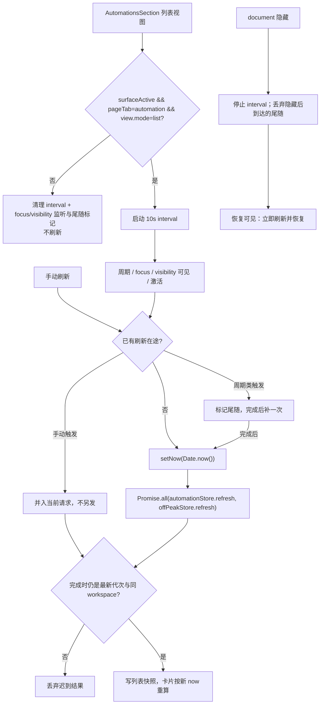

# 自动化列表自动刷新

## 目标

自动化管理页的定时、延时与闲时列表停留在可见列表视图时，以 10 秒周期从既有 store/service 入口回源，并同步推进卡片相对时间的基准 `now`。窗口重新聚焦、document 恢复可见、保活表面重新激活时立即刷新；隐藏或离开列表视图时停止轮询。手动刷新与上述自动触发共用同一刷新入口与单飞队列。

本规格不新增服务、RPC、持久化通道或第二份列表状态，也不改变创建、编辑、删除、暂停等写操作语义。

## 产品规则

- **刷新对象**：一次刷新同时回源两类列表——定时/延时（`useAutomationManagementStore.refresh`）与闲时（`useOffPeakTaskStore.refresh`）。空列表同样参与刷新，不按任务数短路。
- **可见列表视图**：仅当自动化表面处于前台（`surfaceActive`）、顶级标签停在「自动化」（`pageTab === "automation"`）、子视图为 `view.mode === "list"` 时轮询。创建、编辑、延时编辑、闲时创建/编辑页不轮询。
- **激活即刷新**：以下事件立即触发一次刷新，并恢复 10 秒周期：
  - `window` 的 `focus`（document 可见时）；
  - document 的 `visibilitychange` 从隐藏变为可见；
  - `surfaceActive` 从 `false` 变为 `true`（设置/文件主视图覆盖后返回任务面，或保活表面重新激活）。
- **首次挂载不重复请求**：列表挂载已由 `initialize` 回源；轮询只在挂载后按周期执行，避免同帧双请求。若挂载时表面本就不可见（保活层被设置/文件主视图覆盖），第一次激活按重新激活处理，立即刷新一次。
- **隐藏即暂停**：document 隐藏时清除定时器，不保留后台空转；隐藏后到达的尾随刷新被丢弃，重新可见时立即刷新一次再恢复周期。
- **手动刷新共用入口**：工具栏刷新按钮调用同一条刷新入口。空闲时立即发起一次；已有刷新在途时并入该次请求，不再另发一次。按钮 loading 跟随其触发的请求结束，不改变错误归属。
- **时间推进**：每次刷新（周期、激活或手动）在发起时用 `Date.now()` 更新列表基准 `now`；卡片倒计时和「下次运行」不会再冻结在挂载时刻。
- **草稿隔离**：轮询不读写 `view`、表单草稿或 `runsCache`；进入编辑态时轮询完全停止。
- **不重复闲时轮询**：闲时列表不再有独立的 10 秒轮询；两类列表共用同一次刷新与同一条定时器。

## 状态所有者

| 状态                                        | 所有者                                  | 说明                                                                                                       |
| ------------------------------------------- | --------------------------------------- | ---------------------------------------------------------------------------------------------------------- |
| 定时/延时列表快照、加载与错误               | `automationManagementStore`             | 周期刷新复用其 `refresh`；既有 `automationLoadSeq` + workspace 比对继续拒绝迟到结果                        |
| 闲时列表快照、加载与错误                    | `offPeakTaskStore`                      | 周期刷新复用其 `refresh`；`refresh` 与 `initialize` 的首次 list 共用同一单调代次，只允许最新一次响应写快照 |
| `now`、`view`、`tab`/`pageTab`              | `AutomationsSection` 视图状态           | `now` 仅在刷新、写操作回源与既有额度边界计时器更新，不引入全局时钟                                         |
| 轮询定时器、焦点/可见性监听、单飞与尾随合并 | `useActiveSurfaceRefresh`（仅 UI 调度） | 手动刷新与自动触发共用该单飞队列；不保存业务数据；`active=false` 或卸载时清理定时器、监听与尾随标记        |

`surfaceActive` 由持有布局所有权的 `WorkspaceShellLayout` 传入：`isWorkspaceVisible && shellPrimaryView === "tasks"`。设置页独立挂载 `AutomationsSection` 时默认激活。

## 事件时序

事件顺序：

1. 列表挂载：`initialize` 回源；轮询只挂定时器，不额外请求。
2. 10 秒到点：推进 `now`，并发调用两个既有 store 刷新入口。
3. `focus` / `visibilitychange(visible)` / `active false→true`：立即执行同一条刷新；隐藏时只停表并丢弃尾随。
4. 手动刷新：空闲时立即执行同一条刷新；已有刷新在途时并入，不重复请求。
5. 刷新返回：store 校验代次（定时/延时还校验 workspace），过期结果直接丢弃。
6. 离开列表视图或卸载：清理定时器与监听，销毁尾随标记。

## 失败与异步语义

- **错误归属不变**：请求失败只写各自 store 的 `error`；轮询与手动刷新都不弹 toast、不重试；手动刷新按钮的 loading 只跟随本次请求结束。
- **单飞与尾随**：同一表面同时最多一个列表刷新在途，手动与自动触发共用该队列。周期/焦点/激活在途期间再次触发合并为一次尾随刷新，避免请求堆叠；手动刷新在途时并入当前请求，不额外排队。
- **迟到结果**：`automationManagementStore.refresh` 继续以 `automationLoadSeq` 和 workspace 身份拦截跨 workspace 回写；`offPeakTaskStore` 的 `refresh` 与 `initialize` 首次 list 共用单调代次，旧响应（含旧错误与初始化失败回退的空列表）不得覆盖新响应。
- **不阻塞交互**：轮询不设置全局 loading，不覆盖创建/编辑草稿与 `runsCache`。
- **无新通道**：只调用既有 `IZCodeAgentService.listAllAutomations` 与 `IOffPeakTaskService.list` 封装，不新增协议或持久化。

## 验收场景

1. 空列表停在定时 tab：10 秒后两类 store 都收到刷新请求，`now` 推进。
2. 停在延时 tab：到期时间与剩余时间随 10 秒刷新更新，不冻结。
3. 从设置/文件主视图返回自动化列表：立即刷新一次，不需要等 10 秒。
4. 窗口失焦后重新聚焦、document 从隐藏恢复：各立即刷新一次。
5. document 隐藏期间不产生周期请求；恢复后立即刷新并继续周期。
6. 进入创建/编辑页或切到「工作流」标签：停止轮询；返回列表后立即刷新且草稿保留。
7. 刷新慢于周期时最多一个在途请求，完成后最多补一次尾随刷新。
8. 切换 workspace 时，旧 workspace 的迟到响应不写入新列表。
9. 卸载后不再有定时器或监听触发。
10. 手动刷新与周期刷新重叠：只产生一个在途列表请求，不重复请求；空闲时点击立即刷新，loading 随请求结束收敛。
11. 闲时初始化慢于周期/激活刷新：初始化的旧结果（含失败回退的空列表）不覆盖较新列表。

## 范围外

- 编辑态 History 的 5 秒轮询保持现状。
- 不新增「自动刷新」开关、刷新间隔设置或手动刷新之外的 UI 控件。
