# Spec: 内置浏览器代理标签页

## 目标

AI 操作内置浏览器访问境外站点时，出口跟随系统代理；用户按「每处单独启用代理」的习惯使用时（系统代理关闭、全局代理关闭），AI 无法访问需要代理才能到达的站点。本次改动让 AI 在 `newTab` 时通过 `proxy: true` 创建「代理标签页」：该 tab 挂到独立 partition `persist:zcode-embedded-browser-proxy`，出口代理来自设置页新增的「内置浏览器代理」地址（`AppSettings.embeddedBrowserProxy`）。普通标签页、系统代理与全局代理（`httpProxyEnabled` gate）行为完全不变。

AI 只选用、不接触代理地址；地址只在设置页维护。本期只做桌面内置浏览器（IAB）；CLI headless 的 CDP adapter 对 `proxy: true` 返回明确的 backend 不支持错误，后续可用 Playwright context 级代理补齐。

## 产品规则

- **按标签页区分，创建时决定**：只有 `newTab` 命令接受 `proxy: z.literal(true).optional()`（只接受显式 `true`）；已有标签页的网络出口不可事后切换。`activateTab` 绑定代理 tab 后执行的普通命令走该 tab 既有出口，无需再声明。
- **`usesProxy` 摘要字段**：`BrowserTabSummary` 新增 `usesProxy: z.boolean()`，newTab 返回的 `tab`、`list` 返回的 `tabs`、`BrowserViewReady` IPC payload 与 AI facade 的 `TabInfo` 均携带；`true` 表示该 tab 挂代理分区。
- **未配置地址必须显式报错，不静默直连**（对齐 `docs/specs/network-settings.md` MCP `config_invalid` 先例）：AI 请求 `proxy: true` 而设置页未填地址时，newTab 返回结构化错误 `proxy_not_configured`（新增错误码），不创建任何 tab。静默直连会让配置遗漏伪装成站点不可达。
- **代理地址独立于全局开关**：`embeddedBrowserProxy` 不受 `httpProxyEnabled` gate——「为全局启用」关闭时代理标签页照样走该地址。填写即生效，不设独立开关；时效与 renderer session 一致（设置页保存后经即时通道重应用，无需重启）。
- **代理分区出口规则**：地址已配置 → `fixed_servers` + bypass `<local>`（localhost/127.0.0.1 不走代理）；未配置 → `direct`（newTab 前置校验已挡住，此处仅兜底）。
- **证书策略沿用内置浏览器现有设置**：代理分区与默认分区同样应用 `embeddedBrowserAllowInsecureCertificates` 与 `httpProxyCaCertPath`（自定义 CA 与代理无关，直连场景也需要）。
- **代理分区不导入 Chrome 登录态**：独立 partition 即独立 cookie jar；代理 tab 是 AI 的独立身份，需要登录的站点在代理 tab 内重新登录。「清除内置浏览器数据」同时清两个分区；Chrome 数据导入仍只进默认分区。
- **子代理可用**：`newTab`（含 `proxy: true`）不在子代理拒绝列表（`SUBAGENT_BROWSER_DENIED_COMMANDS` / `SUBAGENT_DENIED_BROWSER_METHODS`），带 grant 的子代理可创建自己 scope 内的代理 tab，无需额外授权项。
- **UI 标识**：代理 tab 在标签标题处用轻量记号标识（遵循 `DESIGN.md`，不加二级说明文字）；renderer 只做布尔 → 固定 partition 字符串映射，不透传任意 partition 值。

## 状态所有者与接口

```mermaid
flowchart TD
  S[(AppSettings.embeddedBrowserProxy<br/>校验 validationAppSettings<br/>归一化 normalizeSettingsPatch)] --> NP[desktopNetworkPolicy<br/>第 3 个 target：代理分区<br/>已配置→fixed_servers + &lt;local&gt;<br/>未配置→direct<br/>证书同默认分区]
  UI[SettingsPage 网络分区<br/>内置浏览器代理输入框] -- settingService.update 落盘 --> S
  UI -- syncAppSettings 即时通道 --> M0[main: syncImmediateAppSettings<br/>→ reapplyDesktopChromiumNetworkPolicy]
  AI[AI: tabs.new&#123;proxy:true&#125;] --> CMD[newTab 命令<br/>共享 schema 严格校验]
  CMD --> GM[guest manager<br/>resolveEmbeddedBrowserProxy&#40;&#41;<br/>未配置 → proxy_not_configured<br/>不创建 tab]
  GM -- 已配置 --> MT[ManagedTab.usesProxy = true<br/>webview partition = persist:zcode-embedded-browser-proxy]
  MT -- BrowserViewReady&#40;usesProxy&#41; --> R[renderer workspaceSidePane<br/>→ UnifiedBrowserView → BrowserViewportSurface<br/>布尔映射固定 partition 字符串]
  MT -- summary&#40;&#41;/list --> AI2[AI 拿到 usesProxy=true 的 tab]
```

- 持久化事实源：`AppSettings.embeddedBrowserProxy`（`packages/shared/src/protocol.ts`；校验 `validationAppSettings.ts` 两个 schema；patch 归一化 `packages/services/src/setting/normalizeSettingsPatch.ts`）。
- 网络策略所有者：`packages/desktop/src/main/desktopNetworkPolicy.ts` `applyDesktopChromiumNetworkPolicies` 增加第三个 session target；热切换入口 `syncImmediateAppSettings`（`packages/desktop/src/main/index.ts`）在 patch 含 `embeddedBrowserProxy` 时重应用。
- tab 状态所有者：main 侧 `ManagedTab.usesProxy`（`browserGuestManager.ts`）；`createTab` 接收 proxy 选项，`summary()` 输出，三处 `BrowserViewReady` 通知（首挂、恢复兼容回退、重绑）携带同值。
- renderer：`workspaceSidePane` 事件保留 `usesProxy` → `BrowserUseSidePaneContent` → `UnifiedBrowserView` → `BrowserViewportSurface` 按 `usesProxy` 选 partition。
- AI facade：`tabs.new(options?: { proxy?: true })`（`apps/zcode-cli/packages/core/src/browser-client/facade.ts`）；`BrowserTabInfo` 映射 `usesProxy`。
- contracts 手写镜像（`apps/zcode-cli/packages/contracts/src/interfaces/browser-control.port.ts`）与共享 schema 同步：`proxy?: true`、`usesProxy: boolean`、错误码 `proxy_not_configured`。中间转发层（node-repl bridge、protocol broker、validation.ts、host bridge）复用共享 schema，零改动。

## 边界

- **in-session suspend/restore**：驻留经 `ManagedTab` 保持 `usesProxy`，residency 通知只更新已有 tab，不改出口。
- **冷启动恢复**：当前 main 未注入 recoveryStore（恢复链路未接线），本次不做恢复存储改动；未来接线时 `BrowserViewRestoredTabShell` 需补 `usesProxy`。
- **popup 不继承代理**：人类用户经 `OpenBrowserUrl` 打开的新 tab 落默认分区，属已知限制；代理 tab 只能由 AI 显式创建。
- **恢复 bootstrap 协议**：`BROWSER_VIEW_RESTORE_BOOTSTRAP_URL` 的 protocol handler 需对代理分区同样注册。
- **CLI headless**：CDP adapter `proxy: true` 返回 `capability_unsupported` 结构化错误；`usesProxy` 恒 `false`。

## 验收场景

1. 设置页「网络」分区出现「内置浏览器代理」输入框（中英文案齐全）；填入地址保存后立即生效，无需重启；清空保存后字段被删除。
2. 已配置地址：AI `tabs.new({ proxy: true })` → 返回 `usesProxy: true` 的 tab，访问境外站点可达；同 session `tabs.new()` 普通 tab 仍按既有出口（系统代理）访问，两者互不影响。
3. 未配置地址：AI `tabs.new({ proxy: true })` → 报 `proxy_not_configured`，不产生任何新 tab；错误文案指向设置页网络分区。
4. `proxy: false` 或其他值被共享 schema 严格校验拒绝；不带 `proxy` 字段的行为与改动前完全一致。
5. `list` 命令能区分代理 tab 与普通 tab（`usesProxy` 值不同）。
6. 代理 tab suspend/restore（in-session 驻留）后 `usesProxy` 保持，出口不变。
7. 全局「为全局启用」关闭时，代理标签页仍走 `embeddedBrowserProxy` 地址。
8. 「清除内置浏览器数据」后两个分区的 cookie/localStorage 均被清除；代理 tab 内的登录态与默认分区互不可见。
9. 代理分区证书策略跟随「允许不安全证书」与自定义 CA 设置（与默认分区一致）。
10. 人类用户手动打开的 tab（OpenBrowserUrl）不挂代理分区。
11. CLI headless 下 `proxy: true` 返回明确的不支持错误，不崩溃、不静默忽略。
