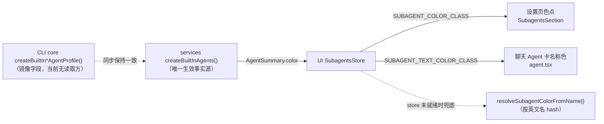

# 内置子智能体身份色

## 目标

内置子智能体（general-purpose 显示名「通用」、Explore 显示名「探索」）在所有 UI 面展示固定的身份色：

| 身份名 | 显示名 | 身份色 |
| ------ | ------ | ------ |
| `general-purpose` | 通用 | `red`（设置页色点为玫红，聊天卡名称文本为 rose 系） |
| `Explore` | 探索 | `green`（设置页色点为翠绿，聊天卡名称文本为 emerald 系） |

身份色用于在设置页「内置子智能体」列表头像右下角色点、聊天 Agent 工具卡名称文本等位置区分不同子智能体，不承载任何业务语义。

## 颜色所有权与数据流

- **唯一生效事实源**：`packages/services/src/subagents/subagentsService.ts` 的 `createBuiltInAgents()`。UI（设置页、聊天卡）颜色全部来自它产出的 `AgentSummary.color`。
- **CLI 镜像**：`apps/zcode-cli/packages/core/src/subagent/profile.ts` 的 `createBuiltInGeneralPurposeAgentProfile()` / `createBuiltInExploreAgentProfile()` 各有一个 `color` 字段，当前在 CLI 内只写不读（不进协议、不进 prompt、不影响 TUI 输出）。它必须与 services 事实源保持一致，避免两份定义漂移；将来若协议开始透传该字段，语义自动成立。
- **UI 颜色映射**：`packages/ui/src/lib/subagentColors.ts` 的 `SUBAGENT_COLOR_CLASS`（填充色）与 `SUBAGENT_TEXT_COLOR_CLASS`（文本色）是 `AgentColor` → CSS 类的唯一映射；任何新的颜色消费面都应复用它们，不允许另写颜色常量。

## hash 兜底不变量

UI 查找颜色走三段回退：`configuredAgentColor`（store，来自 services）→ 协议载荷 `getAgentColor(toolCall)`（CLI 当前从不写入）→ `resolveSubagentColorFromName()`（按英文名 hash）。

hash 兜底按英文名计算（`hash*31 + charCode` 后对 `SUBAGENT_COLORS.length` 取模），当前结果为：

- `resolveSubagentColorFromName("general-purpose") === "red"`
- `resolveSubagentColorFromName("Explore") === "green"`

因此**显式身份色必须与 hash 兜底色保持一致**：store 未就绪（列表加载中、跨窗口冷启动）时 UI 短暂回落到 hash 色，用户看到的颜色不应跳变。修改内置身份色时，必须同时校验 hash 兜底结果或调整 `SUBAGENT_COLORS` 数组顺序，保持两条路径一致；注意 `SUBAGENT_COLORS` 数组顺序本身是隐式契约，调整顺序会影响所有非内置 agent 的 hash 色。

## 修改规则

- 修改内置身份色只允许改两处：services 的 `createBuiltInAgents()` 与 CLI core 的 profile 工厂，两处必须同步提交。
- 内置身份名（`general-purpose` / `Explore`）由 `BUILT_IN_AGENT_NAMES` 保护，用户 agent 不可占用，避免用户配置抢占内置颜色查找。
- 内置 agent 是只读 profile，用户不能在设置页改它的颜色；颜色没有用户级或 workspace 级覆盖。

## 验收场景

1. 打开设置页「内置子智能体」列表：「通用」行头像色点为玫红（`red`）、「探索」行头像色点为翠绿（`green`）。
2. 聊天中发起 general-purpose 子代理任务：Agent 工具卡名称文本为 rose 系红色；发起 Explore 任务：名称文本为 emerald 系绿色。
3. 在 store 未就绪时（如刚进入会话、配置列表尚未加载完成），聊天卡名称色与最终显式色一致（hash 兜底 = 显式色），不发生颜色跳变。
4. `pnpm typecheck`、`pnpm lint`、`pnpm architecture:check --changed` 通过；身份色相关测试（services 事实源、CLI 镜像、hash 兜底一致性）通过。
