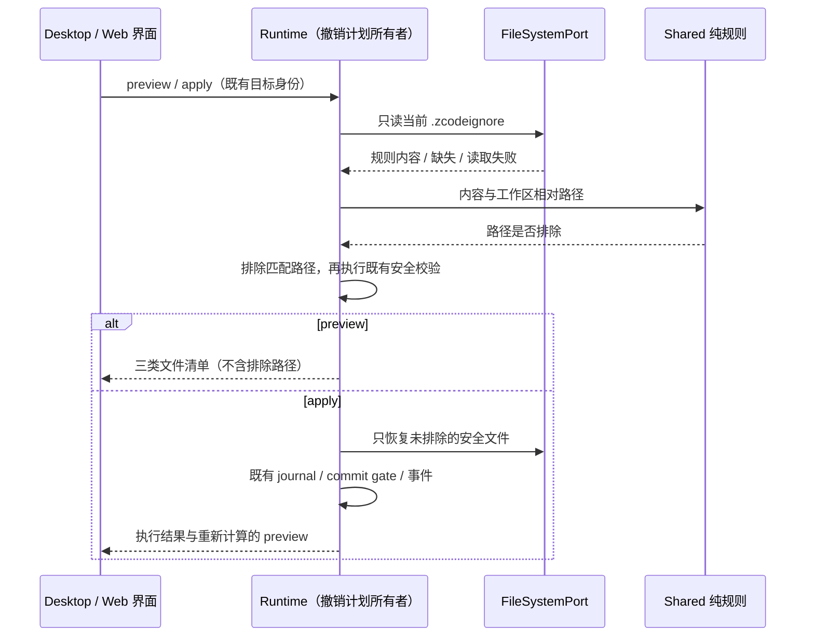

# 文件撤销的工作区忽略边界

## 目的与范围

历史消息编辑的「撤销并重发」以及文件变更摘要的「撤销文件改动」必须遵循当前工作区的 `.zcodeignore`。已忽略目录中的工具脚本、依赖和产物不应进入恢复清单，也不应因内容变化阻塞对话重发。

本规格只修改 `previewWorkspaceFileRewind` / `applyWorkspaceFileRewind` 共用的文件撤销计划。不改变工具访问权限、checkpoint 记录与继承、旧式工作区 fork/恢复原语或文件搜索范围。

## 产品规则

1. `.zcodeignore` 是已存在工作区的路径忽略规则来源。匹配与文件搜索共用 `ignore` 包的 gitignore 语义，包括目录、锚定路径、通配和反选；不得在 runtime 手写另一套规则解析。
2. 每次 preview 或 apply 各读取一次当前规则，整次计划使用同一规则快照。apply 不信任 UI 的旧 preview，仍自行重算文件计划与普通文件的安全校验。
3. 匹配的路径在工具类型分类、after-content 解析及当前文件读取前剔除，不进入 `safeFiles`、`unsafeFiles` 或 `ignoredFiles`，不计入恢复数量、不阻塞重发、不写入或删除对应文件。该规则适用于绝对和相对 checkpoint 路径，也适用于已有和继承的旧 checkpoint。
4. `ignoredFiles` 仍只表示未被路径规则排除的 `bash_ignored`。现有 Bash 冲突、普通文件的外部修改、unsupported checkpoint、checkpoint 不可读以及 overwrite 限制不变。无法读取整个 checkpoint 时不能证明其中路径已忽略，仍拒绝恢复。
5. `.zcodeignore` 不存在时，只在内存使用与文件服务首次创建相同的模板：根 `.gitignore` 的内容加内置默认段（含 `.git/`）。预检和执行均不得创建、同步或改写规则文件。
6. `.zcodeignore` 已存在但不可读时，文件撤销必须返回 `file_read_failed`，不执行恢复；不得把未知规则当成空规则继续覆盖。读取根 `.gitignore` 仅用于缺失规则文件时的初始模板；它不可用时使用内置模板。取消应传播，不应当作读取失败处理。
7. 仅对工作区内的相对路径应用规则。工作区外的 checkpoint 路径保持原有安全检查，不因名称碰巧匹配忽略规则而静默消失。不新增工作区越界访问权限。
8. 只有已忽略文件时，preview 三类清单均空；编辑提交走既有纯对话确认/重发路径，独立文件撤销没有可执行文件。混合文件时只还原未忽略且安全的文件。预检后规则变化，以 apply 时重新读取的规则为准。
9. 文件搜索现有规则自动创建、设置页编辑、降级行为保持不变；已有 `.zcodeignore` 内容仍是唯一规则，不额外并入硬编码的路径排除清单。

## 所有权与接口

- `.zcodeignore` 的文件创建、编辑和原子保存仍由文件服务所有；runtime 是只读消费者。
- 默认模板、分区转换与规则解析的唯一实现放在 `@zcode/shared/workspaceFileIgnore` 公开入口。文件服务与 runtime 都依赖该入口，core 不导入 services 实现。
- runtime 经已有 `FileSystemPort.readTextFile` 读取规则。文件撤销计划仍是 runtime 的派生值，不新增跨查询缓存、持久化状态、命令或协议字段。
- checkpoint 继续 append-only 保存原始工具写入事实；忽略路径只影响本次恢复计划，删除忽略规则后原有 checkpoint 仍能参与恢复。

Desktop 的 `desktop-continuous` 与手机/Web 的 `web-remote-replayable` 使用相同 runtime 决策；只改变候选过滤，不改变 owner/lease、事件顺序、幂等边界、重连或回放协议。

## 验收场景

- 历史 Write checkpoint 指向 `.git/stage-mine.mjs`，当前文件已变化，`.zcodeignore` 含 `.git/`：preview 无冲突；编辑按纯对话路径重发，不访问或恢复该脚本。
- 同一轮有上述脚本和普通源码：preview 只列源码；apply 只恢复源码，脚本字节不变。
- `.zcodeignore` 不存在：使用共享初始模板排除 `.git/` 和依赖目录，不创建规则文件；根 `.gitignore` 的自定义规则仍生效。
- `*.log` 与 `!important.log` 按声明顺序执行；已忽略父目录下的子路径不能仅靠反选子文件恢复，与搜索语义一致。
- `.zcodeignore` 已存在但不可读：preview/apply 返回读取失败，不写任何文件；取消信号仍传播。
- 被忽略的旧 checkpoint 缺少可恢复 after-content：路径先被排除，不产生 unsupported 冲突；整个 artifact 不可读仍阻塞。
- 未忽略的源码被外部修改：继续报告 `external_modified`；默认不覆盖，overwrite 仍须持久化覆盖前快照。
- Bash 路径匹配规则时排除；未匹配时保留 `bash_ignored` 及其现有阻塞语义。
- 修改规则后再次 preview/apply 立即使用新内容，不缓存旧判断。工作区外路径不被工作区规则误排除。
- 交互验收：历史编辑只有忽略文件时不出现文件冲突弹窗；同时存在普通冲突文件时仍展示冲突。文件摘要撤销与编辑重发对同一目标得到一致候选集合。Desktop 与手机/Web 语义一致。
