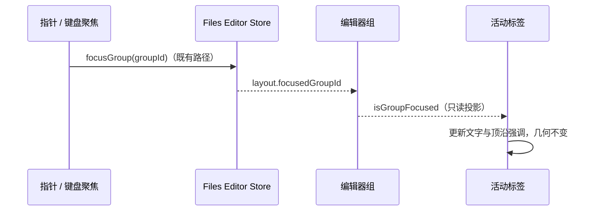

# Spec: 文件编辑器组的结构边界

## 目标与范围

消除文件工作台整圈聚焦描边与外壳圆角叠加产生的矩形内框。对齐 `DESIGN.md` 的结构面板规则，覆盖单组、空组与横纵分屏，不扩展到内容卡片、菜单或平台窗口外沿。归属 `ui` 模块，仅改变既有聚焦状态的视觉投影，无服务、协议或持久化迁移。

## 产品规则与状态所有者

- **结构边界只由外壳绘制一层。** 文件编辑器组是布局分组，不增加整圈边框、圆角、ring 或阴影；单组、空组和横纵分屏遵守同一规则。分屏与标签条保留既有公共边分隔线，不把每组画成独立卡片。外层平台圆角与 Web 铺满规则继续由工作区外壳负责。
- **组聚焦通过活动标签表达。** 聚焦组的活动标签保留主文字和顶沿强调；非聚焦组的活动标签保留选中底色，使用次级文字并隐藏顶沿强调。没有标签的空组不额外造聚焦外框。聚焦/失焦不能改变边框占位、内容坐标或标签条尺寸。唯一状态仍是 Files Editor Store 的 `layout.focusedGroupId`，由既有指针/键盘聚焦事件更新，标签只读取投影，不新增 DOM 焦点状态或持久化字段；本地、远程共用该规则，焦点失败时不另建回退写入路径。

## 验收场景

1. 明暗主题、Desktop 与 Web：单组 / 空组无额外整圈描边；横纵分屏后通过点击或键盘切换聚焦组，只有聚焦组的活动标签显示主文字与顶沿强调，另一组仍显示自己的选中底色。切换前后正文和标签坐标不移动，右上角不出现矩形内框压住外层圆角的折线。
2. 实际组件渲染回归：空组与有标签组的根部无整圈边框、圆角、ring 或阴影；双组均保留各自选中标签，且只有聚焦组有顶沿强调。聚焦切换前后根部和标签的尺寸类及 style 不变。
3. 交互 E2E（需获准操作隔离应用后执行）：在 Desktop 与手机 Web 打开文件、横纵分屏，通过指针和键盘切换组，确认标签提示与保存/关闭的目标组一致；窗控与 Tab 避让正常，缩放窗口时角部没有重复折线。
