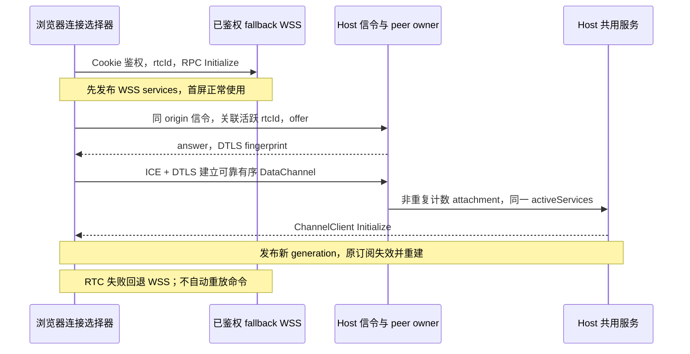

# 手机远控 WebRTC DataChannel 直连

## 目标与范围

浏览器通过桌面远控的 HTTPS 公网链接加载页面并完成原有 Cookie/WSS 鉴权后，机会性建立 WebRTC DataChannel。成功时 RPC 走加密直连；失败、浏览器不支持或连接中断时继续使用原 WebSocket。页面 origin、工作区、会话与 Agent 不变，不为局域网安装 CA 或签发 HTTPS 证书。

只作用于桌面 Mobile Remote Control 声明能力的 `/ws`。普通 Server、`?remote=` 转发、分享页与资源管理器不自动启用。已有 HTTP 局域网链接保持现状；公网安全上下文才自动尝试。没有外部 STUN/TURN，没有端口扫描，不承诺隔离 Wi-Fi、防火墙或 UDP 受限环境可直连。不将全部 HTTP 流量迁入 DataChannel。

## 产品规则

- 先完成现有 WebSocket RPC Initialize，再尝试直连；协商不阻塞首屏与隧道业务。
- `server-info.capabilities.webRtcDirect === true` 且安全上下文存在 `RTCPeerConnection` 时启用，缺少能力或浏览器 API 时不创建 peer 或信令连接。
- 每条物理 fallback WebSocket 生成密码学随机的临时 `rtcId`，仅用于关联本次已鉴权 fallback 与 `/ws/rtc` 信令连接，不作为独立认证凭据、不落浏览器存储。重连使用新 ID，避免服务端尚未感知旧 socket 关闭时拒绝合法的新连接。
- fallback `/ws?rtcId=...` 仍由原 Cookie 鉴权；信令 `/ws/rtc?rtcId=...` 同时要求 Cookie、合法同 origin 的 Origin、以及仍存活的对应 fallback。无效、重复占用、未知关联、超额或超长信令拒绝，不暴露 SDP、token、ICE 密码或内网候选到日志。
- 信令交换版本化的 offer/answer/error，以及直连建立后的 ping/pong 保活。双方先收集完本地 ICE，再发送一次 SDP，避免独立 candidate 写入队列。SDP 长度有上限，解析严格校验；协商有有界期限，不无限等待。SDP 的 DTLS fingerprint 通过既有可信 WSS 传递，维持现有信任模型，不额外配对。
- RTC ready 后客户端每 20 秒发送信令 ping，Host 仅在 answer 已发送的有效会话回应 pong，避免隧道因信令空闲而关闭健康的直连。ping/pong 不触发协商或业务调用，不能当作命令确认；会话关闭时回收保活计时器。协商阶段的 ping/pong、客户端发 pong 或重复 answer 均拒绝。
- 桌面 Host 使用 Node WebRTC 实现，`iceServers` 为空。浏览器 DataChannel 为可靠、有序的二进制通道，不设置部分可靠重传限制。不得调用 `getUserMedia` 或要求媒体权限。
- RPC 的 DataChannel 适配使用既有 SocketProtocol 流式帧。发送按保守大小分片；有限发送队列和 bufferedAmount 高低水位提供背压，异常/溢出关闭通道并回退，不丢弃部分帧后继续连接。
- 只有 DataChannel 及其 ChannelClient Initialize 完成后才能发布新 service generation。页面 facade/store 保留，旧订阅 ownership 先失效，再通过新 attachment 重建订阅，继续 `web-remote-replayable` 的 cursor/snapshot 语义。Desktop `desktop-continuous` 不改。
- 连接选择器是唯一业务入口，每时刻仅发布一个 services。不会同时向 WSS 和 RTC 提交同一调用，不自动重放在途命令；已经交给旧 attachment 的调用只能在旧 attachment 完成或因关闭而失败。
- fallback WSS 存活时保留其 RPC client 供回退，但在 RTC 生效时不把它的服务发布给页面。RTC 失败立即发布存活的 WSS services，generation 单调递增。fallback 换代、断开或前台强制重建时，旧 RTC 和信令立即失效，不能让旧 peer 的迟到回调重新升级。
- 每个 fallback generation 最多尝试一次直连，失败不建立热循环；fallback 新代恢复后可再次尝试。长时间后台恢复沿用既有 foreground reconnect，不能把冻结的 peer 当成存活事实。
- 一台浏览器的 WSS 与 RTC 是同一逻辑连接，`connectedClients` 不因升级而翻倍。RTC attachment 仍复用同一 activeServices 和相同手机权限裁剪，不暴露远控管理服务或 provisioning。
- 同一逻辑连接内 WSS↔RTC 切换保持 `continuityGeneration` 不变，只递增物理 `generation` 并重建订阅；fallback 换代、断开或前台强制重建才更换 continuity。切换期间已交给旧 WSS 的成功结果仍然有效，不自动重放命令。完整合同见 [web-connection-continuity.md](./web-connection-continuity.md)。
- fallback、信令、peer 任何关联的关闭均须回收相应 peer；stop/resetToken/suspend/dispose 在监听关闭路径中先禁止新的 fallback/信令 admission，再撤销所有协商与 DataChannel，之后等待隧道和监听关闭。下一次成功启动才恢复 admission。过期异步建连结果就地关闭，不复活旧连接。
- 安装包对懒加载的 `werift` 收集并校验完整运行时依赖闭包。Node 内置模块不得当作待复制 npm 包；解析结果必须是匹配包名的绝对包目录，不能沿 cwd 将仓库根当作依赖。

## 状态所有者与边界

- Host 远控 runtime 是监听、授权撤销和 peer 集合的唯一 owner。信令 controller 作为其生命周期子对象，不创建第二套服务、Agent 或用户认证事实。
- 浏览器连接选择器是当前服务代次的唯一 owner；fallback managed WebSocket 继续持有退避、心跳与前台恢复。
- `@zcode/shared` 提供信令的严格运行时 schema/类型与能力；`@zcode/rpc` 只持有通用可靠二进制 DataChannel 到 ISocket 的适配，不依赖业务/werift。
- `@zcode/server` 仅提供附加受保护 WebSocket 端点和请求上下文/Origin 校验，不持有 RTC 业务状态。`packages/desktop/src/host` 实现 Node peer 和授权关联。`@zcode/client` 实现浏览器 peer 与服务选择；`packages/web` 依据 bootstrap capability 启用。
- workspace identity 隔离键仍为 `workspaceIdentity?.trim() || workspacePath`；Host attachment 的 `web-remote-replayable`、stale run、owner/lease 与命令 admission 均保持原有实现。
- `connectedClients` 继续统计 fallback 浏览器连接；RTC attachment 与对应 fallback 绑定，不单独计数。

## 接口契约

- `WebRtcSignal`：严格的 discriminated union，`{version:1,type:"offer",sdp:string}`、`{version:1,type:"answer",sdp:string}`、`{version:1,type:"error",code:string}`、`{version:1,type:"ping"}`、`{version:1,type:"pong"}`；SDP 最多 256 KiB，error code 为有限枚举，不携带底层异常文本。
- `LanHttpServerOptions` 可注册多个受原中间件保护的 WebSocket endpoint，并接收只读请求 url/origin；RTC 信令端点要求同 host Origin（支持 TLS 隧道回源 HTTP 的协议差异，不信任任意 forwarded host）。原单个 webSocket 接口保持兼容。
- DataChannel socket adapter 通过小型结构接口注入 send/bufferedAmount/消息与关闭事件，使浏览器与 Node 实现共用分片/排队边界。
- `connectViaWebRtcManaged` 返回现有 `WebSocketConnection` 契约；无需 React Root 重挂载，不改变通用 managed WebSocket 默认行为。快照以可选只读 `connectionInfo` 发布实际业务通道和直连状态，详情入口与验收见 `web-connection-info.md`；信息必须与 services 的实际选择一致，不改变连接代次或原重连语义。

## 验收与证据

先补对应自动化测试，再实现。测试入口以目标包 package.json 与既有 node:test/tsx 用例为准。

1. 无能力、HTTP 非安全上下文、不支持 API：只有原 WSS，无多余 peer/信令。
2. WSS ready 前不发起 RTC；协商失败、超时、SDP 错误不影响 WSS 业务，且每代仅一次尝试。
3. 正确鉴权与 origin/关联的 offer-answer 建立纯 data channel，发送 RPC、较大 payload，数据顺序一致、无媒体权限。
4. 未鉴权、跨 Origin、未知 rtcId、重复信令、超限 SDP/peer 均拒绝；token 轮换与 stop 后旧 peer 不再可调用服务。
5. 分片跨 SocketProtocol 帧重组正确；bufferedAmount 高水位暂停、低水位恢复，关闭拒绝 drain，超过有限队列上限回收，且不静默丢帧。
6. WSS → RTC → WSS service generation 单调；只有当前服务收到新调用；订阅恢复；在途调用不自动重放。侧栏任务列表（Controller tasks-index 订阅）必须在新 attachment 上重建并自动恢复，不能停在“暂无任务”。
7. fallback 重连/强制前台换代/窗口关闭期间的迟到 answer、open、Initialize 不得复活 RTC；资源与计时器全部清理。
8. 真实 Node peer 之间执行 offer-answer 与较大二进制收发，覆盖依赖实际 API；HTTP/WSS 集成测试覆盖 Origin/auth、信令和附件回收。
9. Android Chrome/iOS Safari 真机：同 Wi-Fi，无媒体权限，直连、AP 隔离/UDP 阻断回退，锁屏/前后台/网络切换。没有真机或 UI 授权时记录未执行，不能写成已通过。
10. 执行根 `pnpm typecheck`、`pnpm lint`、`pnpm architecture:check --changed`，区分本次问题与已有本地改动。不得操作、重启或关闭运行中的 YCode；默认不使用 CDP/UI 自动化。

## 非目标

不加入 TURN/STUN 账号，不扩展公网 NAT 穿透承诺；不改 OAuth/Cookie 持久化，不恢复/重放已提交命令，不改变会话所有权与 accepted queue；不宣称 data-only iOS 后台保活，不增加用户配置面板或修改现有远控弹窗。
