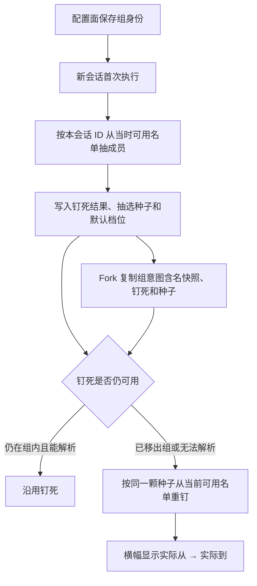

# Spec: 模型组（Model Group）

## 目标

模型组是一层可编辑的模型别名，不是新的供应商。设置「模型」分类下新增独立「模型组」页；Subagent、命令绑定等配置面把组当成一个普通模型来选。会话在钉死成员仍可用时沿用它（缓存、同一长会话、Fork 不漂移）；一旦钉死成员被移出组或已无法解析，发送前按组当前名单与同一颗抽选种子重钉，让超长会话跟着组换免费模型，而不把人锁死。

## 三层事实

- **配置意图**：设置、Subagent、命令、Composer 胶囊选中的是组。身份是组 ID + 组名快照。不带思考档位。
- **会话钉死**：会话第一次真正跑模型组时，按抽选种子 + 组 ID 从**当时仍可用**的成员名单抽一个具体模型写进该会话模型配置，并记录种子。种子写入后本会话不再更换。钉死条目同时带该成员的思考档位。
- **时间线展示**：横幅与消息记录的是当时实际在跑的具体模型 + 档位；胶囊仍显示组名。



不要每次发送都按最新名单重算。组从两个变三个、旧成员还在时继续用原来那个。重钉只发生在「旧钉死已经不能代表这个组」时。成员顺序只参与两种哈希下标：还没有钉死；钉死已不可用后的重钉。钉死仍可用时重排组内成员不换人、不落横幅。

## 产品规则

### 设置与菜单

- 侧栏「模型」分类下新增独立入口「模型组」（`modelGroups` section），与「供应商和模型」并排；导航仍只来自 `packages/ui/src/settings/settingsPageConfig.ts` 与 `packages/ui/src/lib/settingsNavigation.ts`。
- 设置页主从布局：顶部为描述 + `SettingsResourceHeaderActions` 新建按钮（与供应商页头部排法一致），左侧组列表走共享 `SettingsSortableNav`（拖拽排序 + Layers 行图标，见 `settings-master-detail-shared.md`），右侧只承担组详情编辑。详情头走共享 `SettingsDetailHeaderMenu`（标题 + 右侧启用开关 + `...` 菜单：重命名 + 红色删除，删除确认沿用现有确认框）。新建点击后弹出系统 `Dialog` 单输入小窗（组名输入 + 保存/取消，Enter 保存，空名与重名禁用保存并在窗内提示，创建失败错误留在窗内，成功后关窗并自动选中新组）；左栏与详情区不再承担创建态。添加成员走弹窗选择器（按供应商分组、可搜索，选中映射回 provider/model 二元组提交），过滤掉模型组自身（禁止组套组）。详情区段间距与供应商卡片一致（`space-y-3`，不套第二层内边距）；成员段为区头（标题左置 + 右上添加按钮）+ 列表容器 + 空态虚线行，成员行对齐 `ModelRowInput`（mono id + 徽标 + 右操作组）。成员顺序由行首的独立拖拽手柄调整，**不再提供上移/下移按钮**：拖动手柄落到目标位置即提交新顺序；键盘可用同一手柄（聚焦后空格抓起、方向键移动、空格放下）。同模型重复条目各自可拖动，不合并、不改写档位。
- 窄屏呈现（< `md`）：左栏只留图标 + 选中态（组名走 `sr-only` 保留给读屏，tooltip 复用 `ControlHintTooltip`），`md+` 显示图标 + 组名 + 成员数；排序走拖拽，窄屏不再设详情区备用箭头；成员列表同样用拖拽手柄排序，手柄在窄屏保持可点按。详情区标题 / 重命名 / 删除行允许换行（`flex-wrap`），重命名输入框 `min-w-0 flex-1 basis-40`；成员行操作组窄屏折到第二行右对齐（与 `ModelRowInput` 换行做法一致）。新建小窗本身居中浮层，窄屏同样可用。不新增 Drawer，不引入自动保存。
- 用户可创建、重命名、删除、启用/停用组；组内添加、移除、排序**具体模型**（provider+model 二元组），并为支持思考深度的成员保存具体档位值。添加成员时在同一弹窗中选模型和档位；有档位表时默认选中模型当前默认档，并保存该值；无档位表时只保存模型身份。界面不提供“跟随模型默认”选项。旧配置缺少档位字段仍按未绑定读取，执行时使用模型默认档；选定具体档位后写入该值。已绑定档位不再受模型默认值后续变化影响。模型组成员候选包含普通模型选择器中隐藏或关闭的已配置模型；隐藏/关闭只控制普通选择器的展示，不阻止加入模型组。加入模型组不改变 CLI/runtime 对实际可用性的校验。
- **成员档位在添加时一次确定，之后不可改**：添加弹窗里选定的档位随成员一起落盘，成员行只读展示，不再提供档位下拉编辑。要换档位就删掉该成员再重新添加，不做“原地改值”的第二条写入路径。
- **同一模型可以重复加入**：组内不按 provider+model 去重，同一模型可加入多次（例如同模型不同档位各一条）；成员列表按加入顺序完整保留，每条独立可移除。持久化同样不去重。
- 组启用（`enabled`，缺省 `true`）：关闭后该组离开模型选择器，但详情页仍可编辑、标记保留，重开后按已保存标记恢复；旧盘缺字段视为启用。停用组的发送按「无可用成员」拒绝（`modelGroup.noMembers`，文案用当前名），胶囊保留组名，不回落、不清意图。
- 模型组整体 Primary（`modelGroupsPrimary`，缺省 `false`）：挂在个人配置顶层（与 `providerOrder` 同层），只决定「模型组」分节在一二级，不参与可执行判定，不改变成员可用性与排序；关闭保留标记。打开后只渲染一个置顶的本地化「模型组」分节（`directItems`），各模型组作为该分节内的普通可选条目平铺，组名只出现一次，组条目之间没有分割线，分节与首个供应商分组之间有分割线；关闭后整节收进一个二级「模型组」菜单。旧盘缺字段视为非 Primary；历史逐组 `isPrimary` 字段只做兼容读取，不再写入、不再参与投影。
- 草稿组意图（Renderer）：菜单点组只写 `modelGroupIntent` 草稿；`updateDraftConfig` 与 `persistV4ComposerDraft`、`seedImportedSessionDraft` 必须原样携带组意图，组与具体选择互斥，覆盖即丢用户意图（本次修复的依据：选组后新会话模型选项为空）。
- 组身份走独立命名空间：组 ID 由 Host 生成（`model-group:` 前缀 + slug），禁止占用保留供应商 ID（`account:`、`builtin:` 前缀），组不得注册成假供应商，不进 Registry 的 providers 名单。
- 选模型菜单里组作为一条普通模型出现：Primary 时位于置顶的「模型组」分节内，非 Primary 时位于二级「模型组」菜单内；两种形态都只出现一次组名。条目值编码 `model-group:<groupId>`，与 `provider/model` 编码分开，不借用保留供应商 ID。
- 胶囊显示组名：组还在时读个人配置的当前名；组已删时用会话/草稿上的组名快照；快照也缺失才回退显示组 ID（实现兜底，正常路径禁止）。

### 抽选与会话

- 哈希发生在两种时候：还没有钉死；已有钉死但已不可用。输入 = 抽选种子 + 组 ID，对**当时可解析、参与新选择且属于当前最高优先级池**的成员按组配置顺序取下标（沿用 FNV-1a 32 位取模）。候选池只有一个成员时就是纯别名。
- 同一模型重复加入时，重复条目各自占一个下标：抽到哪条就用哪条绑定的档位（典型用法是同模型低/高档位各一条，抽中哪档随种子走）。钉死仍可用的判定按模型身份（provider+model）比对，同模型的其它档位条目不因此触发重钉。
- **种子一旦写入不再更换**。新会话第一次钉死时种子 = 该会话自己的 ID。Fork 原样拷走种子，不换成子会话 ID。同一会话改选另一个组，仍用已有种子抽新组成员。
- 同一会话从组 A 改选组 B 再改回 A、且 A 的最终候选池及其顺序没变：哈希输入相同，抽回原成员，实际模型没变，不落横幅。显式改选组需要新选择，候选池会受当时开关和时段影响，不承诺跨时段切回同一成员。
- 钉死仍可用时：组里后来新增、重排其它模型，本会话和 Fork 都不改抽。
- 钉死已不可用时：发送前重钉，用户不必改选具体模型。
- 配置面改组，对仍钉着旧成员且旧成员还可用的会话不生效；对以后新开的 Subagent、旧成员已不可用的长会话生效。

### 新选择资格与每周时段偏好

成员是否仍属于组、执行时是否可解析、是否参与新选择是三个独立事实。不得将新选择开关或时间偏好混入已有会话的成员有效性判定。

- 每条成员增加可选 `selectable`，缺省为 `true`。设为 `false` 后保留组成员及其档位，但不再参与首次钉死或重钉。已经钉住该模型且仍能解析的会话继续使用它；关闭窗口、重启恢复、隔日续聊和 Fork 继承不改变这一点。重新开启后重新参与未来选择。
- 从组中删除成员仍保留原语义：已有钉死失效，下一次发送前按当前候选重新选择。关闭整个组、删除组或删除底层 Provider/Model 配置也不等同于关闭成员的 `selectable`，不新增绕过执行可用性校验的路径。
- 每条成员可保存 `deprioritizeSchedule: { timeZone, windows }`。`timeZone` 必须是有效的 IANA 时区标识；配置显式落盘，不随客户端或执行机器的系统时区变化。时区随成员保存，允许同组不同供应商按各自计费时区配置。
- 每条窗口是 `{ daysOfWeek, startTime, endTime }`。`daysOfWeek` 使用 ISO 星期编号 1（周一）至 7（周日），至少选一天；时间精度为分钟，起点格式为 `HH:mm`（00:00–23:59），终点另允许 `24:00`。起止相等无效，全天用 `00:00–24:00`。窗口数组非空；没有窗口时移除整个 schedule 字段。
- 窗口包含开始、不包含结束。结束早于开始表示跨午夜，星期归属于开始日。例如周五 `22:00–02:00` 命中周五晚间及周六凌晨，不命中周五凌晨。重叠窗口取并集，命中任意窗口即降低优先级，不叠加权重。夏令时按配置时区当地钟表时间匹配，重复小时两次都适用，跳过的小时没有对应执行时刻。
- **先沿用有效旧钉死，再筛新候选**。首次钉死或旧成员失效时，先按既有规则筛可解析成员，再排除 `selectable=false`；有未命中降级窗口的成员时只从这些成员抽选，全部命中时才从降级成员抽选。各候选池保留组配置顺序、重复条目和原抽选种子及哈希语义。仅排序不能表达优先级：N 个成员各占一个下标、抽中概率相同，排序只改写同一批种子的下标映射，不改变各成员被抽中的概率，也不影响已绑定的会话。
- 选择时刻是执行端受理输入、需要首次钉死或重钉时的一次时间快照，不是打开空白会话、客户端显示、定时任务计划触发或每个成员各自读取的时刻。不设置定时器，不因跨过时段边界中断 turn、切换已有会话或重算既有绑定。
- 当所有成员都不参与新选择时，仍有效的旧钉死继续执行；需要新选择的会话使用现有 `modelGroup.noMembers` 拒绝，不抽回已退出候选的成员。整组仍保留在设置与选择视图，不因新选择池为空而消失。
- 重复 provider+model 条目各自保存开关和时段策略，编辑按成员索引整体提交 `memberOrder`，不按模型身份批量改写；已有钉死的保留仍按 provider+model 身份判断，原会话档位不变。
- 此能力是新选择偏好，不是费用上限。会话在低价时段绑定后，可以在高价时段继续使用同一模型，供应商仍可能按请求当时的价格计费。网络错误、限流不触发组级切换。

设置页成员行增加“参与新选择”开关和时段编辑入口。时段弹窗复用现有 Dialog/Input/Button，提供时区、星期多选、时间段增删与保存/取消；初次编辑可用当前客户端时区作为草稿初值，但保存必须带明确时区，数值 UTC 偏移不作为 IANA 时区接受。移除所有窗口即清除时段策略；校验或保存失败不得关闭弹窗或丢失输入。弹窗打开时记录完整有序成员快照：无关配置刷新、深克隆不阻止保存，成员列表内容或顺序变化则拒绝提交并提示重新打开，不把旧索引草稿写到另一成员。保存期间禁用弹窗输入、增删与关闭操作。`24:00` 使用明确的结束于全天边界开关表示，不伪装成 `23:59`。开始与结束时间是等宽两列，标签与输入框逐行对齐；“结束于 24:00”开关单独占一行并落在结束列下方，不与时间输入行错位。窄屏时两列改为上下堆叠。成员档位继续只读。窄屏允许成员操作换行，弹窗内容可滚动，不引入额外全局状态、定时器或自动保存路径。文案提供中英文。

### 横幅（复用 `modelChange` 分隔线，见 model-change-divider-thought-level.md）

- 比较与展示都用**钉死的具体模型身份**，不是组名；横幅不得写成「组 A → 组 B」。
- 普通新会话选具体模型：保持静默首轮，不出现「正在使用」。
- **新会话选模型组**：首轮出现「正在使用 {实际模型} · {档位词}」。`toThought` 必填，填钉死补上的默认档位；档位表为空写空串（渲染层按现有规则只显示模型名）。Subagent 开头那条同样填实际成员和该默认档位。
- 中途切换（用户改选，或重钉）：落「模型已切换 {实际从} → {实际到} · {新实际档位}」。两次实际模型相同不落；只改档位、模型身份没变也不落。
- 横幅由 CLI 投影（`product-projection.ts` 的 TurnStarted 裁决 + `onModelSelected`）在钉死写入走 `app.setModel` + `ModelSelected` 事件时自动成立，投影层不新增组分支；本 spec 只约束事件形态：首次钉死的 `ModelSelected` 必须带 `previousModelSelection: null`（source-less「正在使用」分支）。

### 思考档位：钉死后恢复可调

组意图本身不带档位；组配置为成员保存可选的 `reasoningLevel` 绑定，取值必须属于该模型当前支持表。新成员在添加弹窗中同时选择模型和档位；模型支持档位时默认选中当前默认档并保存具体值。已绑定值不随模型默认档变化。旧配置缺少字段按未绑定读取，运行时使用模型默认档；用户选定具体档位后写入该值。设置界面不提供“跟随模型默认”选择项。**组设置页的成员行只读展示已绑定档位，不提供改值入口**——档位在添加成员时一次确定，要换就删掉该成员再重新添加。

1. **尚未钉死**（草稿已选组、或会话还没成功跑过第一轮）：档位控件隐藏；成员档位在组设置页预先绑定，不代表会话档位已产生。
2. **已钉死且仍可用**：会话档位控件恢复可调，表来自钉死成员。改档位只写进该会话钉死条目的档位，不改组意图、不触发重钉。组成员绑定档位的后续修改不覆盖现有会话钉死。
3. **首次钉死或重钉成功**：先用抽中成员的绑定档位；未绑定时按现有 `resolveDefaultReasoningLevel` 补默认档，不沿用旧成员档位（成员档位表可能异构）。横幅 `toThought` 为最终采用的档位。之后控件继续可调，表换成新成员的。

用户显式改选另一个组：组意图换成新组，沿用本会话已有种子（尚未钉死则首次 admission 写入）抽新组成员并按新成员的绑定档位或默认档位钉死；抽中的实际模型与上一轮相同则不落横幅。改选具体模型：退出组意图，走现有主动切模型补默认档规则。组已删或没有可用成员时控件保持隐藏，直到用户另选。

### 组名快照

身份只有组 ID；个人配置删除组是真删除，不留墓碑。

- **组还在**：胶囊和设置页读个人配置当前名，改名立刻反映到仍指向该组的胶囊；成功的 admission 把当前名写进该会话的组名快照。
- **选中组时**：草稿/配置面的组意图同时记下组 ID 和当时组名；会话创建或首次 admission 把快照带进会话配置。
- **组已删**：胶囊和失败文案用会话（或未建会话时草稿）上的组名快照；不留墓碑，不编新名字。
- Fork 把组名快照一并拷走。组还在且后来改过名，子会话下次成功 admission 刷新快照；组已删则一直用拷来的那份。

### 重钉失败的可见形态

组已删或重钉时组内没有任何可用成员：失败；不回落父模型，不偷偷改成某个具体模型。

- **命令**：`sendText` / 带首条输入的 `createSession` 在 admission 内被拒。ACK `status=rejected`，`reasonCode` 为 `modelGroup.deleted` 或 `modelGroup.noMembers`。`message`：已删用「模型组「{组名}」已删除，请另选模型」；无可用成员用「模型组「{组名}」没有可用模型」。`{组名}`：组还在用个人配置当前名；已删用组名快照。
- **输入区**：走现有发送失败路径，在输入框上方展示 `message`；草稿文本保留。
- **胶囊**：组意图不变；组还在显示当前名，已删显示快照名并进入不可发送的失效态；选择器里已删的组不再出现。
- **档位控件**：保持隐藏。
- **会话配置**：不写新钉死，不清除组意图；必须显式另选才能恢复发送。
- Subagent / 命令绑定 / Automation 启动失败：同样抛配置错误（不回落父模型），文案与两条 `reasonCode` 对齐。
- 限流、网络失败不重钉，也不走这两条 `reasonCode`。

### 何时沿用，何时重钉

「仍可用」必须同时成立：还在当前组名单里，并且按现有有效选择能解析（在目录、未禁用、账号/套餐能对应上）。判定用的组名单是 **admission 当下**从个人配置读到的那份，不是会话创建时冻住的旧名单；写入走个人配置同一把文件锁。子智能体侧的解析口径见「三表面的选组语义」小节：探测的是带档位的 Selection，档位取该成员按组配置实际会采用的档位。

- 组里加了第三个模型、旧钉死仍在组且能解析：沿用。
- 旧免费模型被移出组、换上新的：下一次发送前按种子从当前可用名单重钉；胶囊仍是这个组。
- 旧模型还在组里但解析失败（删除、禁用、套餐失效）：视为不可用，从其它仍能解析的成员重钉，不会再次抽中已死成员。
- 重钉换了实际模型：落「模型已切换 {旧实际} → {新实际} · {新档位}」。同一轮发送只重钉一次，不在失败后再连抽。
- 网络错误、限流、临时忙碌：不重钉。
- 用户显式改选另一个组或具体模型：按新意图处理；仍是组则用已有种子抽新组成员（种子不变）。
- 组已删，或重钉时组内没有任何可用成员：失败，见上节。

### 钉死写入的并发与幂等

- 唯一写入者：该会话自己的模型配置条目；写入时机是 **CommandInbox per-session 串行 admission**（session gate 持有到 settle）。
- 同一会话不同 `commandId` 的两次发送：后到等前一次 admission 结束；第一次若完成钉死，第二次读到已有钉死且仍可用则沿用，不并排抽两次。
- 同一 `commandId` 重试：`CommandInbox` 返回 `duplicate`，不第二次钉死。
- 桌面与手机、两个窗口对同一会话发送：owner/lease 把命令路由到同一 CLI 的同一个 `CommandInbox`；桌面 continuous 与手机 replayable 都消费这一份会话钉死，恢复链路不得自己再哈希。
- 组名单在 admission 读到之后、settle 之前被改掉：本轮按读到的那一拍判定；下一轮再读新名单。不在 admission 里重试等待。

## 状态所有者与接口

- **组名单唯一写入者**：个人层供应商配置（`provider_config.json` 同一把文件锁）。`ProviderConfigLayerSnapshot`（`packages/provider/src/config-service.ts`）增加 `modelGroups` 与顶层 `modelGroupsPrimary`；`ProviderConfigService` 提供组的创建/重命名/删除/成员增删排序事务方法与整体 Primary 补丁，组与 Provider/Model 共用一次 Repository update 边界。组不是假供应商。
- **会话钉死唯一写入者**：该会话自己的模型配置条目。会话配置（`packages/shared/src/zcode-protocol-v4/session-config.ts` 的 `sessionConfigStateSchema`）增加 `modelGroupIntent`（组 ID + 组名快照）与 `modelGroupPickSeed` 两个 optional 字段；现有 `modelSelection` / `provider` / `model` / `thought` / `thoughtLevels` 在钉死后表示钉死成员及其档位投影，尚未钉死时这些投影为空。写入只发生在 `CommandInbox` admission（bootstrap `commands/handlers/session-flow.ts` 的 sendText / createSession 路径，以及 `fork-edit-retry.ts` 的 editUserQuery 路径），复用 `app.setModel` / `app.setThoughtLevel` + `ModelSelected` 事件。种子写入后本会话不再更换。会话 entry 侧用新的 `SESSION_ENTRY_MODEL_GROUP_STATE` 持久化组意图与种子（Fork 复制的载体）。
- **成员思考档位唯一写入者**：个人配置中的 `ModelGroupConfig.memberOrder[].reasoningLevel`，与组名单共用 ProviderConfigService/个人配置事务。UI 只在**添加成员**时提交一次成员引用与绑定值，此后成员行只读，不提供改值入口；改档位的唯一路径是删除该成员后重新添加。CLI 在 admission/子智能体启动时构造本轮成员快照，快照同时携带当前支持档位与默认档位，纯裁决只读该快照：绑定值仍受支持时优先使用，否则回退快照中的默认档位。组名单与目录事实不在裁决中二次读取，避免同一轮混用不同时间点的配置。
- **成员顺序即唯一身份**：`memberOrder` 不按 provider+model 去重，同一模型可出现多次，每条按加入顺序独立存在、独立可移除；持久化规范化只裁空白档位，不合并条目。
- **构建契约**：会话模型组纯裁决的成员输入是本轮目录快照（成员引用、可选支持档位与默认档位）；共享 `ModelGroupMemberRef` 表达持久化身份、绑定档位及新选择策略，不承载目录字段。首次钉死/重钉裁决只从快照读取目录字段。
- **新选择策略所有者与公共接口**：`selectable` 与 `deprioritizeSchedule` 由个人配置现有成员事务唯一写入，继续使用 `IProviderSettingsService.setModelGroupMembers`，不新增独立写入路径。配置边界拒绝非法星期、时间与时区；旧配置缺字段时保持原选模行为，不迁移或重写会话 pin。共享纯策略 `selectModelGroupCandidates(members, now)` 通过 `@zcode/shared/model-selection` 公开供 CLI/runtime 使用，保留成员快照泛型字段；Provider 从公开入口复用或导出相同策略，不维护第二份时间判断。组目录 `available` 仍仅表达既有可解析性，不包含新选择资格或时段优先级。
- **配置意图扩展**：配置面（草稿、`sendText` / `createSession` 携带的选择、Subagent / 命令绑定 / Automation）新增可辨识的组意图载荷 `modelGroupIntentSchema`（`packages/shared/src/model-selection.ts`）：`{ groupId, groupNameSnapshot }`，与 `modelSelection` 互斥（命令 payload superRefine 校验）。组不塞进供应商字段。
- **模型选择视图**：`ModelSelectionView`（`packages/provider/src/facades.ts`）增加 `modelGroups` 候选分节（组 ID、当前名、成员及其可用性），由个人配置 + Registry 可解析性投影；组不进 `providers`。
- **横幅**：仍由 CLI 投影在 turn 开始时按「上一轮实际模型 vs 本轮实际模型」裁决；组场景的「实际模型」即钉死结果，`toThought` 即钉死后的档位。新会话 + 组意图走已有的 source-less「正在使用」分支（钉死 `ModelSelected` 带 `previousModelSelection: null`），普通主会话静默首轮不变。
- Renderer 只读写组意图和（钉死后）档位循环；抽选与钉死只在 CLI/runtime owner 上发生。

## 事件顺序

```text
设置保存组 → ProviderConfigService 事务（personal repository 文件锁）→ Registry/Facade 刷新
Composer 选组 → 草稿写 modelGroupIntent{groupId, 名快照}（档位控件隐藏）
sendText / createSession(firstInput) → CommandInbox session gate
  → admission：读会话钉死状态 + admission 当下组名单 + 同一轮模型目录
    → 将每个成员的支持档位与默认档固化进本轮快照
    → 无组意图 → 现有具体模型路径（不变）
    → 组已删 → rejected ACK modelGroup.deleted（名快照文案）
    → 无可用成员 → rejected ACK modelGroup.noMembers
    → 已钉死且钉死成员仍可用 → 沿用（payload 只改档位时仅更新档位）
    → 否则 → 排除不可新选成员 → 按同一次 now 和成员时区取当前最高优先级候选池
      → 同一颗种子哈希抽选 → app.setModel + 默认档 + 写种子/意图 entry
      → 首次钉死发 ModelSelected(previousModelSelection=null) → 投影下轮 sourceLess「正在使用」
      → 重钉换人 → 下轮 TurnStarted 落「模型已切换」
forkAssistant → 父会话组 entry（意图 + 名快照 + 钉死 + 种子）随 bundle 原样拷入子会话（种子不变）
Agent / SendMessage → 取得既有 child execution claim（沿用 owner、fencing epoch 与分支校验）
  → 首次：读组配置与目录快照；恢复：先读 child 的模型选择、组意图与种子
  → 同一纯裁决：有效旧 pin 沿用；原成员离组或无法解析才重钉；配置或存储失败即拒绝
  → 新 child 先落 session；child runtime 持久化具体选择 + 组状态
  → ModelSelected（实际选择与档位）→ TurnStarted → 同一选择的模型请求
  → 本轮内重试只复用本轮 Model；限流或失败不重新入组抽选
```

## 设置入口与页面

`docs/specs/settings-model-category.md` 同步：模型分类下新增 `modelGroups` 入口。页面为独立 section 内容组件，主从布局左组列表右成员编辑；删除组不级联改写 Subagent 文件，失效在新会话执行时按失败 UX 暴露。

## 需要接到组身份的表面

- Composer 草稿、最近选择、Host 默认模型：存组 ID 与组名快照
- 会话配置：组 ID + 组名快照 + 钉死具体模型（含档位）+ 抽选种子
- 历史消息的行内编辑卡（specs/message-history-edit.md 规则 44）：存组 ID 与组名快照；与具体模型互斥；重发时随 `editUserQuery` 携带
- Subagent / 命令绑定 / Automation / Workflow：配置存组 ID 与组名快照；每次新开的子会话各自钉死；Fork 继承组 ID、组名快照、钉死和种子，旧成员不可用时按同一颗种子重钉
- Agent 工具 `ListModels`（`apps/zcode-cli/packages/contracts/src/tools/list-models.ts`，经 `model-catalog-port.ts`）与 CLI `/model` 列出组；不是 V4 `commandPayloadSchemas` 协议命令

### 设置表单的组分节（已打通存取）

- 唯一拼装入口：`packages/ui/src/lib/modelSelectionGroups.ts` 的 `withModelGroupSection`（registry 分组 + 一个组分节；`buildModelGroupSelectGroups` 只做纯展示投影，为每个组产出一条 `value=model-group:<groupId>` 的条目）。`V4ComposerToolbar` 与子智能体/命令/自动化三处表单共用它，不再各自手拼。
- `sectionPrimary`（缺省跟随 `view.modelGroupsPrimary`）只决定整节一二级，且显式覆盖值优先于视图：为 true 时把全部组平铺进一个置顶的本地化「模型组」分节（单个 `directItems` 分组），组名只出现一次、组条目之间没有分割线、分节与供应商分组之间有分割线；为 false 时整节收进一个二级「模型组」菜单。Composer 缺省跟随视图；子智能体/命令共用入口显式传 `false`。文案统一用 `chat.toolbar.model.groupSection`。停用组由 Facade 预过滤（`projectModelSelectionGroups`），展示层不再二次过滤。
- 「模型组」分节恒排在供应商「其他」组（`other` 展示权重，见 [provider-primary.md](provider-primary.md)）之前：`withModelGroupSection` 在 other 组之前插入组分节，「其他」合成组排在分节之后。
- 三处表单均真正支持存取：选组清掉具体模型（含档位），选具体模型清掉组意图；保存写组 ID + 组名快照，回填按组条目展示组名，组已删按失效处理提示重选。

### 编辑历史消息的组语义（specs/message-history-edit.md 规则 44）

编辑卡复用主 composer 的模型控件簇，组条目与具体模型条目同在一个菜单里。组身份在编辑路径上有三个必须成立的性质：

- **配置意图层**：编辑卡持有组 ID + 组名快照，与具体模型互斥（选组清具体选择，选具体模型清组意图）。卡片显示组名，档位控件隐藏——组意图不带档位，档位跟钉死成员走。
- **会话钉死层**：编辑重发选中的组按发送同源语义裁决（沿用 / 钉死 / 重钉），裁决结果写进该会话组钉死。选中组即成为该会话的组，与 Composer 选组后果一致；胶囊显示组名、时间线横幅记实际成员模型。
- **拒绝前置层**：组已删或组内无可用成员时，编辑重发在 **rewind 之前**被拒，`editUserQuery` 返回 `disposition: "blocked"` 且 `reasonCode` 为 `modelGroup.deleted` / `modelGroup.noMembers`。历史不被截断，编辑卡保持打开并按 reasonCode 行内展示原因。

未显式改模型的重发沿用该轮当年的组身份（该轮跑的是组就仍按组重发，按组当前可用名单重钉），不降级为组内某个成员模型；这一条依赖行投影带组身份（`userInput.admissionModelGroupIntent`）与提交意图带组意图（`TurnInputIntentMetadata.modelGroupIntent`）。

改选具体模型即退出组意图：编辑卡从组切到具体模型后提交只带具体模型，CLI 同步清掉该会话的组钉死，与 Composer 的「改选具体模型：退出组意图」同口径。

- **子智能体**：配置（Markdown `model` / agents-state.json 覆盖）存组意图 `{ groupId, groupNameSnapshot }`，与 `modelSelection` 互斥。固定粒度是整个 child session，不是单次运行或单个 turn。首次启动以子会话 ID 为种子，调用与 V4 一致的 `decideSessionModelGroupPin` 纯函数钉死；终态后的 SendMessage 续跑、父 runtime 重建后的冷恢复和 Fork 必须先读取该 child 自己的组状态、种子与具体选择，再执行同一裁决，禁止用空状态重新抽选。原成员仍在组且可解析时，新增、重排、`selectable=false`、跨越降优先级时段、限额、限流、网络错误、取消或父模型变化均不改变已有绑定。只有原成员离组或配置解析失败时，才按原种子从当前候选重钉；组已删抛 `modelGroup.deleted`，无可用成员抛 `modelGroup.noMembers`，均不回落父模型。
- **子会话状态与事件所有者**：取得现有 child execution claim 后，由该 child runtime 唯一提交选择。沿用现有 `runtime/model_selection` 保存完整具体选择，`runtime/model_group` 保存组意图与种子，不新增第二份成员事实、组缓存或持久队列。新 child 必须先落 session，再写组状态；恢复 child 时不得被新构造的 runtime、父模型或当前 profile 覆盖已有绑定。完成选择与持久化后，在本轮 `TurnStarted` 之前发布与实际执行一致的 `ModelSelected`（含实际档位及支持表）；首次为 source-less，合法重钉为实际旧模型到新模型，原成员沿用不新增切换横幅。模型工厂、运行时选择、用户消息、会话投影与请求日志必须指向同一选择。Desktop continuous 与手机 replayable 消费同一 owner 的事件，不在客户端抽选或修正模型。
- **旧子会话兼容边界**：旧 child 已保存具体选择但缺 `runtime/model_group` 时，沿用该 child 的 `runtime/model_selection` 作为已有 pin，组身份从该 child 持久化的 profile 快照取得，缺失种子使用 child session ID 并在成功受理时补写；不得因缺组条目把旧 child 当作新会话。Fork 已有组种子必须原样保留，不换成 Fork 后 ID。读取或持久化绑定失败时明确拒绝启动，不以父模型或一次临时抽选掩盖存储故障；不批量改写已有消息、历史横幅或供应商配置。
- **内置子智能体的组意图覆盖必须与具体模型覆盖一起进 runtime config**：`agents-state.json` 是内置覆盖表的唯一写入路径（协议层不下发覆盖表，桌面端也不经协议下发）。CLI 启动时 bootstrap 读盘后，`create-app.ts` 必须把 `builtInSubagentModelSelectionOverrides` 与 `builtInSubagentModelGroupIntentOverrides` **同时**交给 `resolveAppRuntimeConfig`；漏传任一侧，该内置类型在子会话启动时就拿不到组意图，表现为静默继承父模型（父模型与父档位），设置页却显示已选组。core 侧按存储层内置名（`BuiltInSubagentName`）寻址覆盖表，见 [`team-mode.md`](./team-mode.md)「子代理」。
- **子智能体侧的成员可用性探测必须带档位**：子智能体侧用「带档位的 Selection 能否解析成相同 provider/model 的有效选择」判断成员可用（主会话侧按目录存在性判断）。已有 pin 按 child 保存的实际档位验证，不受组成员默认档变化或同模型重复条目顺序影响；已保存档位缺失或不再受支持时明确拒绝，不静默换档或换供应商。首次选择及其它重钉候选按该成员**按组配置实际会采用的档位**探测——绑定档位仍受支持就用绑定值，否则用本轮快照里的默认档位（`resolveModelGroupMemberReasoningLevel`）。模型档位校验要求 Selection 带 `reasoningLevel`，新候选探测若不带档位会被判成 `reasoning-level-missing`，组内成员会被全判不可用，表现为子智能体启动一律报 `modelGroup.noMembers`。探测档位与实际执行档位必须同源，禁止各写一套口径。
- **命令绑定**：文件头 `model: model-group:<groupId>`（+ `model-group-name` 快照）/ 内置绑定配置存组意图，与具体模型互斥。解析时刻为发送/预填时：插入命令芯片时若绑定是组，发送侧按 admission 语义在发送当下现读组名单解析为具体模型（`findCommandModelBinding` 返回组意图时走组 admission 路径）；绑定组已删或无可用成员时芯片置不可用并 toast 提示，不静默切换成别的模型。
- **自动化**：DB `model_selection` 列存组意图 JSON（与具体模型 JSON 互斥，同一列区分形态），`ZCodeAutomation` / run 均带 `modelGroupIntent`。解析时刻为定时/触发 run 实际执行时（`resolveAutomationSubmissionModelSelection`）：首次派发在目标 Host 现读组名单哈希钉死并固定进 run，同一 run 重试复用已固定选择。降级：组已删 / 无可用成员时派发失败并记录 `lastError`（`modelGroup.deleted` / `modelGroup.noMembers` 同款文案），不回落 Workspace 首选；用户另选后恢复。

## 决策记录

- owner：组名单在个人配置；钉死在会话模型配置
- command path：设置页 → 模型组 Host 服务 → 个人配置事务；首次执行 / 钉死已不可用 / 显式改选 → `CommandInbox` admission 写入会话钉死
- derived views：设置列表、选模型菜单里的组、胶囊组名、档位控件（钉死后）、横幅实际模型名与档位
- ordering：无钉死则抽；有钉死先问是否仍可用；不可用才按同一颗种子重钉；本轮只重钉一次；改选组不换种子；Fork 复制组 ID、组名快照、钉死和种子
- concurrency：同会话命令由 `CommandInbox` session gate 串行；owner/lease 保证跨端只有一个 CLI 执行 admission；组名单以 admission 当下的个人配置为准
- delivery：抽选与钉死只在 CLI/runtime；桌面 continuous 与手机 replayable 都携带组意图，消费同一份会话钉死
- failure：`modelGroup.deleted` / `modelGroup.noMembers` 拒绝命令，意图保留，不回落

## 负面边界

- 不把组装进 Provider Registry 的 providers 名单，不产生假供应商。
- 不在每次发送时按最新名单重算成员。
- 不为已删组在个人配置留墓碑，不为文案编造新名字。
- 不因限流、网络失败重钉。
- Renderer 不做抽选、不自行哈希；恢复链路不重复哈希。
- 组意图与 `modelSelection` 在命令 payload 中互斥；不新增第二个模型选择通道。

## 验收场景

1. 能创建组、加入两个具体模型、改名、排序、删除；不能组套组；组 ID 不占用保留供应商 ID；组不注册成供应商。
2. Composer / Subagent / 命令绑定能把组当一条模型选中，配置存组身份。
3. 同一会话连续发送始终用首次钉死的成员；中途组名单改成三个模型，该会话与它的 Fork 仍用原来那个。
4. 两个新建的不同会话可以抽到组内不同成员。
5. 组内只留一个成员后，以后新开的 Subagent 都用这个成员。
6. 选模型组的新主会话，首条消息上方出现「正在使用 {实际模型} · {默认档位}」；无档位表时只有模型名。选具体模型的新主会话仍不出现。
7. Subagent 开头「正在使用」显示实际成员和该默认档位，不是组名。
8. 中途改选另一个组或具体模型，横幅为「实际从 → 实际到 · 新档位」；两次钉死相同无横幅；只改档位不落横幅。
9. Fork 后组名单增加、旧成员仍在且能解析：父子都继续用原成员和原档位。
10. 长会话钉着 A；A 被移出组换上 B：下一次发送自动改钉 B，横幅为实际 A → 实际 B 并带 B 默认档位，胶囊仍是这个组。
11. 同一长会话的 Fork 也钉着 A；A 被换下后，父子按同一颗种子接到同一个新成员。
12. 组里只多加 C、或只重排成员、A 仍可用：不重钉，不落切换横幅。
13. 限流或网络失败不重钉。组已删：发送被拒 `modelGroup.deleted`，输入框上方提示用快照组名，胶囊显示快照名且不可发送，个人配置无墓碑，会话不改成具体模型。组在但无可用成员：`modelGroup.noMembers`，提示用当前名。
14. 尚未钉死时档位控件隐藏；首轮钉死后按钉死成员档位表恢复可调；改档后后续发送沿用该档位，不重钉、不落横幅。
15. 同一会话两条并发发送只钉死一次；同一 commandId 重试不第二次钉死。
16. 同一会话从组 A 改选组 B 再改回 A，A 的最终候选池及其顺序未变：抽回原成员，不落横幅；种子仍是第一次钉死写入的那颗。开关或时段改变最终候选池时允许改选，既有同组有效绑定则仍不重选。
17. 添加组成员时可在同一弹窗选择模型及思考档位；支持档位的模型默认选中并保存当前默认档，用户可改选其它支持档。档位在添加时确定：成员行只读展示已绑定档位，要换档位只能删掉该成员再重新添加。已有未绑定成员仍按模型默认运行；已有会话钉死不随组成员档位变化而变。
18. 普通选择器继续隐藏关闭的供应商/模型；模型组成员选择器仍可查找并加入已配置的隐藏/关闭模型。其执行可用性仍由 CLI/runtime 按当前 Registry 判定，不因可加入组而放宽。
19. 同一模型可加入同一组多次：成员列表按加入顺序保留多条（典型是同模型不同档位各一条），持久化不去重；每条独立可移除、可排序，添加弹窗不排除组内已有模型。
20. 编辑历史消息的组：编辑卡里点组条目 → 条目选中、卡片显示组名；提交后该轮按组执行，会话组钉死写为该组，横幅记实际成员模型；组已删或无可用成员时提交被拒（`modelGroup.deleted` / `modelGroup.noMembers`），历史不被截断。
21. 菜单分节结构（单组/多组）：`modelGroupsPrimary=true` 时顶层只有一个本地化「模型组」分节标题；每个组只作为该分节内的一条普通可选条目出现一次（`value=model-group:<groupId>`，显示组名），不存在「同名标题 + 同名唯一选项」的逐组结构。多组保持视图顺序；组条目之间没有分割线；分节排在全部供应商分组之前，分节与首个供应商分组之间有分割线。
22. 无模型组：无论 `modelGroupsPrimary` 取何值，`view.modelGroups` 为空时不渲染「模型组」分节，菜单与未配置组时一致；组内没有可用成员不属于此情形，不影响该组展示。
23. Primary 开关与 override：`modelGroupsPrimary=false` 时只有一个二级「模型组」菜单，registry 分组在前、组条目收在其中；`sectionPrimary` 显式传值时优先于 `view.modelGroupsPrimary`（Composer 缺省跟随视图，子智能体/命令共用入口恒为 false）。两种形态的条目值编码、组顺序、草稿/持久化均不变。
24. 菜单展示与选择 E2E：打开 Composer 模型菜单，分别在 Primary 开/关时确认上述分节层级、组名出现次数与分割线；点击组条目后菜单关闭，触发器显示组名，草稿写入组意图；设置表单与命令绑定侧选中组后仍保存组 ID + 组名快照，不写具体模型。

### 新选择策略验收场景

25. A/B 两个成员都能解析，关闭 A 的“参与新选择”：新会话只选 B；原已钉住 A 的会话、重启恢复和 Fork 继续使用 A，档位不变，不发模型切换横幅。重新开启 A 后它参与后续新选择。
26. 所有成员均 `selectable=false`：原有效 pin 继续执行；未钉死或原 pin 已被移除的会话被拒 `modelGroup.noMembers`，组仍显示，不回退到不可新选成员，不清意图。
27. 配置 A 每周一至周五 `18:00–22:00` 降优先级：17:59 新选择可抽到 A/B，18:00 至 21:59 新选择只选未降级 B，22:00 恢复 A/B；原已钉住 A 的会话跨边界不换模。所有可新选成员均降级时仍可从降级池选择。
28. 配置周五 `22:00–02:00`：周五 22:00、周六 01:59 命中，周五 01:00、周六 02:00 不命中；星期日到星期一同理。时区、全天、重叠窗口和夏令时重复/跳过小时按本节规则验证；非法时区、无效时间、空星期和起止相等在配置边界被拒。
29. 同 provider/model 重复条目分别设置不同策略和档位，保存、重排、文件 codec 往返后完整保留，不合并、不误改其他条目。旧配置无新字段时原哈希抽选结果不变。
30. 子智能体新会话走同一候选策略；主会话发送、首条输入、命令绑定和历史编辑复用 admission 裁决；恢复、重复提交与桌面/手机不在 Renderer 重算时间或抽选。
31. 设置交互 E2E 场景：进入模型组，关闭 A 的“参与新选择”，重新加载设置确认持久化；为 B 添加周末跨午夜窗口并保存，重开编辑确认时区/星期/时间；取消编辑不写入，非法输入保留弹窗及错误，清空窗口删除策略。窄屏下开关和保存按钮可操作，同模型重复行只更新目标索引。未经用户明确授权不使用 CDP、UI 自动化或调试协议操作 YCode；受限时报告 GUI E2E 未执行，纯模型/服务/渲染测试不得冒充完整 GUI 验证。
32. 成员拖拽排序场景：拖动行首手柄把成员移到新位置，落下后顺序持久化、刷新设置保持不变；同模型重复条目各自可拖动且不合并、不改写档位；拖拽过程中切换“参与新选择”或打开时段弹窗仍作用于被拖动的那个条目；已绑定模型的会话不因排序变化而换模型；键盘可用手柄完成同样的排序。

### 子智能体固定绑定回归场景

33. 子会话首次选中 A 并持久化后终止；关闭 A 的参与新选择、跨入 A 的降优先级时段并新增或重排其它成员，再用 SendMessage 续跑或冷恢复：仍调用 A，档位与种子不变，无切换横幅。所有成员均不可新选时，有效旧 pin 也继续沿用。
34. A 返回限流、额度错误或网络错误后续跑：只尝试 A，不回落父模型、不重新哈希；本轮多个模型 step 与自动重试都保持同一 provider/model。成功、失败和取消均不能清除已有绑定。
35. 旧 child 仅有具体选择与持久 profile 组意图、无组条目：恢复仍沿用 A 并补写组状态；已有组状态或 Fork 带原种子时保留原种子与当前档位。读取或写入模型配置失败时不发起模型请求。
36. 从组中删除 A 或使 A 的配置不可解析后续跑：按原种子合法重钉，持久化新选择；`ModelSelected` 在 `TurnStarted` 前提交，时间线显示实际 A → B，刷新或重连后的模型与真实请求相同。组已删、无可用成员时明确失败，不改写旧 pin、不回落父模型。
37. 原 profile 未绑定组、而是显式具体模型或父模型继承的 child：续跑仍恢复该 child 已保存的选择；父模型变化不隐式修改已启动子会话。内部仅作用于本次 execution 的模型 override 保持现有执行作用域，不改写 child 的会话 pin；首轮 override 也不借会话初始化写成永久选择，移除 override 后按该 child 的 profile 或组完成首次绑定。构造期模型能力、上下文预算、消息和本轮请求均使用实际执行模型，不能为避免持久化而改用另一模型初始化。

## 验证

- 哈希抽选、沿用、重钉、重排不触发重钉：`packages/provider` 与 `apps/zcode-cli` 测试
- Fork 复制组 ID、名快照、钉死和种子；名单变长不变；换下旧成员后父子接到同一新成员：`apps/zcode-cli` 测试
- admission 串行：同会话两条发送只钉一次；duplicate 不二次钉
- 横幅：组意图首轮「正在使用」带 `toThought`、切换显示实际模型和新档位：投影测试
- 失败 ACK 文案、胶囊保留组名、不回落；钉死后档位控件可调
- 菜单分节结构（单组/多组/无模型组）、Primary 开关与 `sectionPrimary` override：`packages/ui/test/modelGroupSection.test.ts`
- `pnpm typecheck`、`pnpm lint`、`pnpm architecture:check --changed`
- 不用 CDP 操作 YCode
