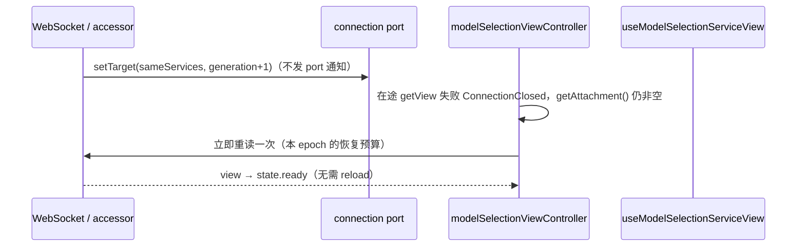

# Spec: 模型目录在 Web 连接换代后自动恢复

## 目标

手机/浏览器 Web 的 RPC 连接换代（WebSocket 断开后重连、前后台切换、facade target 替换）时，模型目录读取要自动恢复：首次目录读取被在途连接拒绝后不得长期卡在 `error`，已有目录要跨代保留，新 attachment 就绪后自动重读，用户无需点击「重试」或刷新页面。

本 spec 只修复「模型目录读取生命周期」与 transport 代际的关系，不改变模型目录、选择语义、RPC/Host 协议，也不改变桌面 `desktop-continuous` 与手机 `web-remote-replayable` 的投递语义。选择变化时的显示连续性仍由 [composer-model-switch-continuity.md](./composer-model-switch-continuity.md) 约束；Web 连接生命周期仍由 [web-remote-reconnect.md](./web-remote-reconnect.md) 约束。

## 现状与根因

`useModelSelectionServiceView`（`packages/ui/src/hooks/useModelSelectionView.ts`）在 effect 内只订阅 `modelSelectionService.onDidChange` 并调用 `getView`。它把一次读取的失败直接当成业务失败：

- 首读失败且尚无目录时写入 `{ status: "error" }`；
- `isTransientReadError` 只识别 `errno` 与浏览器 `TypeError`，不识别 Web facade 在代际切换时抛出的 `ConnectionClosed`；
- hook 没有订阅「底层 attachment 已换代」这一 renderer-local 信号。

Web 的 `SwitchableServiceAccessor` 在页面生命周期内保持 service facade 身份稳定，只在连接换代时替换 target；换代或断线时在途 RPC 会以 `ConnectionClosed` 结束（`packages/web/src/connection/switchableServiceAccessor.ts`）。因此：

```text
首读 getView
  → WebSocket 断开 / target 替换
  → facade 拒绝在途 RPC（ConnectionClosed）
  → hook 写入 error
  → 新 attachment 就绪，但没有恢复订阅
  → error 一直保持到用户手动重试
```

普通本地服务（桌面 stdio Host）没有 transport 换代问题，也没有 connection port；它们保留原有的「读取 + 有界瞬时错误重试」语义。Web 服务同样保留非 `ConnectionClosed` 的瞬时错误重试，因为 RPC 会透传 Host 的 errno/fetch 错误且不伴随 attachment 通知。

## 产品规则

1. **transport 中断不是模型目录失败**：`ConnectionClosed` 等确定的连接代际错误只表示当前 attachment 不可用，不能作为「模型目录读取失败」展示。没有目录时保持 `loading`（等待新 attachment），有目录时保留原目录。
2. **断开期间不发起读取**：service 暴露 connection port 且 `getAttachment()` 为 `null` 时不调用 `getView`，避免在明确不可用的代际上制造失败；等新的非空 attachment 就绪通知。断开本身没有通知，**只有在有在途读取时才会被感知**；没有在途读取时 controller 不知道也不猜测连接状态。
3. **新 attachment 自动重读**：port 通知「新的非空 attachment 已就绪」后立即用当前输入重读，并重置本代恢复预算与瞬时重试次数；恢复由连接信号驱动，不靠超时轮询或无限重试。
4. **attachment 未变但 generation 提升时允许一次只读恢复**：真实 accessor 可能在 service identity 不变的情况下提升 generation，并按 identity 过滤而不发 port 通知（例如 RTC 升级后立即回退合并快照）。若 `ConnectionClosed` 到达时 `getAttachment()` 仍非空，controller 允许**每个恢复轮次一次**立即重读（不排计时器、不无限重试）；该次仍失败则停止自动恢复，保持目录/loading 并等待下一次 port 通知或手动重试。新 attachment 通知或一次成功读取都会开启新的恢复轮次。这是幂等的目录 projection 读取本地恢复，不重放 mutation。
5. **旧结果不能覆盖新结果**：RPC 成功与失败回调必须同时满足「仍是当前请求」「仍是当前 attachment epoch」「未被 dispose」。`onDidChange` 事件本身不携带 requestId；它由 Web facade 的代际守卫隔离旧代事件，controller 再校验 dispose 与当前非空 attachment，带输入时只触发当前输入重读，不直接接管结果。owner/input 变化由 hook 重建 controller，旧 controller 的 `dispose` 使迟到结果无法写状态。
6. **已有目录跨代保留**：目录属主不变（稳定 facade 身份、同一 workspace target），连接换代只影响底层读取，不重建 React ownership，不清空 `status: "ready"` 的目录；`selectionFresh` 仍由输入键决定。
7. **revision 作用域**：controller 有 connection port 时每次重建都以 `-1` 起步（`retainedView` 只供展示，不作为新 controller 的 revision 下限）；初次绑定后的 fresh read 以当前 Host 返回的权威 revision 为准。只有同一 controller 已绑定 attachment 内的事件/读取才使用单调下限，避免同一轮新事件被更旧读取倒退。同一 Host 的 revision 本身单调；服务重启后新 attachment 可以从低值重新开始，旧代高 revision 不得永久压制新代结果。不新增持久化的 attachment/revision 绑定状态。
8. **真正业务失败仍可见**：非 transport 的读取失败且从未读到目录时，仍写入 `error`，用户可手动重试；已有目录时刷新失败仍保留目录且不显示错误。
9. **手动重试保留**：`reload()` 继续通过重建 effect/controller 发起读取；重试时若 attachment 为 `null` 仍按规则 2 等待。
10. **瞬时错误重试不分 port**：Host 可能通过 RPC 透传 `ECONNRESET` / `ETIMEDOUT` / `ECONNREFUSED` / `EAI_AGAIN` 或 fetch `TypeError`，这类错误不伴随 attachment 通知。无论有无 port，当前 attachment 可读时都保留原有 `500ms / 1500ms` 两次有界重试；只有 `ConnectionClosed` 走连接恢复路径，不按瞬时错误重试。断开期间到期的重试只进入等待，不越过 `canRead` 门禁发请求。
11. **无目录时进入读取/等待必须回到 loading**：controller 在没有目录时进入任何一次读取或等待都会先通知 hook 置为 `loading`；已有目录时绝不调用。业务 `error` 之后的 reload、新 attachment 读取或重新等待不会持续显示旧错误。
12. **不改变传输面语义**：不改 `packages/shared`、`packages/web`、`packages/client` 或 Host 协议；桌面连续链路与手机可重放链路不变，不引入第二个目录缓存或订阅 owner。

## 状态所有者与事件顺序

- **模型目录读取 owner**：`useModelSelectionServiceView` 内每一次 effect 对应的 `modelSelectionViewController`。它唯一负责本代读取、失败判定、有界重试与事件提交；hook 只把结果写入 React state。
- **attachment owner**：Web 的 `SwitchableServiceAccessor`。UI 只通过 `getServiceAccessorConnection(service)` 读取当前 attachment 并订阅「新非空 attachment」；UI 不拥有连接生命周期，也不重连。
- **目录展示 owner**：`useModelSelectionView` / `owned` state。跨 effect 复用仍由 `modelSelectionViewState.ts` 的纯函数判定。



事件顺序约束：

1. 先 `setTarget` 再通知 port，通知发生在事件订阅迁移之前；controller 收到通知后立即重置 epoch、恢复预算与重试次数并重读。
2. 断开只把 `getAttachment()` 变为 `null`，不发通知；controller 只有在有在途读取失败时才能感知，并进入等待。
3. 旧代在途读取结果（成功或 `ConnectionClosed`）在 epoch/requestId 不匹配时被丢弃，不写入状态。
4. 普通事件（`onDidChange`）由 facade 的代际守卫隔离旧代；controller 只校验 dispose 与当前非空 attachment。带输入时不能直接接管结果，只更新同代 revision 下限并触发当前输入重读。
5. `ConnectionClosed` 且 attachment 非空时最多立即重读一次；再次失败不再自动重读，避免在同一个“未更换”的 attachment 上忙循环。新的 port 通知会重置预算。

## 接口

新增 `packages/ui/src/hooks/modelSelectionViewController.ts`（无 React 依赖）：

```ts
createModelSelectionViewController({
  service,
  input,
  retainedView,
  resolvedCurrentInput,
  onLoading,
  onView,
  onError,
  scheduleRetry?, // 仅用于测试注入；默认 setTimeout
}): { dispose(): void }
```

- `retainedView`：同一 owner 下可复用的旧目录；只决定失败是否可见并用于展示，不作为有 port controller 的 revision 下限。
- `resolvedCurrentInput`：当前输入是否已解析（决定是否允许首读瞬时重试）。
- `onLoading`：无目录时进入读取或等待的唯一 loading 出口；已有目录绝不可调用。
- `onView` / `onError`：controller 向 hook 报告唯一状态的出口。
- `dispose()`：失效 requestId、取消重试、释放 `onDidChange` 订阅与 connection port 订阅。

`useModelSelectionView.ts` 保留现有公开 API（`useModelSelectionServiceView` / `useModelSelectionView` / re-export 的类型），只把 effect 内读取/订阅生命周期委托给 controller；`onLoading` / `onView` / `onError` 统一在该 controller 内产生，hook 不自行推断。`modelSelectionViewState.ts` 复用与失效判定不变。

## 不变量

- 同一时刻只有一个 controller 能写当前 hook 的目录状态；旧 controller dispose 后不能再写。
- 有目录时任何 transport 换代都不得让 `status` 退回 `loading` 或 `error`；目录字段不因重连丢失。
- `getView` 只在「无 port」或「当前 attachment 非空」时发起。
- revision 下限只在同一 controller 已绑定的 attachment epoch 内生效；换代或重建 controller 必须重新起步。
- 每个恢复轮次遇到 `ConnectionClosed` 最多立即重读一次；新 attachment 通知或成功读取重置该预算。当前输入尚未解析时，瞬时 errno/fetch 错误重试最多两次。
- 无目录的读取/等待必定先经过 `onLoading`，业务 `error` 不会跨越 reload 或新 attachment 读取持续展示。
- 只有 connection port 存在时才把 `ConnectionClosed` 解释为 transport 中断；无 port 服务沿用既有错误分类与有界重试。

## 负面边界

- **不改选择连续性**：`stale`、`selectionFresh`、`projectModelSelectionCatalog` 的语义不变。
- **不改 Web 连接管理**：不新增重连、退避或 health check；不读取浏览器全局对象，不直接依赖 WebSocket 管理器。
- **不改协议与 Host**：不新增 RPC、事件或服务字段。
- **不新增目录缓存/持久化**：目录仍只活在 hook state 中。
- **不把 transport 中断包装成业务错误提示**：断线期间不弹模型目录错误；连接状态由既有连接状态条表达。
- **不引入第二个订阅或轮询**：恢复由 port 通知、一次有界只读重试和 `onDidChange` 驱动；不对断线状态做计时轮询。

## 验收场景

自动测试（`packages/ui/test/modelSelectionViewController.test.ts`，node:test 真实异步）覆盖：

1. 首读在 attachment replacement 中断后，新 attachment 就绪自动重读成功，无需 reload。
2. 断线（`getAttachment()=null`，无通知）期间不发起读取；重连通知后读取成功。
3. `ConnectionClosed` 到达时 attachment 仍非空（无 port 通知的 generation 提升）：立即重读一次并成功。
4. 持续 `ConnectionClosed` 时每个 epoch 只自动重读一次，不忙循环、不重复写 error；新 port 通知重置预算并正常重读。
5. 旧请求后到（迟到成功、迟到 `ConnectionClosed`、迟到业务失败三种独立 promise）不能覆盖新结果。
6. 已有目录跨 attachment 换代保留，读取失败不写 error。
7. 真正的业务失败仍写入 error，手动重建 controller（reload 等价路径）可重新读取。
8. reload 或新 attachment 读取时，无目录状态先回到 loading，不持续展示旧 error。
9. dispose / 输入变化后旧结果不写状态。
10. 无 connection port 的普通服务保留两次有界瞬时重试。
11. 有 port 且 attachment 已连接时，`ECONNRESET` 等非 transport 瞬时错误同样有两次有界重试；不会永久等待不会到来的连接事件。
12. `dispose()` 释放 `onDidChange` 与 connection port 订阅。
13. 新代 revision 低于旧代时仍能提交（revision 作用域按 attachment/controller 重置）。
14. 同一 attachment 内事件 revision 领先时，重读结果不得倒退。

既有回归：`packages/ui/test/modelSelectionViewRetention.test.ts` 的目录复用语义保持不变；`packages/web/test/switchableServiceAccessor.test.ts` 的 port 通知与事件迁移顺序保持不变。

### 交互与 E2E 验收场景

1. 手机 Web 经 HTTPS 冷启动，在首次 `getView` 未完成时从 WSS 切换到 RTC：连接完成后自动显示模型，不需要点击「重试」。
2. 首读期间断开连接后恢复：连接提示由既有连接状态条表达，模型读取不永久停留在错误；已有目录、当前会话和未发送草稿不丢失。
3. 已加载目录后在 WSS、RTC、WSS 之间切换，以及切后台超过 8 秒后回前台：目录持续可见，新连接就绪后重新读取，不自动重发消息。
4. 真正的目录业务失败仍显示「重试」，点击后进入读取状态；读取成功恢复模型选择，旧请求不能覆盖随后切换的输入或 workspace。

未经明确授权不操作运行中的 YCode，不使用 CDP、DevTools 或 UI 自动化。上述浏览器与真机场景未执行时必须如实记录，不能将异步 controller、SSR 或源码断言称为浏览器 E2E。
