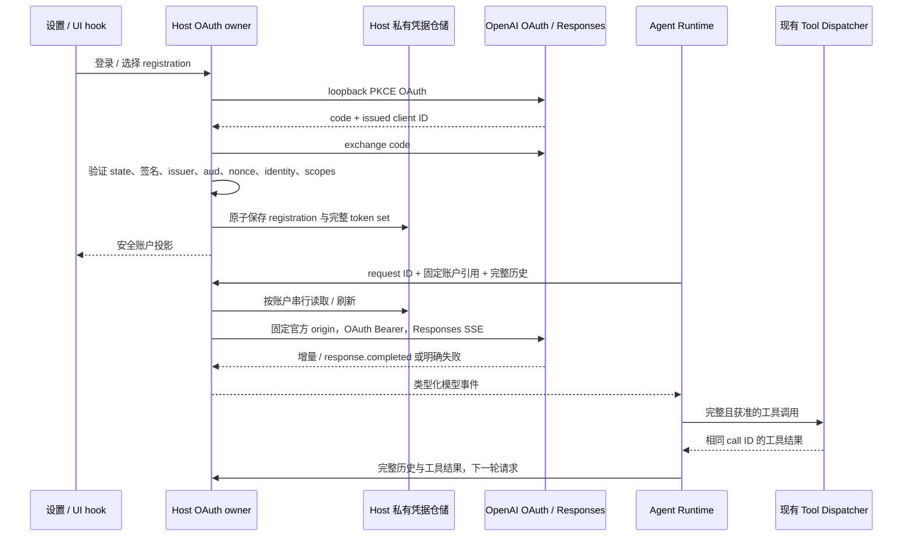

# OpenAI ChatGPT Plan Provider

## 状态与接入门槛

2026-10-18：已实现独立 Provider、Host OAuth 生命周期、Responses 桥接和账户设置。真实用户账户推理与桌面交互 E2E 尚未验收，不能将 mock 通过视为真实订阅接入成功。

实施来源：[实施计划](../../.zcode/plans/sess_24eff225-b80c-49fc-949a-86e9f81a07b1/实施_openai_chatgpt_plan_provider-bce122f9.md)。

选型已确认：不引入或复制官方 DevKit，使用 MIT 许可的 openid-client 实现标准 OAuth/OIDC 流程，独立编写 OpenAI 注册与 Responses 适配。SDK 的 private/非商业许可不再作为阻断点。官方 DevKit 仅用于来源核验，不作为代码依赖。

来源：

- [官方 DevKit package.json](https://github.com/openai/sign-in-with-chatgpt-devkit/blob/main/packages/local/package.json)
- [官方 DevKit LICENSE](https://github.com/openai/sign-in-with-chatgpt-devkit/blob/main/LICENSE)
- [官方集成说明](https://developers.openai.com/cookbook/articles/sign-in-with-chatgpt)

官方公开契约已确认：开源和本地个人项目支持 ChatGPT plan usage，符合资格的 Plus/Pro 用户可以授权；付费或远程托管产品需要另外申请接入。此核验不代表具体用户账户已经获得权限，也不代表已完成真实订阅推理验收。见 [Quickstart](https://developers.openai.com/siwc/quickstart)。

## 产品规则

- 新增独立 ID `openai-chatgpt-plan`，显示名 `OpenAI (ChatGPT Plan)`。不能复用 OpenAI API Key provider 的身份、凭据、目录或错误回退。
- 未登录时仍可看到账户入口，模型不可选；仅身份登录成功但未授予套餐使用权限时同样不可推理。UI 展示这两种状态的区别。
- 模型与账户分别选择和持久化。账户切换后重新获取该账户目录；旧模型不存在时明确要求重新选择，不自动切到其他 provider。
- 设置显示当前账户、授权状态和官方额度管理入口，不显示推测额度，不把 API Platform 余额作为套餐额度。
- 登录按钮使用官方要求的 `Continue with ChatGPT` 文案及对应国际化；额度管理指向 [ChatGPT Settings → Usage](https://chatgpt.com/settings/usage)。
- Desktop 本地 Host 可发起 loopback OAuth。Web、远程 workspace、手机 attachment 不能因为 UI 能调用 RPC 就获得登录能力；只有对应可信本地 Host 能完成回调且环境符合接入条件时才启用。默认不向远端转发本地凭据。

## 实现前边界与当前落点

- `packages/provider/src/config/provider-data-schema.ts`、`provider-config.ts`：已新增 chatgpt-plan access 分支，只保存脱敏账户引用；严格 schema 拒绝把 token 放入 `apiKey`。
- `packages/services/src/model-provider/providerRuntime.ts`：复用现有 Registry、Config Source 和 Facade，不另起 Registry。
- `packages/services/src/oauth/oauth.ts`：现有接口以 active provider 和 deep link URL 为核心，不能直接表示同 provider 多个 registration。
- `packages/services/src/oauth/providers/index.ts`：当前返回空 adapter 列表；不恢复已经移除的供应商 adapter。
- `packages/services/src/oauth/repo/oauthCredentialRepo.ts`：当前凭据 key 以 provider 粒度区分，ChatGPT 必须按 registration 隔离。
- `packages/services/src/credential/credential.ts` 与 `packages/client/src/remoteServiceAccess.ts`：通用凭据 load/save/delete 可经 RPC 调用。因此仅把 ChatGPT token 存进一个普通凭据 key 不满足 Host 私有要求；新增存储必须通过 Host 私有接口隔离，RPC 不可按 key 读取它。
- `apps/zcode-cli/packages/adapters/src/model/model-execution.ts`：现有 AI SDK 请求在 Agent 进程执行。不能把 Host token 传入此处的 request auth、provider config 或环境变量；订阅通道已增加 Host 发起网络请求的专用类型化桥接，其余通道沿用原路径。
- `apps/zcode-cli/packages/bootstrap/src/model-factory.ts`：复用现有模型适配入口和 Runtime 工具循环；专用桥接不成为第二个工具执行器。

以上为已检出源码确认的约束。新接口由 `packages/shared/src/chatgpt-plan.ts` 的严格 schema 和 `packages/services/src/chatgpt-plan/contract.ts` 定义；不依赖旧 OAuthProviderId 的宽泛字符串类型作准入。

## 唯一所有者与接口

Host OAuth 生命周期拥有安装 host ID、pending attempt、registration、活动账户和刷新状态。Host 私有凭据仓储拥有完整 token set；Registry/UI 只消费安全投影。Agent Runtime 拥有模型步骤、工具执行和完整历史，Host 网络适配器不执行工具。

registration 的身份是 issued client ID 与验证后的 issuer/subject 关联，不能用 email 去重。host ID 是每个安装持久化一次的不透明 `urn:uuid:…`，不随重启、账户切换或登出改变。

安全账户投影仅允许稳定账户引用、显示标签、已连接/需登录、授权权限、刷新状态和稳定错误码。禁止返回 access/refresh/ID token、PKCE verifier、含 id_token_hint 的授权 URL、原始 token endpoint 响应及其错误对象。

Host 命令至少涵盖读取投影、开始/取消登录、选择账户、退出、删除账户和刷新模型目录。开始登录返回不含 token 的授权 URL，UI 通过 IPlatformService 打开系统浏览器；重新授权省略可选 id_token_hint，禁止通过 Renderer 返回含 token 的 URL。Agent 请求只携带绑定账户引用、模型、受限请求材料、request ID 和取消关联，不携带可覆盖 endpoint/header。

桌面 `desktop-continuous` 和手机 `web-remote-replayable` 均消费同一 Runtime 事实与既有序号；模型桥接事件不是手机重放日志，不新建 session、Agent 或 Host。沿用 owner/lease、workspaceIdentity/remoteSessionId 和 stale run 校验。

## OAuth 状态与事件顺序

按 [Registration and sign-in](https://developers.openai.com/siwc/token-sharing-open-source/sign-in) 实施：

1. 先启动 `127.0.0.1` HTTP callback listener，再生成本次 state、nonce、PKCE S256。端口可变化，scheme、host、path 不变；禁止替换成 localhost 或 deep link callback。
2. 首次授权使用 `dynamic_agent_client`、实际 app 名称和稳定 host ID；scope 为 `openid profile email offline_access resource.invoke chatgpt.tokens.use.direct`，resource 为 `https://api.openai.com/v1`。
3. 回调先验证 state 与 OAuth error。首次注册必须返回 issued client ID，禁止保存入口 ID；重新授权必须匹配 pending registration 的 issued client ID。
4. 换码使用同一个精确 callback URI、issued client ID 和 verifier。验证 ID token 签名、issuer、audience、exp、nonce；重新授权还须验证 subject 与原 registration 一致。
5. 按 token response 的 granted scopes 判定推理权限，不能相信 callback scope 或仅有有效 ID token。新账户验证完成前不替换当前活动账户。
6. 验证后原子写入身份、issued client ID、scope、access/refresh/ID token 和 expiry。取消、新 attempt、退出、删除增加 generation，迟到结果不得覆盖状态。

按 [Accounts and sessions](https://developers.openai.com/siwc/token-sharing-open-source/profiles-and-sessions) 刷新和退出：

- 同账户刷新跨进程串行化，旋转 refresh token、access token、scope、expiry 原子替换。刷新用已发放 client ID 与原 refresh token，resource 不变，省略 scope。
- 每个请求在 admission 时绑定 registration；活动账户切换不改变已绑定请求。若绑定账户退出或删除，取消其请求并拒绝后续使用，迟到刷新不得重新写回。
- 退出停止使用 token，按 OIDC discovery 提供的 revocation endpoint 撤销 renewable session，再清理本地 token；失败时允许本地退出，但投影必须注明远端撤销未确认。
- 退出保留 registration/client mapping 和 host ID；删除额外清理该 registration 的本地记录。删除与刷新、切换之间必须使用相同事务/锁及 generation 边界。
- 认证、权限和刷新失败不尝试其他账户、API Key、CLIProxy 或自定义 endpoint。

## 模型目录与请求白名单

[Models and inference](https://developers.openai.com/siwc/token-sharing-open-source/models-and-inference) 已确认 `GET https://api.openai.com/v1/models` 支持本通道 OAuth：使用同一绑定账户的 Bearer token；响应为 `models` 数组，保留服务端顺序，只展示 `visibility === "list"`，显示 `display_name`，推理使用 `slug`。不套用普通 API 的 `data[].id` 解析，不凭空维护静态可用模型。

[Preview limitations](https://developers.openai.com/siwc/token-sharing-open-source/preview-limitations) 对本通道额外约束：

- 固定 `POST https://api.openai.com/v1/responses`；禁用重定向到其他 origin，不允许配置替换 base URL、Authorization 或其他认证头。
- 每次强制 `store:false`、`stream:true`，`input` 是数组并带必要完整历史。system 内容转换为 instructions 或 developer message，不发送显式 system message item。
- 专用 allowlist 转换 model、input、instructions、支持的 reasoning/text 选项及工具。禁止透传任意 options。
- 不发送 previous_response_id、prompt_cache_retention、background、conversation、max_output_tokens、max_tool_calls、metadata、moderation、multi_agent、prompt、safety_identifier、temperature、top_logprobs、top_p、truncation、user。
- 函数/custom 工具使用 namespace 或 additional_tools。复用本地工具执行；不发送 hosted MCP、tool_search、programmatic_tool_calling 或其他本通道不支持的 hosted 工具。
- 文本/图片/文件按模型能力转换；不支持的音视频和文件上传不能静默丢弃，发送请求前明确报能力错误。

## 流、工具与失败语义

- SSE 支持分段 UTF-8、跨 chunk frame、多行 data、CRLF。协议解析有大小边界，未知非终止事件可忽略，损坏 JSON 和矛盾终止事件显式失败。
- 转换文本、推理摘要、函数参数增量、调用完成、usage。调用 ID、名称、JSON 参数完整且有效后才提交现有 Dispatcher；不得从参数片段提前执行工具。
- 仅有效 `response.completed` 确认本轮成功。failed、incomplete、error、HTTP 失败、取消、EOF 缺少完成事件全部失败；已输出文本不等于成功。
- 套餐限额错误可能在流开始后到达，包括 subscription_sharing_usage_limit_exceeded 和 subscription_sharing_usage_unavailable；保留稳定错误码，并提供官方管理入口。
- 完成后将工具调用与相同 call ID 的结果成对写入现有历史，下一轮发送完整历史；不依赖服务端存储。
- 缓存 token 仅从服务端 usage.cached_tokens 对应事实映射；缺失为未知，不能当作零或推测命中。
- 本通道禁止套用现有通用模型自动重试策略。只允许在可证明请求未被接受时做规格明确的认证重试；流中断或结果未知时不重放请求和可能已执行的工具。AbortSignal 贯穿 Host 请求与流读取。

## 验收场景

实现前补充相应测试，至少覆盖：

1. provider ID/catalog/access schema 独立；普通 OpenAI API Key 和其他 provider 的请求、参数、工具循环无变化。
2. 正确 OAuth 回调；拒绝 consent；state/nonce/audience/签名不符；issued client ID 缺失或变更；权限缺失；取消后迟到 callback；重授权 subject 不符。
3. 相同邮箱不同 registration 不合并；并发刷新仅发生一次；旋转 token 原子保存；账户切换不改请求绑定；退出/删除后迟到刷新不恢复账户。
4. Renderer、通用 Credential RPC、Agent 协议、模型录制、日志、工具环境和错误 cause 均不暴露 token。
5. 按账户模型目录；切换后刷新；目录失败不展示其他账户缓存为当前可用；缺失模型明确不可选。
6. 固定 origin、无认证覆盖、请求 allowlist、system 转换、命名空间工具；所有禁止字段均不可通过模型 options 绕过。
7. 分段文本/推理/参数、多个调用、无效 JSON、未知 call ID、重复完成、failed/incomplete、HTTP 429、半途限额、断流、取消以及 cached_tokens 缺失。
8. 至少两轮真实 Runtime + mock OAuth/API 工具循环；多个工具、权限拒绝、历史 call ID 配对、重启续接，以及结果未知时不自动重放。
9. Desktop 本地账户管理交互；Web/远程禁用不可达 callback；手机 attachment 复用现有 Runtime，分别验证 continuous 和 replayable 的恢复语义。
10. 用户亲自授权自己的符合条件账户，完成真实 Responses 推理并在 ChatGPT 设置核对归属。自动测试只使用 mock token；未执行该项不得标记真实接入验收完成。

## 初始核验记录（实现前）

- workspace freshness：通过，当前 dev 与 origin/dev 同步。
- 实施前 architecture changed check：通过，0 violations / 0 baseline / 0 new。
- 已读取 provider、services、zcode-cli 受控上下文；当前均为 unmanaged，未发现受控依赖 contract，不能把缺失 contract 当作已具备安全桥接接口。
- 未添加依赖、未启动 OAuth、未访问用户凭据、未操作或重启 YCode。
- 未通过真实账户验证订阅推理，不使用官方 SDK。功能与真实账户验收分别记录，不能互相代替。
- 初始阶段仅新增本规格；随后用户确认通用 OAuth/OIDC 库方案，继续实施。
- `pnpm typecheck`：失败，OffPeakEditView 的 readOnly 声明前使用（2 条）及 StorageSection 的可选函数调用（1 条），均位于本任务未修改的文件。
- `pnpm lint`：失败，82 warnings / 2 errors；错误为 SavedWorkflowDetailView 和 useWebUrlSync 超过 max-lines，均非本任务修改。
- `pnpm fmt:check`：失败，217 个文件存在格式问题；未批量修改无关文件。新规格的单文件格式检查通过。
- 收尾 `pnpm architecture:check --changed`：通过，0 violations / 0 baseline / 0 new。

## 实现决策（2026-10-18）

- Host OAuth owner 暴露显式安全 RPC facade，私有仓储不注册为通用 Credential 服务。使用现有凭据加密适配器与原子私有文件写入、跨进程文件锁；完整 registration 在同一文件事务中更新。
- 专用模型桥接使用现有 stdio 的反向 RPC：open → read（拉取 SSE 字节）→ close，凭据永不进入协议。流关联按 stdio client + request ID 隔离，连接关闭时取消；请求绑定 account ID，read 不能跨连接读取。
- Provider Config 新增 chatgpt-plan access，只保存非敏感 account ID。Host 将活动账户目录发布为现有个人配置中的派生投影，Agent 使用现有 Registry 与文件更新链路；服务端请求仍校验该账户的实际授权和目录，不能靠编辑配置伪造授权。
- 在现有 ConfigService 增加单次原子发布接口，更新该 provider 的 access、模型目录与 discovered rules；不全量覆盖其他个人配置。账户选择和该投影之间以发布结果为可用性门槛，失败向上报错。
- 模型请求用现有 AI SDK Responses 序列化/事件适配和 Tool Dispatcher，注入 Host transport。Host 再执行请求 allowlist、命名空间工具转换和 completed-only 流校验；该 provider 所有自动重试、历史修复重试和空回复重试均禁用。
- 登录管理 channel 仅在 desktop-local 装配，远程 attachment 和手机 socket 排除；手机可消费既有模型 Runtime 事件，不能控制登录。

- 禁止重放的请求在 adapter 错误 context 标记 `requestReplayForbidden:true`。Core stream recovery 和自动 compact 重试均必须尊重该事实；不能只把 adapter maxAttempts 设成 1，因为 Core 有独立恢复预算。

- 跨窗口账户同步复用现有 Broadcast：私有仓储写入成功并释放文件锁后，只广播 `chatgpt-plan:changed` 空负载失效通知。接收 Host 重读同一私有仓储，刷新安全投影并取消已退出账户的流；失效通知不是账户事实，重复通知幂等，安全投影读取不回广播。

- Registry 接受宿主注入的 `chatGPTPlanAvailable` 能力，缺省 false；Web、远程 Host、独立 CLI 即使读到本地账户目录投影，也不能把订阅模型发布为可执行。Desktop 本地 Host 为所属 stdio Agent 注入仅表示能力的布尔环境标记，不包含凭据。保留的 provider ID 不能被 API Key access 冒用。

- `ZCODE_CHATGPT_PLAN_HOST_AVAILABLE` 是由 Host spawn 注入的非敏感环境能力标记。只接受字符串 `1`，其他值/缺失均禁用；不接受个人 Provider 配置覆盖。优先级为 Host 的 desktop-local 装配事实 > 子进程标记 > 默认禁用，独立 CLI 无论环境变量如何均禁用。该标记不授予 API 权限，最终由 Host 私有账户和目录再校验。
- stdio open/read/close 沿用当前 model invocation 的 traceContext，Host 模型生命周期日志只记录 stream ID、模型 ID 和安全错误码，不记录请求体、认证头或 token。

## 手工验收步骤（未执行）

1. 在用户自行构建并启动的本地 Desktop 中打开模型供应商设置，确认独立 ChatGPT Plan 卡片与普通 OpenAI Key 卡片共存。
2. 用户在系统浏览器完成自己的 ChatGPT 账户授权；返回后确认账户、权限状态及服务端模型目录，刷新设置后仍保持一致。
3. 在 Composer 选择订阅模型，执行至少两轮获准的本地文件/终端工具任务，核对调用 ID、结果配对及真实返回内容；在 ChatGPT 用量页核对额度归属。
4. 流中停止、切换账户、退出与重新登录，验证已绑定请求不串用账户，已退出请求取消，不产生 API Key/CLIProxy 请求。
5. 重启后续接本地历史，并分别检查 Desktop continuous 与手机 replayable 的恢复；手机和远程设置不提供登录控制。

未操作、注入、关闭或重启正在运行的 YCode；以上步骤需要后续用户验收或明确授权的测试环境。

## 交付验证记录（2026-10-18）

- OAuth/OIDC 使用 `openid-client@6.8.8`（MIT），未引入或复制 DevKit。
- 相关服务、Provider、真实 SDK/反向 RPC mock 集成及 CLI 回归测试：46 项通过；设置 SSR 测试：2 项通过。多轮集成测试验证请求与工具历史配对，不等同于完整 Runtime 工具权限与桌面 E2E。
- Adapters build、Bootstrap 与 Core 的直接 TypeScript 编译通过；架构检查通过，0 violations / 0 baseline / 0 new。
- 全仓 `pnpm typecheck` 仍失败：OffPeakEditView 的 readOnly 声明前使用（2 条）、StorageSection 的可选函数调用（1 条）；均为任务外文件的既有问题。
- 全仓 `pnpm lint` 仍失败：82 warnings / 2 errors，错误仍为 SavedWorkflowDetailView 与 useWebUrlSync 的 max-lines。目标文件检查没有新增错误；CLI 既有大文件显式 lint 有 6 条 max-lines，未为通过检查而关闭规则。
- `pnpm fmt:check` 仍有 208 个文件格式问题；本任务修改文件单独格式化并检查，未批量修改无关文件。
- CLI 聚合 `typecheck` / `lint` 均因 `turbo: command not found` 无法运行。尝试 frozen install 时现有 CLI manifest 与锁文件不一致，未修改其依赖基线；上述直接编译不能替代聚合检查。
- 真实账户授权、真实额度归属、完整 Runtime 工具权限、多平台交互及 continuous/replayable 恢复 E2E 尚待验收；未访问真实凭据，未操作或重启 YCode。
