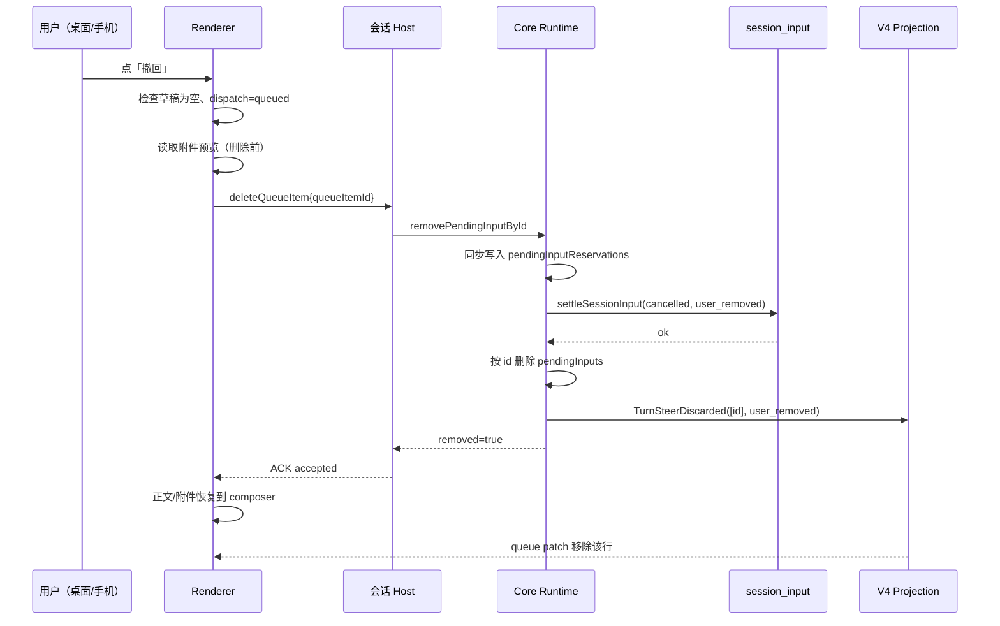
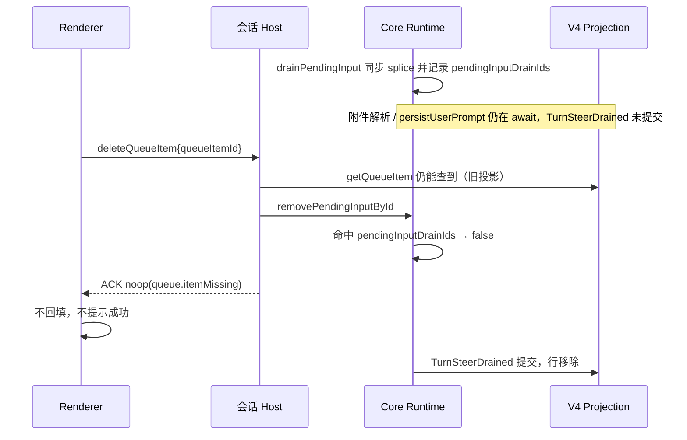
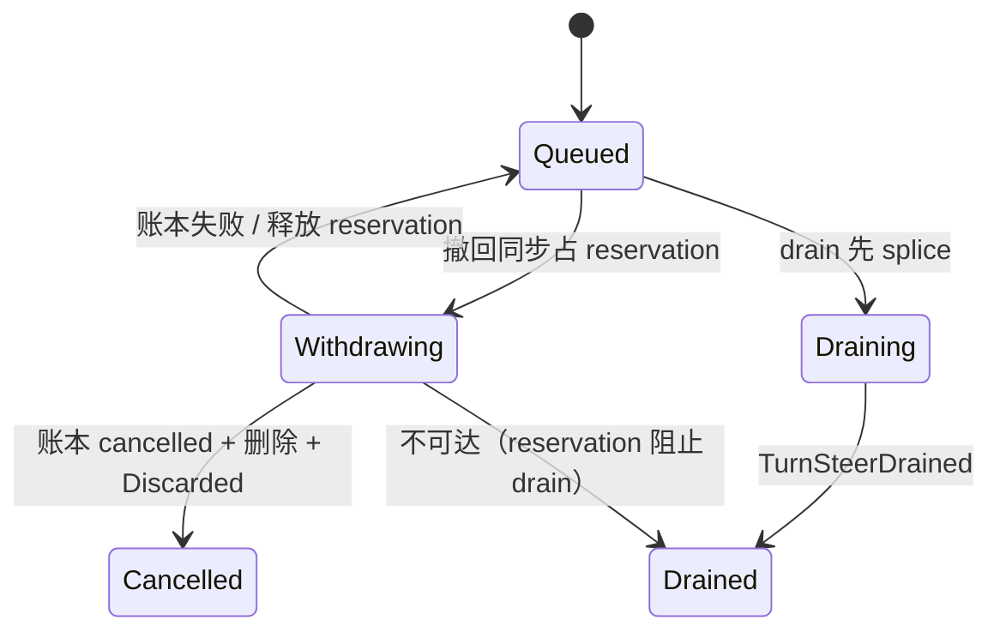

# 待引导消息撤回

> 状态：已实现（未跑 E2E，人工验收场景见第 8 节）。适用面：`packages/ui` 的
> `ConversationPendingGuideList` 与 `apps/zcode-cli` 的 `deleteQueueItem` /
> `removePendingInputById`。

## 1. 问题

当前轮运行期间发送 guide（`delivery.admitted === "guide"`）后，消息以「等待引导当前任务…」
形式显示在时间线，但它既不在 `ConversationQueuePanel` 中（`projectPendingGuideQueue` 把 guide
过滤成 `pendingGuides`），也没有任何删除入口。用户发出后又改变主意时无法撤回。

本功能只补齐**撤回入口与原子边界**，不新增协议命令，也不引入第二队列。

## 2. 产品规则

1. **撤回语义 = 权威取消成功后，把正文与附件恢复到输入框。**
   - 与队列项「编辑」共用同一条恢复管线：先读回附件预览，再发 `deleteQueueItem`，只有 CLI
     权威确认删除后才把 `text` / `attachments` / `mode` / `modelSelection` 写入 composer。
   - 实现复用 `packages/ui/src/v4/SessionPane.tsx` 的 `handleEditQueueItem` 恢复步骤与
     `deleteQueueItem` 命令，不为 guide 另写删除或回填路径。
   - 禁止在命令发出前清空输入框或恢复草稿；禁止用本地快照直接删除行。
2. **非空草稿不覆盖。**
   - composer 已有正文、附件或正在发送时，撤回按钮不执行恢复，保持现有
     `chat.queue.editDraftConflict` 提示语义，不发删除命令（避免用户内容丢失）。
3. **`reserved` / `promoting` 禁用。**
   - guide 行的撤回入口以投影 `queueItem.dispatch.state === "queued"` 为可用条件；
     正在派发时禁用，不发命令。
4. **noop / 已 drain 不回填。**
   - `deleteQueueItem` 返回 `noop`（`queue.itemMissing`，含并发 drain、重复删除、replay 旧快照）
     时不把正文写回输入框，也不报「删除成功」。内容已经进入对话，回填会导致重复发送。
   - `guard.queueItemReserved` 等拒绝同样不回填；可提示重试。
5. **桌面与手机共用同一 owner。**
   - 撤回命令与普通会话命令一样，经 `zcodeAgentService.sendConversationCommandV4` 携带
     `workspaceIdentity` / `remoteSessionId` 路由到该会话的 Host；手机远控复用桌面已有的
     Host attachment 与会话运行时，不另起 Agent、Local Host 或远程会话。
   - 客户端只读投影，不维护 guide 队列副本。
6. **guide 降级为 queue 后仍可撤回。**
   - `TurnSteerDeliveryChanged`（guide → queue）只改变展示归属，`queueItemId` 不变，撤回链路不变。

## 3. 状态所有者

| 事实               | 所有者                                                               | 说明                                                 |
| ------------------ | -------------------------------------------------------------------- | ---------------------------------------------------- |
| 待消费输入（live） | core runtime `activeTurn.pendingInputs`                              | guide 与 queue 共用 `pendingInputId` 空间            |
| 持久 admission     | `session_input` 账本                                                 | `admitted` → `cancelled` / `promoted`                |
| 投影队列项         | v4 投影 `snapshot.queue.items`                                       | UI 唯一可读权威；guide 通过 `delivery.admitted` 分流 |
| 派发中的占用       | core runtime `pendingInputReservations`                              | 撤回与 drain 的互斥锁                                |
| drain 进行中的项   | core runtime `pendingInputDrainIds`                                  | 已 splice、事件未提交；撤回只能 noop                 |
| 行展示             | renderer `projectPendingGuideQueue` + `ConversationPendingGuideList` | 只读，不产生事实                                     |

## 4. 原子胜负边界

撤回与模型步边界 drain 都会消费同一个 pending input，必须由 `pendingInputReservations`
给出唯一胜负：

- **撤回先落锁**：`removePendingInputById` 在第一次 await 前同步写入
  `pendingInputReservations`。`drainPendingInput` 在出队前复查该 map，看到占用即放弃本次
  drain。撤回获胜：账本置 `cancelled`，内存项删除，发 `TurnSteerDiscarded(user_removed)`。
- **drain 先出队**：`drainPendingInput` 先同步 `splice`，再 await 附件解析 / `persistUserPrompt` /
  `TurnSteerDrained` 提交。该窗口内投影仍显示该项；runtime 用 `pendingInputDrainIds` 记录正在
  消费的 id，撤回看到命中即返回 false / noop，**不得**走 `discardHeldPendingInputById`，也不得
  结算账本或按旧索引删除相邻项。
- **真正的 held**：目标项不在 active turn 的 `pendingInputs` 中，也不在 `pendingInputDrainIds`
  中，但仍保留在投影里，才允许按投影删除；包括 `enqueueDeferredInput` 在 turn 内保留的项与
  上一轮结束后的队列。不能因为存在 active turn 或 `pendingInputDrains > 0` 就拒绝全部 held。
- **账本写入失败**：撤回不删除内存项，释放自己写入的 reservation，并向上抛错；输入保持可消费，
  不能出现「composer 已恢复但模型仍会消费」的双份事实。
- **事件写入失败**：账本已结算、内存项已删除，命令以失败返回；不把该次撤回报告为成功，也不
  回滚成第二条可消费输入。投影可能短暂残留，重试由 held/noop 路径幂等收口。
- **caller 已持有 reservation**（`sendQueuedNow` 的 `promoted` 删除）：沿用 caller 的
  `reservationId`，不新建、不在失败时释放 caller 的锁。

关键不变量：

1. 成功返回 `true` 的实现必须已经删除**同一个 id**，且 `TurnSteerDiscarded` 只带该 id。
2. 任意失败路径都不会删除其他 pending input，也不会让其他项从内存静默消失。
3. 不能只靠 await 后重查索引：若没有 reservation，drain 在 await 窗口内消费该项后，
   「撤回成功」会变成模型仍然消费该消息。
4. 不能在 await 前删除、失败后不回滚：那会把输入从 runtime 与账本同时丢掉。
5. 已进入 drain（splice 完成、事件未提交）的项不能被当作 held 撤销。

## 5. 状态时序

### 5.1 撤回成功（撤回赢得锁）



### 5.2 drain await 窗口 / 已 drain（drain 获胜）



### 5.3 撤回进行中被 drain 尝试



### 5.4 UI 按钮状态

```text
dispatch.state !== "queued"           → 禁用
composer 有内容 / busy                → 可点但提示草稿冲突，不发命令
点击后                                → 进入 restoring，按钮禁用
ACK accepted / duplicate              → 回填正文与附件
ACK noop / 已 drain                   → 不回填（内容已在对话中）
ACK rejected（含 reserved 竞争）       → 不回填，提示重试
```

## 6. 与 `deleteQueueItem` 的关系

- 不新增命令、不改信封：guide 撤回复用 `deleteQueueItem { queueItemId }`。
- `deleteQueueItem` 已豁免整会话 revision 相等（见
  `docs/specs/queue-item-command-admission.md`），Web / 手机长间隔投影不会因 revision 落后被拒。
- 投影没有该项 → `noop(queue.itemMissing)`；`dispatch.state !== queued` →
  `guard.queueItemReserved`；runtime 未命中 → 同样 noop。
- `TurnSteerDrained` 与 `TurnSteerDiscarded` 都以 `pendingInputId` 为准；冷恢复的
  `event-reducer` 与 live `removeQueueItems` 语义一致，不会在重启后复活已撤回项。

## 7. 负面边界

- 不在 renderer 建立 guide 队列或本地权威删除。
- 不修改 `session-flow.ts` 的 ACK `delivery` 字段（与本功能无关）。
- 不为撤回新增第二个 command 或第二套 id。
- 不改变 `sendQueuedNow` 的 reserve → promote → remove 生命周期；`promoted` 删除继续沿用
  caller reservation。

## 8. 验收

1. 运行中发送 guide → 显示「等待引导当前任务…」→ 点撤回 → 正文与附件回到输入框，时间线行消失。
2. composer 已有草稿时点撤回 → 不覆盖草稿、不发删除命令。
3. `dispatch.state=reserved/promoting` → 按钮禁用。
4. guide 在模型步边界被消费后再点撤回 → ACK noop，正文不回填。
5. 撤回与 drain 并发（测试用可控 deferred 分别卡住账本与 persist）→ 只允许一方获胜：
   - 撤回先占 reservation：drain 不得消费；
   - drain 先 splice、持久化未完成（投影仍显示该项）：撤回必须 noop，不得按 held 结算账本，
     也不得删除相邻项；
   - active turn 内 `enqueueDeferredInput` 的 held 项、turn 已结束的 held 项仍可撤回。
6. 账本写入失败 → 撤回失败，输入仍可被后续 drain 消费，reservation 已释放。
7. Web / 手机 replay 快照已过期时撤回 → noop，不复活、不重复发送。
8. 冷恢复后已撤回项不出现；`session_resumed` 清扫行为不变。

测试入口：

- 组件入口/禁用/只读：`packages/ui/test/conversationPendingGuideWithdraw.test.ts`（静态渲染，
  锁入口显隐与禁用；点击后恢复与并发仍按第 8 节人工 E2E 验证）
- runtime 并发/失败：`apps/zcode-cli/packages/core/test/removePendingInputRace.test.ts`
- 命令准入：`apps/zcode-cli/packages/bootstrap/test/queueItemCommandAdmission.test.ts`
