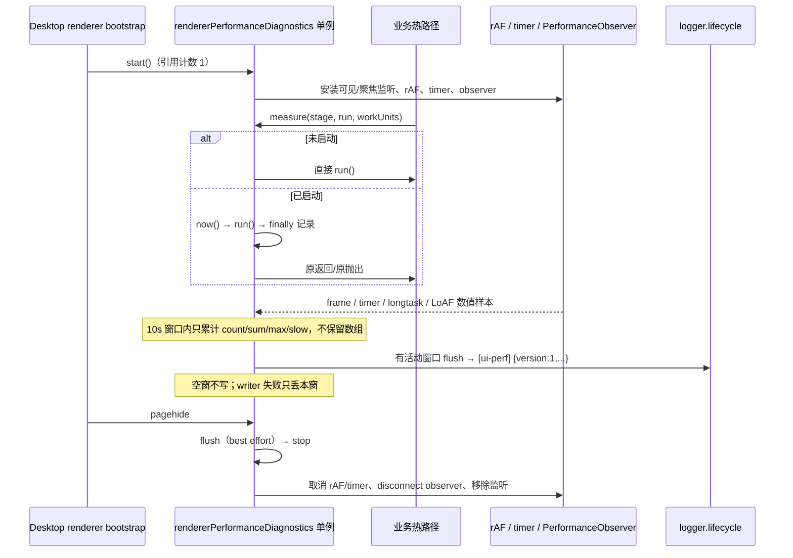

# Spec: Renderer 性能诊断聚合器

## 1. 背景与目标

Electron renderer 的卡顿目前只能靠零散的 `performance.now()`、settings 计时和临时滚动探针判断。需要一套常驻但低开销的本地诊断聚合器，把 renderer 侧的同步工作、浏览器帧/定时器异常、长任务和 Long Animation Frame（LoAF）统一成固定窗口的数值摘要，写入现有桌面日志，供后续定位卡顿使用。

本 spec 只规定诊断观测、所有权、数据形状和清理语义，不规定具体卡顿修复，也不改变会话、投影、渲染或滚动行为。

## 2. 范围与非目标

### 2.1 包含

- UI lib 内一个 renderer 单例聚合器。
- 固定 stage 的同步耗时包装与外部耗时记录 API。
- 10 秒窗口的 count / sum / max / slow 计数，不保留逐样本数组。
- 可见且聚焦时的 rAF 帧间隔与固定 timer 延迟采样。
- `longtask` 与 `long-animation-frame` 的 feature detect、try/catch 观察与原生字段聚合。
- Desktop renderer bootstrap 中每个窗口启动一次；Web 不启动。
- 复用 `logger.lifecycle.info("[ui-perf]", summary)` 的现有本地桥落盘。
- 替换 Desktop renderer 入口中旧的 `[provider-settings-timing]` longtask / heartbeat / Worker 诊断块。

### 2.2 不包含

- 不新增远端上报、ARMS 事件、IPC 协议字段或 `@zcode/shared` 类型。
- 不记录 `sessionId`、workspace path、消息正文、tool name、URL、文件路径、命令行或其他真实内容。
- 不采集用户交互目标、DOM 选择器、组件 props 或 React fiber 树。
- 不改变 Desktop continuous 实时流、Web/mobile replayable 快照与补偿、会话队列或投影语义。
- 不引入 React profiling production build，不修改 React 生产 bundle。
- 不操作、不重启正在运行的 YCode；不使用 CDP、DevTools、UI 自动化或调试协议。

## 3. Stage 与计量语义

### 3.1 固定 stage

stage 是闭合联合类型，后续接线只能使用这些值；新增 stage 必须单独修订本 spec。

```ts
export type RendererPerformanceStage =
  | "conversation.frame"
  | "sessions-index.frame"
  | "sessions-index.items"
  | "conversation.share-units"
  | "conversation.turn-frame"
  | "react.session-pane";
```

| stage                      | 预期接线点                                                                    | `workUnits` 固定含义   |
| -------------------------- | ----------------------------------------------------------------------------- | ---------------------- |
| `conversation.frame`       | `ConversationProjectionStore.handleFrame`（解码后的 store 应用与同步 notify） | 不提供                 |
| `sessions-index.frame`     | `SessionsIndexStore.handleFrame`（解码后的 store 应用）                       | 不提供                 |
| `sessions-index.items`     | `useWorkspaceSessionsIndexItems` 聚合输出                                     | 输出 metas 数          |
| `conversation.share-units` | 会话分享 units 构建                                                           | 输入 rows 数           |
| `conversation.turn-frame`  | `buildConversationTurnRenderUnitFrame` 调用点                                 | 输入 rows 数           |
| `react.session-pane`       | React `<Profiler onRender>`                                                   | 不定义，调用方不得传递 |

- `conversation.frame` 与 `sessions-index.frame` 只测已解码 store 应用和同步 notify，**不提供 workUnits**；不得为了埋点在 `handleFrame` 内解析或重新统计 wire 结构。
- `workUnits` 只表达输入规模，不表达耗时、字节数或用户内容。
- 对未定义 `workUnits` 的 stage，传入值必须被忽略且不进入摘要。
- 同一 stage 的 `workUnits` 口径必须固定，不能在不同调用点混用 rows、metas 等不同单位。

### 3.2 时长含义

- stage 时长是 `run()` 同步执行期间由单调 clock 测得的墙钟耗时，单位为毫秒。
- 只覆盖 `run()` 同步返回前的部分。若 `run()` 返回 Promise，Promise 后续异步阶段不计入本次时长。
- 时长包含同步重入、同步状态更新和同步渲染触发；不区分 React commit、store 更新和数据复制。
- rAF 帧间隔是连续 frame callback 之间的时间差，不等于 render 耗时。
- timer 延迟是固定间隔定时器的实际回调时间与预期时间的差，不等于整个事件循环或进程冻结时长。
- `longtask` duration 使用浏览器原生 entry 字段；LoAF 各字段见第 7 节。
- observer 回调是异步交付的，entry 的原始 `startTime` 可能早于回调到达时间，entry 时长也可能跨窗口；诊断只按回调交付窗口归属，不按 `startTime` 回填已 flush 的窗口。
- 所有时长均不得由日志消费者自行相加推导“精确占比”。

### 3.3 窗口

- 产品窗口固定为 10,000ms；`windowMs` 选项只用于测试注入，不作为用户设置暴露。
- 窗口内只保存累计器：每个 stage 的 count、duration sum/max、slow count、workUnits sum/max；runtime 指标同理。
- 不保存逐条 duration、entry、stack、URL、脚本地址或样本数组。
- 窗口结束时若没有任何 stage 记录，也没有任何 runtime 样本，则不写日志（空窗不刷屏）。
- observer 回调触发时，把该批 entry 的数值记入**当前交付窗口**；不读取 entry.startTime 回填旧窗口，不保留逐条 entry 等待下一个窗口。
- 有活动则每个窗口最多写一条日志；`flush()` 提前结束当前窗口时同样最多一条。
- 所有 stage 与 runtime 指标按窗口归零；跨窗口不累计，不做滚动平均。

## 4. 所有权、启动与清理

- `packages/ui/src/lib/rendererPerformanceDiagnostics.ts` 是唯一所有者，模块级单例状态。
- 单例只保存固定窗口累计器、capabilities、observed 计数、启动引用计数和清理句柄；不持有业务对象、session、DOM 或 React 引用。
- Desktop renderer bootstrap（`packages/desktop/src/renderer/src/main.tsx`）在非 `update-status` 窗口启动一次。
- 每个 BrowserWindow 的 renderer 各自拥有一个单例；不做跨窗口聚合，不写 main 进程状态。
- Web 端不调用 `start`；未启动时所有测量 API 都是 hot-path no-op。
- `start` 使用明确引用计数：
  - 首次调用创建 observer、定时器和监听器，引用计数为 1。
  - 再次调用只增加引用计数，返回独立 handle；首次 options 生效，后续 options 忽略。
  - 每个 handle 的 `stop()` 只减少一次引用计数；重复 `stop()` 无副作用。
  - 引用计数归零时执行严格清理。
- `flush()` 可随时提前关闭当前窗口；多个 handle 共享同一个窗口，任一 `flush()` 都作用于该单例。
- `pagehide` 时执行 best-effort `flush()`，随后停止并清理；`flush` 或 writer 失败不阻止清理。
- 不通过超时掩盖同步问题；不使用后台重试。

## 5. 公共 API

文件：`packages/ui/src/lib/rendererPerformanceDiagnostics.ts`。
公共入口：`packages/ui/src/index.ts` 根导出（desktop renderer 已从 `@zcode/ui` 导入）。不新增 `packages/ui/package.json` subpath。

```ts
export type RendererPerformanceStage =
  | "conversation.frame"
  | "sessions-index.frame"
  | "sessions-index.items"
  | "conversation.share-units"
  | "conversation.turn-frame"
  | "react.session-pane";

export function measureRendererPerformance<T>(
  stage: RendererPerformanceStage,
  run: () => T,
  workUnits?: number,
): T;

export function recordRendererPerformanceDuration(
  stage: RendererPerformanceStage,
  durationMs: number,
  workUnits?: number,
): void;

export interface RendererPerformanceDiagnosticsHandle {
  stop(): void;
  flush(): void;
}

export function startRendererPerformanceDiagnostics(
  options?: RendererPerformanceDiagnosticsOptions,
): RendererPerformanceDiagnosticsHandle;
```

### 5.1 `measureRendererPerformance`

- 未启动或 `enabled: false`：直接执行并返回 `run()`，不调用 clock，不创建 try/finally 计时包装，不记录任何指标。
- 已启动：记录起始时间，执行 `run()`，在 `finally` 中记录耗时后原样返回或原样抛出。
- 诊断代码自身的异常必须被隔离：`run()` 的原返回 identity 保真，抛出的原异常 object/identity 保真；诊断失败不得替换或吞掉业务返回/异常。
- `workUnits` 必须是非负有限数；非法值按未提供处理。

### 5.2 `recordRendererPerformanceDuration`

- 供 React Profiler 或其他无法用 `measure` 包装的同步回调使用。
- 未启动时立即返回。
- `durationMs` 必须是非负有限数；非法值忽略。
- 记录失败不能抛异常，不能影响调用方。
- `workUnits` 规则同 `measureRendererPerformance`。

### 5.3 可注入依赖

`RendererPerformanceDiagnosticsOptions` 至少允许注入：

- `enabled?: boolean`（默认 `true`；仅测试或显式关闭时使用）
- `windowMs?: number`（默认 10,000；测试用）
- `slowThresholdMs?: number`（默认 8；测试用，产品固定 8）
- `now?: () => number`（默认 `performance.now()`，缺失时 `Date.now()`）
- `scheduler?: { setInterval; clearInterval }`
- `observerFactory?: (type, callback) => { observe; disconnect } | null`
- `visibility?: { isVisible(); isFocused(); addEventListener; removeEventListener }`
- `write?: (summary: RendererPerformanceSummaryV1) => void`

生产默认值不得依赖测试注入；所有可选依赖缺失时仍能正常运行或安全降级。

## 6. 聚合指标与日志

### 6.1 Stage 指标

每个有活动的 stage 输出：

```ts
interface RendererPerformanceStageMetrics {
  count: number;
  durationMsSum: number;
  durationMsMax: number;
  /** durationMs >= slowThresholdMs（默认 8ms）的次数。 */
  slowCount: number;
  /** 仅当至少一次调用提供合法 workUnits 时出现。 */
  workUnitsSum?: number;
  workUnitsMax?: number;
}
```

- `count` 是记录次数，不是样本数组长度。
- `durationMsSum` / `durationMsMax` 使用毫秒数值，窗口结束时四舍五入到 0.1ms。
- `slowCount` 按单次 duration 与 8ms 比较，不对 sum 或平均值比较。
- 没有活动的 stage 不出现在 `stages` 中，不输出全零对象。

### 6.2 Runtime 指标

```ts
interface RendererPerformanceRuntimeMetrics {
  raf?: {
    count: number;
    intervalMsSum: number;
    intervalMsMax: number;
    /** 帧间隔严格大于 50ms 的次数；固定异常阈值，不是刷新率预算或掉帧数。 */
    over50msCount: number;
  };
  timer?: {
    count: number;
    delayMsSum: number;
    delayMsMax: number;
  };
  longTask?: {
    count: number;
    durationMsSum?: number;
    durationMsMax?: number;
  };
  loaf?: {
    count: number;
    durationMsSum?: number;
    durationMsMax?: number;
    blockingDurationMsSum?: number;
    blockingDurationMsMax?: number;
    scriptDurationMsSum?: number;
    scriptDurationMsMax?: number;
    forcedStyleAndLayoutDurationMsSum?: number;
    forcedStyleAndLayoutDurationMsMax?: number;
    renderPhaseMsSum?: number;
    renderPhaseMsMax?: number;
    styleAndLayoutPhaseMsSum?: number;
    styleAndLayoutPhaseMsMax?: number;
  };
}
```

- runtime 分类只在当前窗口至少收到一个有效样本时出现；不支持或未观察到数据的分类直接省略，不输出零值占位。
- 分类内个别 observer 字段缺失或非法时省略该字段；合法 `0` 保留（`count` 可增加、sum/max 可为 0）。
- rAF 只记录帧间隔的 count、sum、max 和 `over50msCount`；不计算 p95、刷新率估算或“掉帧数”。
- `over50msCount` 只是固定异常阈值计数，不代表显示器刷新率预算或真实掉帧数量。
- `longtask` 与 `loaf` 可能描述同一段主线程工作，二者**分开报告，不相加**。
- LoAF 的 duration、blockingDuration、scriptDuration、forcedStyleAndLayoutDuration 以及派生 phase 之间也不相加，不要求总和等于 duration。

### 6.3 Capabilities 与 observed

```ts
interface RendererPerformanceCapabilities {
  performanceObserver: boolean;
  longTask: boolean;
  longAnimationFrame: boolean;
  requestAnimationFrame: boolean;
  reactProfiler: "dev-only" | "unavailable";
}

interface RendererPerformanceObserved {
  rafSamples: number;
  timerSamples: number;
  longTaskEntries: number;
  loafEntries: number;
  reactProfilerCallbacks: number;
}
```

- capabilities 只表示能力探测结果；observed 表示本窗口实际收到多少样本/entry/callback。
- 不能因为 capability 为 true 就声称本窗口已有数据。
- `reactProfiler` 在生产构建固定为 `"unavailable"`；在开发构建为 `"dev-only"`。不得声称生产 bundle 的正常 `onRender` 可用。
- capabilities 与 Profiler 接线必须使用同一个 `import.meta.env.DEV` 标记，不混用 `NODE_ENV`、查询参数或额外全局开关。

### 6.4 Summary 与日志规则

```ts
interface RendererPerformanceSummaryV1 {
  version: 1;
  windowMs: number;
  stages: Partial<Record<RendererPerformanceStage, RendererPerformanceStageMetrics>>;
  runtime: RendererPerformanceRuntimeMetrics;
  capabilities: RendererPerformanceCapabilities;
  observed: RendererPerformanceObserved;
}
```

- 写日志固定调用 `logger.lifecycle.info("[ui-perf]", summary)`；summary 是单个对象，不拼接自由文本、不插入真实内容。
- `version` 固定为 `1`。
- 每个有活动的 10 秒窗口最多一条日志；空窗不写。
- writer 抛错时只丢弃当前窗口，不重试、不降级到 console、不影响下一窗口和业务。
- 本次不收集 memory registry context，不引入与 `packages/ui/src/lib/memoryDiagnostics.ts` 的耦合，也不修改 `@zcode/shared`。
- 日志经现有 renderer → 桌面桥 → main logger 落盘，不经过 `logMemoryDiagnostics` 专属接口，不新增 IPC。

## 7. 浏览器 runtime 采集

### 7.1 可见且聚焦

- 只有 `document.visibilityState === "visible"` 且 `document.hasFocus() === true` 时才采样 rAF 帧间隔和固定 timer 延迟。
- 监听 `visibilitychange`、`focus`、`blur`、`pagehide`。
- 切到后台或失焦时：
  - 取消当前 rAF 循环；
  - 丢弃当前帧/定时器 baseline；
  - 不把后台间隔计入任何指标。
- 回到可见且聚焦时：
  - 重新建立 baseline；
  - 首个 rAF 间隔和首个 timer 周期不作为样本；
  - 不补记后台空档。

### 7.2 rAF

- 使用 `requestAnimationFrame` 连续采样，仅在可见且聚焦段内有效。
- 每次回调计算 `now - lastFrameAt`，累加 count、interval sum、interval max；帧间隔严格大于 50ms 时额外累加 `over50msCount`。
- `over50msCount` 是固定异常阈值，不是刷新率预算、掉帧数或 p95 估计。
- 第一帧只建立 baseline，不产生样本。
- rAF 不可用时 capability 为 false，不启动循环，不影响其他指标。

### 7.3 固定 timer

- 使用固定间隔 timer（建议 500ms，具体值在实现中固定并写入测试）测量实际回调时间与预期时间的差。
- 只在可见且聚焦段内累计 count、delay sum、delay max。
- 恢复可见/聚焦后的第一个周期只建立 baseline。
- timer 延迟不是事件循环总卡顿的精确度量，不能据此声称进程冻结时长。

### 7.4 Long Task

- 通过 `PerformanceObserver` 观察 `longtask`，先做 `PerformanceObserver.supportedEntryTypes` 或构造/observe 的 feature detect。
- 所有 observe、callback、disconnect 必须 try/catch。
- 只聚合原生 `entry.duration` 的 count、sum、max。
- 不记录 `entry.name`、attribution、container、脚本 URL 或其他字符串。

### 7.5 Long Animation Frame

- 通过 `PerformanceObserver` 观察 `long-animation-frame`，同样 feature detect + try/catch。
- 每个 entry 读取以下原生字段：
  - `duration`
  - `blockingDuration`
  - `scripts[].duration`：按 entry 求和为 `scriptDurationMs`
  - `scripts[].forcedStyleAndLayoutDuration`：按 entry 求和为 `forcedStyleAndLayoutDurationMs`
- phase 定义（同一 entry 内）：
  - `renderPhaseMs = styleAndLayoutStart - renderStart`，仅当两个时间戳都有效且 `styleAndLayoutStart >= renderStart`。
  - `styleAndLayoutPhaseMs = (startTime + duration) - styleAndLayoutStart`，仅当 `styleAndLayoutStart` 有效且不晚于 entry 结束。
  - 时间戳缺失、为 0 或顺序异常时省略对应字段，不补 0、不猜测。
- 所有 observer 字段先做 finite、非负校验；缺失或非法省略，合法 `0` 保留；不支持该字段的环境不能输出零值伪装“已观测到 0”。
- 这些 phase 由 LoAF 时间戳推导，只能称为“render 阶段”和“style-and-layout 阶段”，**不得称为纯 DOM、纯 layout 或纯 paint 耗时**，也不得声称各 phase 的精确占比。
- 同一 entry 的 duration、blockingDuration、scriptDuration、forcedStyleAndLayoutDuration、renderPhase、styleAndLayoutPhase 可能重叠或覆盖不同侧面，**不相加**。
- observer 回调是异步交付的：entry 的 `startTime` 可能早于回调，entry 也可能跨窗口。整批 entry 只记入**回调交付时仍打开的当前窗口**；不按 `startTime` 回填已 flush 的窗口，不保留逐条 entry 等待下一个窗口。
- 因此 observer 指标只是与窗口关联的证据，不能据此精确还原 entry 的原始发生时刻。
- 不记录 entry 的 scripts 来源、URL、函数名或其他真实内容。

## 8. React Profiler

- `react.session-pane` 只由开发构建中的 React `<Profiler>` `onRender` 回调提供，调用 `recordRendererPerformanceDuration("react.session-pane", actualDuration)`。
- 生产构建默认不启用 profiling，不包装 Profiler、不修改 React bundle、不引入 profiling build。
- 开发构建也必须只记录 `actualDuration` 和回调次数；不记录 component 名、props、state、交互目标。
- capabilities 记录 `"dev-only"` 或 `"unavailable"`；observed 记录实际 `reactProfilerCallbacks` 次数。
- capabilities 与 Profiler 调用点必须使用同一个 `import.meta.env.DEV` 标记；不新增生产 Profiler，不通过运行时开关在生产构建中临时打开 profiling。
- 不能把 `actualDuration` 当作生产 render 成本，也不能在日志或文档中声称生产 `onRender` 正常可用。
- Profiler 自身开销只存在于开发构建，不进入生产验收结论。

## 9. Desktop 集成与旧块替换

- 在 `packages/desktop/src/renderer/src/main.tsx` 的非 `update-status` bootstrap 分支调用一次 `startRendererPerformanceDiagnostics()`。
- 启动点应在 renderer 开始渲染前完成；每个窗口一个单例。
- 删除该文件中现有的旧诊断块：
  - `[provider-settings-timing]` longtask 观察器；
  - 500ms 主线程 heartbeat；
  - Worker 对照 heartbeat。
- 新模块是 renderer 内 longtask / LoAF / rAF / timer 的唯一观察者；其他模块不得再新增重复的 longtask 或 LoAF observer。
- 保留与 startup、launch marks、TTFT、settings view 耗时等无关的既有诊断日志；不要借本次替换删除它们。
- Web/mobile 不启动该模块，不产生 `[ui-perf]` 日志；Web 端调用测量 API 时直接执行原函数。
- 不新增 main 进程状态、协议字段或跨窗口汇总。

## 10. 与 Desktop continuous / Mobile replayable 的关系

```text
Desktop continuous ── 原有实时流/订阅 ──┐
                                        ├─ 仅本地观测 renderer 同步工作
Mobile replayable ── 原有快照/补偿 ─────┘
```

- 诊断器只旁路观察 renderer 本地工作，不消费、不重放、不排序、不缓存任何会话帧。
- Desktop continuous 与 mobile replayable 的 stream、snapshot、queue、owner/lease、重连语义全部保持不变。
- 不对 Web 端启用桌面渲染观测；不在 Web 端新增 no-op 之外的任何链路。

## 11. 事件时序



## 12. 隐私与失败语义

- 日志中只允许出现：固定 stage 名、固定 capability/observed 名、数值、固定版本号、固定窗口长度。
- 禁止出现：sessionId、workspaceIdentity、workspacePath、消息正文、tool name、URL、文件路径、命令行、用户输入、DOM 选择器、脚本地址、函数名。
- 诊断器自身任何异常都不得影响业务：measure/record/writer/observer/clock 的失败只丢当前样本或窗口。
- 未启动时 hot path 不取时间、不创建对象、不注册监听。
- writer 失败不重试、不抛错、不写 console；下一窗口重新开始。
- 诊断数据只落本地日志，不上传、不进入 UI、不影响业务状态。

## 13. 严格清理

`stop()` 或引用计数归零时必须：

1. 取消 rAF 循环；
2. 清除窗口 timer 和所有内部 timeout；
3. 对每个 `PerformanceObserver` 调用 `disconnect()`；
4. 移除 `visibilitychange`、`focus`、`blur`、`pagehide` 监听；
5. 清空当前窗口累计器与 baseline；
6. 将单例标记为未启动，后续 `measure`/`record` 回到直接执行/no-op；
7. 禁止清理后的任何异步回调再写入日志。

`pagehide` 先 best-effort `flush()`，再执行上述清理。`flush()` 与 `stop()` 必须幂等；重复调用不重复写日志、不抛错。

## 14. 测试与验收

建议新增 `packages/ui/test/rendererPerformanceDiagnostics.test.ts`，全部使用注入的 clock、scheduler、observer、visibility 和 writer，不依赖真实等待或运行中的 YCode。

1. **disabled hot path**：未 `start` 时 `measure` 直接返回/抛出，注入的 `now` 调用次数为 0；`record` 为 no-op。
2. **异常保真**：已启动时 `run()` 抛出的同一异常原样抛出，且 finally 仍记录一次耗时。
3. **聚合口径**：固定 stage 的 count、duration sum/max、slowCount（>=8ms）、workUnits sum/max 正确；未定义 workUnits 的 stage 忽略传入值。
4. **无样本数组**：摘要只包含固定计数字段，不出现 durations/entries 数组或逐条对象。
5. **窗口**：10 秒有活动写一条 `[ui-perf]` summary；空窗不写；`flush` 提前关闭最多写一条并归零。
6. **writer 失败**：注入 writer 抛错时当前窗口丢弃、不重试、不抛错，下一窗口仍可正常输出。
7. **引用计数**：两次 `start` 后一次 `stop` 仍运行；第二次 `stop` 后幂等清理；重复 `stop` 无副作用；清理后无定时器/observer/监听残留。
8. **pagehide**：触发一次 flush + 清理；之后无任何日志写入。
9. **可见/聚焦**：hidden 或 blur 时停止采样并重置 baseline；恢复后首帧/首周期不计入，后台间隔不进入指标。
10. **能力探测**：无 `PerformanceObserver`、不支持 `longtask`/`long-animation-frame`、observe 抛错时 capability 为 false，其他指标和业务不受影响。
11. **LoAF 字段**：duration、blockingDuration、scriptDuration、forcedStyleAndLayoutDuration、renderPhase、styleAndLayoutPhase 按原生字段/时间戳正确聚合；字段缺失或非法时省略、合法 0 保留；不同字段不相加。
12. **observer 交付窗口**：entry.startTime 落在更早时间或跨窗口时，仍按 observer 回调到达时的当前窗口归属；不回填已 flush 的窗口；不保留逐条 entry。
13. **rAF 帧间隔**：只聚合 count/sum/max 与严格大于 50ms 的 `over50msCount`；不产生 p95、刷新率或掉帧数。
14. **长任务与 LoAF 分离**：同一时间段内两者都出现时分别计数，不合并、不相加。
15. **React Profiler**：开发构建记录 `actualDuration` 与回调次数，capability 为 `dev-only`；生产构建不调用、不声称可用、不修改 bundle；capability 与 Profiler 接线使用同一 `import.meta.env.DEV` 标记。
16. **Desktop 启动**：renderer main bootstrap 仅在非 `update-status` 窗口启动一次；旧 longtask/heartbeat/Worker 块已移除；其他 startup/TTFT/settings 诊断保留；无重复 longtask/LoAF observer。
17. **Web no-op**：Web 端不启动，measure/record 不产生日志、不安装监听、不创建 observer。
18. **隐私**：构造包含 sessionId/path/text/tool/URL 的调用上下文，摘要中不得出现这些字符串或字段名；不得出现 profiling URL 或逐条样本数组。
19. **架构**：运行 `mise exec -- pnpm architecture:check --changed`，新增文件位于 `packages/ui/src`，无新增跨模块实现依赖或循环依赖。
20. **静态验证**：运行 `mise exec -- pnpm typecheck`、`mise exec -- pnpm lint`、定向 ui 测试；不运行 GUI E2E，不操作正在运行的 YCode。

定向测试命令：

```bash
mise exec -- pnpm --filter @zcode/ui exec tsx --import ./test/helpers/registerAssetStubs.mjs --test "test/rendererPerformanceDiagnostics.test.ts"
```

## 15. 日志查看方法

- Desktop 生产/日常日志：`~/.zcode/v2/logs/YYYY-MM-DD.log`；Windows 通常为 `%USERPROFILE%\.zcode\v2\logs\YYYY-MM-DD.log`。
- 隔离开发环境按 `ZCODE_DATA_BASE_DIR` 下的 `.zcode-dev-home` 日志目录查找。
- 搜索固定前缀 `[ui-perf]`；每个有活动的 10 秒窗口预期最多一行，summary 带 `version: 1`。
- 日志只在本机；不通过 ARMS、server 或远端 relay 查询。
- 若一天内没有活动窗口，不应出现周期性的空日志行。

## 16. 不能归因的事项

- stage 耗时只能说明该同步函数本身及其同步调用链的墙钟时间，不能单独证明是 React commit、store diff、DOM 操作还是数据复制导致。
- LoAF 的 render/style-and-layout phase 只是原生时间戳推导值，不是纯 DOM/layout/paint 分类，也不是精确占比。
- longtask 与 LoAF 可能描述同一段工作，二者不相加；不能把两者之和称为总阻塞时长。
- rAF 帧间隔包含浏览器调度、合成器、可见性节流和机器负载影响；timer 延迟不等于事件循环或进程冻结的精确时长。
- 诊断器不采样网络、IPC、CLI、Host、远端链路，不能据此归因远端或协议延迟。
- 生产构建没有 React Profiler 数据；不能声称生产 `onRender` 正常可用或据此推算生产 render 成本。
- 日志不含 session/path/text/tool/URL，不能按会话、文件或工具归因；也不能跨机器、跨版本直接比较绝对值。
- 本诊断只提供关联证据，不自动给出根因结论，也不改变任何业务状态。
