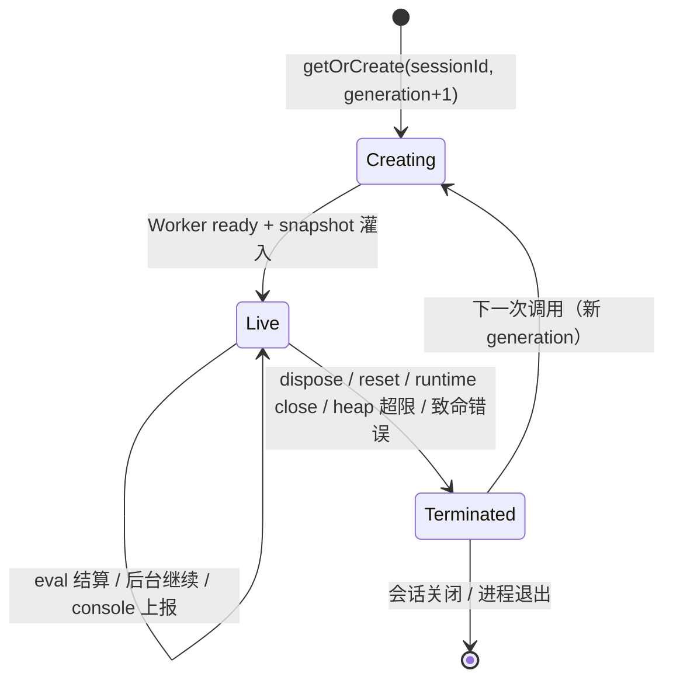
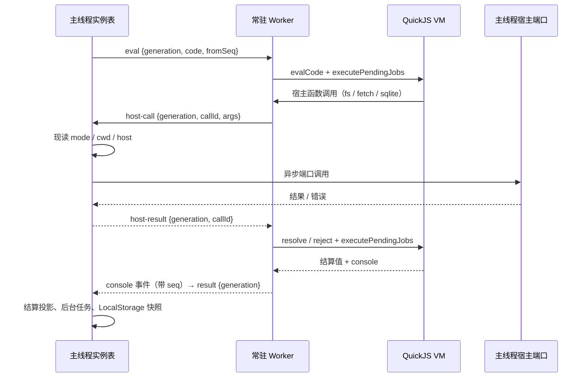
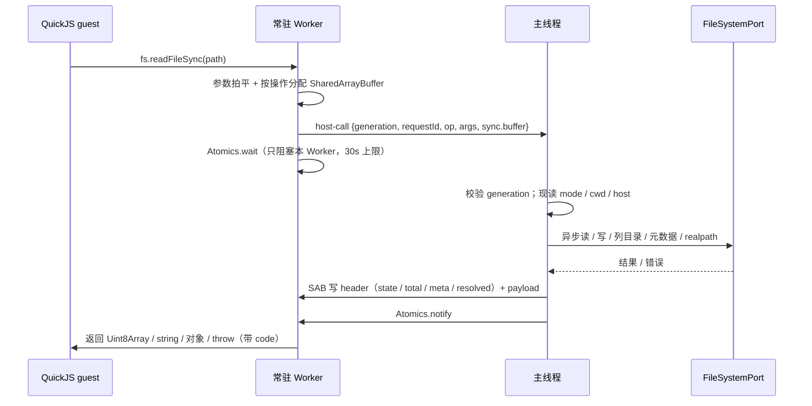
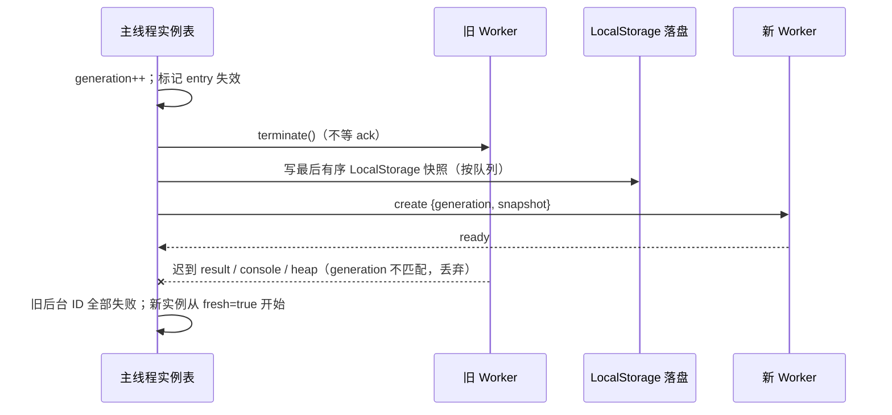
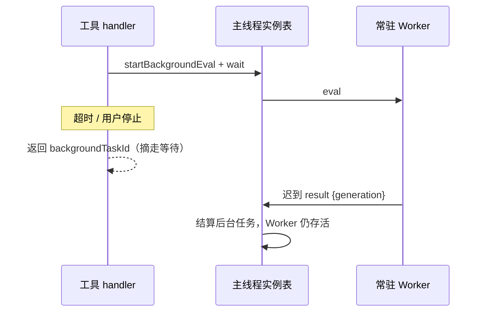

# Spec: Sandbox 内置系统工具（QuickJS 隔离计算面）

## 目标

给模型一个和 History 同级的 always-on 系统工具 `Sandbox`：在隔离的 QuickJS 实例里跑纯 JS 计算，不弹审批、不改工作区。

第一版岗位是纯计算面。文件系统、网络等宿主能力由我们接到沙盒里，不来自引擎本身；接上之后仍不向用户询问。工作区写跟会话档位绑定（Ask / Plan 只读，Agent 可写；只读档写文件直接失败）。出站 `fetch` 三档都放行，不弹审批。

现有特权 `js`（node_repl，给 Browser / Computer Use 当宿主）第一版不改分工说明，稳定后再拆。

## 实现状态（本规格的落地边界）

本文件包含两类内容，阅读和引用时必须区分：

- **现状（阶段 1 已落地）**：per-session 活实例常驻在独立 `worker_threads` Worker 中；QuickJS VM、global、定时器、微任务、LocalStorage 活态和宿主调用都在该 Worker 内，主线程只做生命周期、投影与宿主端口代理。异步 FS / fetch / 只读 SQLite、后台执行、控制台投影保持原有行为。
- **现状（阶段 2 已落地）**：同步 FS 白名单（15 个 `*Sync`）经 Worker → 主线程的 `Atomics.wait` / `Atomics.notify` 桥复用同一 `FileSystemPort`、同一路径解析与同一档位检查；主线程从不阻塞。工具 description、系统 Prompt 与 `sandbox` 技能手册已同步为支持同步形式的文案。

落地顺序：阶段 1（Worker 生命周期与 generation 隔离，本文「常驻 Worker」一节与验收 31–38）已完成；阶段 2 是同步 FS 白名单与桥（验收 39–43、45）。两步共用同一端口、同一宿主路径，没有为同步 FS 另开绕过 `FileSystemPort` 的旁路。

## 产品规则

### 注册与档位

- `Sandbox` 为 always-on 内置系统工具，无灰度门。主会话、子代理、桌面、Web、独立 CLI 均注册。
- 永不向用户弹审批。Ask / Plan 档也放行：会话内内存、LocalStorage、工作区只读 FS（`fs.promises` 读类）、全局 `fetch`（跟服务器通讯），以及把一个文件读进来 eval；不改工作区。Agent 档可通过同一套 `fs.promises` 写回工作区，仍不询问。`fetch` 三档都能发，不走 WebFetch 的按域名审批。
- **岗位（模型分流）**：Ask / Plan 是首要场景——这两档里 Bash **只放行少量白名单命令**（不是「凡只读 / 无副作用就能跑」；没在名单里会被拒，与命令是否真有副作用无关），`Sandbox` 仍可用。接到沙盒里的工作区写按会话工作模式挡（Ask / Plan 只读，Agent 可写）；出站 `fetch` 不按档位挡。Agent 不强制分流，Bash 对工作区通常更强。Bare 拒 `Sandbox`。工具 description 只保留短能力句；何时用写在系统 Prompt 的 Collaboration modes 段，怎么用写在官方 `sandbox` 技能（按需加载，不常驻）。对模型的文案必须写「白名单」，不得写成「只读命令子集」。
- 聊天卡对齐 Bash：模型必须写一句话说明；折叠行只显示这句，源码和输出在展开态。超长输出对齐 Bash（内联有上限，超出落产物，模型拿预览和引用）。
- 超时对齐 Bash：默认 120 秒，模型最多改到 600 秒。

### 聊天工具卡（display payload 通道）

> 学 History 三工具的「聊天工具卡」一节：display 载荷只挂协议 metadata，不进模型上下文。

- **模型通道零改动**：handler、Output schema、`formatModelContent` 文本投影保持原样；display 载荷只挂 `completedToolPartMetadata.display`，由渲染层消费。
- **折叠行只显示必填说明**：模型传入的 `description`（一句话说明）是折叠行的唯一主体，渲染器直接从 `toolCall.input` 读（Bash 卡同款 `getExecuteDescription` 惯例），不经 display 载荷转手、不解析文本投影。display 载荷只带状态与后台 ID。
- **展开态**：源码/路径 + 输出（return 文本 + console），渲染 wire 上已有的 `output.text`（即模型读到的同一段文本），不再 raw JSON 转储。后台态显示“已在后台”（带 task ID），不把代码当摘要。
- **纯只读**：卡上无按钮、无跳转；只保留工具卡框架自带的展开/收起与失败状态。
- **降级**：display 缺席时折叠行只剩 kindLabel（有输入兜底时显示 description），展开态仍显示文本投影；不出 raw JSON、不报错。
- **工具身份与渲染分流**：现役 wire 名为 `JSVM`，历史会话中的 `Sandbox` 是兼容别名；共享 `normalizeZCodeToolName` 将两者规范为 `JSVM`。两名登记在 `ZCODE_KNOWN_TOOL_NAMES`，但不登记跨端 tool family，避免进入通用工具分类；`resolveRenderer` 按规范名分流到沙盒卡。状态面板的时间线证据同样兼容新旧名，且仅在实例状态未判定时作为入口临时依据。`shell` family 的旧 kind 识别不按沙盒工具名匹配。

display 载荷（一个 kind，contracts/shared 两侧 strict schema 逐字段同步）：

| kind      | 字段                                                         | 折叠行示例              |
| --------- | ------------------------------------------------------------ | ----------------------- |
| `sandbox` | `status: success\|failed\|backgrounded`、`backgroundTaskId?` | 沙盒计算 · “一句话说明” |

折叠行的说明文本渲染器从 `toolCall.input.description` 读（与 Bash 卡同惯例），不进载荷——模型通道零改动，载荷只做状态区分。display 缺席时折叠行退回同一输入侧字段，行为不变。

新增 kind 必须同回合改齐：contracts 载荷 schema、contracts union、shared 镜像 schema、shared 双 union、bootstrap 白名单——任何一侧 strict 缺成员，整块 display 被剥、卡退化成 kindLabel 一行（fail-closed，不报错）。

### 代码从哪来

- 每次调用必须提供内联 JavaScript 源码 `code`；不再提供独立文件路径执行入口。需要执行脚本文件时，调用方应通过 `code` 提供源码，或使用 JSVM 当前明确开放的运行时能力；本沙盒不提供子进程/shell 执行。
- 缺少 `code` 或提供已废弃的 `filePath` 均作为输入校验错误拒绝，不执行。历史工具调用记录可按既有方式展示，不新增 `filePath` 执行或重放兼容。
- `code` 中的 `import` 仍只解析受限模块注册表；不支持任意本地 ESM 文件加载。
  依据：JSVM 的执行入口统一为源码，避免工具层路径预读取绕过沙盒模块与资源边界。
- 活世界另有受限模块面：`require` 与 `import` / `import()` 只解析 `fs` / `node:fs` / `fs/promises` / `node:fs/promises` / `path` / `node:path` / `sqlite` / `node:sqlite`，与全局 `fs` / `path` 同一对象（`sqlite` 是宿主只读查询面，见「宿主 SQLite」一节）。其它模块立即说明沙盒没有 Node 模块加载（码 `SANDBOX_NO_MODULE`），不得把引擎的 “could not load module” 原样交给模型。仍不做任意文件的 ESM 加载。

### 活实例与内存（Worker 化，阶段 1 已落地）

- 每个会话一份活实例（含子代理：各用各的实例和 LocalStorage，互不可见）。**每份活实例 = 一个常驻 QuickJS Worker**；VM、global、LocalStorage 活态、定时器、微任务 / job 队列全部只存在于该 Worker 线程。主线程不再创建或持有 QuickJS VM。
- 同一活实例上的多次调用共享同一份 JS 世界；要跨调用留住值，须挂到全局。交回之后还没跑完的定时器 / Promise 留在 Worker 里继续跑，下次调用看得到副作用。
- 新代码一到就交给 Worker eval，和残留定时器在同一事件循环里交错，不等上一轮交回；主线程只负责排队与投影，不参与 JS 执行。
- 活实例跟会话 runtime 一起死（主线程 terminate Worker；常驻池回收、进程退出同样）。另有硬顶：活实例堆内存（不含 LocalStorage）超过 128MB 则销毁整份实例。堆硬顶由 Worker 侧 `memoryLimit` 与结算后测量共同执行；主线程收到超限投影时也 terminate 作为兜底。
- 常驻不变量（实现侧写清，产品规则不变）：有未完成的沙盒后台任务时，该会话计入 `hasResidencyBlockingWork`（与 Bash 后台同一口径），常驻池不得按空闲回收；堆空闲、事件循环已空的活实例不钉住会话，可回收（Worker 终止、堆消失、LocalStorage 仍在、下次调用带新实例提示）。
- 新建实例后的**第一次** `Sandbox` 调用，在工具返回里包一段提示：这是新实例，旧堆内存没了，LocalStorage 还在。提示走工具返回文本（可包 `<system-reminder>`），不必另开通道。只写这一次。
- **CPU 死循环**：主线程不得等待 Worker 接受任何消息才能重置 / 销毁；`dispose` / `reset` 直接 `worker.terminate()`，这是从死循环中脱身的唯一可靠手段。前台超时只摘等待，不 terminate、不杀 JS。

### 常驻 Worker 所有权与跨线程边界（阶段 1 已落地）

#### 唯一所有者

| 状态 / 职责                                                            | 唯一所有者                             | 其它层怎么用                                            |
| ---------------------------------------------------------------------- | -------------------------------------- | ------------------------------------------------------- |
| QuickJS VM、global、定时器、microtask / job 队列、当前交错的 eval      | 会话的常驻 Worker                      | 主线程只发送 eval / evalUser / 读取投影命令             |
| 实例生命周期、generation、活 / 死判定、create / dispose / reset 串行化 | 主线程实例表（`SandboxInstanceTable`） | 控制台、状态面板、V4 命令只读主线程投影                 |
| 后台任务登记、taskId、waiter、终态                                     | 主线程实例表 / 后台管理器              | TaskOutput 从主线程读，不向 Worker 查任务表             |
| 宿主端口服务：`FileSystemPort` / `HttpClientPort` / `SqliteReadPort`   | 主线程（按 sessionId 现取）            | Worker 通过 host-call 代理请求；Worker 不直接拿端口对象 |
| console 环、heap 投影、LocalStorage 派生投影、执行行                   | 主线程实例表（有界投影）               | 工具结果、控制台 tab、状态面板只读这一份                |
| LocalStorage 活态与配额校验                                            | Worker 内的 VM / LocalStorage 实现     | 每次变更按序上报主线程；主线程只保存最后有序快照并落盘  |

- **主线程永不执行 JS、永不 `Atomics.wait`、永不直接调用 `node:fs` 为沙盒服务。** 文件、网络、SQLite 一律经现有异步端口。
- Worker 只做三件事：跑 VM、把宿主调用转成跨线程请求、把 console / heap / LocalStorage 变化按序上报。Worker 不持有 taskId 表、不落盘、不判断会话档位。
- 控制台存在性查询读主线程实例表的 entry，不向 Worker 发“你还在吗”询问。

#### 消息隔离与 generation

- 每次创建实例分配单调递增的 `generation`；`workerData` 携带 `{ sessionId, generation, localStorageSnapshot, wasmUrl }`。
- 每个方向的消息都带 `{ generation, workerId }`。主线程只接受「当前表的 entry、当前 Worker 实例、当前 generation」三者同时匹配的消息；任一不匹配即丢弃，不报错、不改状态。
- 旧 generation 的 eval 结果、host-result、console 事件、heap 上报、后台结算**不得**写入新实例的 console 环、后台表、LocalStorage 投影、`fresh` 提示位或活 / 死判定。旧请求的结果不能复活新实例。
- 主线程在执行宿主调用前校验 generation：陈旧请求直接返回 `SANDBOX_FS_STALE_GENERATION`（或对应端口错误），不发起端口调用。已经进入端口的单个写调用允许自然完成，但其结果不得回写任何新实例状态；后续请求不再发起。
- `reset` / `dispose` 先递增 generation 并 `terminate()`，再处理快照；不向 Worker 发送「请关闭」消息。因此 Worker 处于 `while(true){}` 时 reset 仍能在主线程立即完成。
- 除 generation 外，实例表还维护 per-session `epoch`。`reset` / `dispose` 推进 epoch；异步创建完成时若 epoch 已变化，直接销毁刚建好的实例并让原调用失败（`sandbox_disposed`），绝不把旧调用落到新实例继续执行。这是 CPU 死循环期间「eval 还在等创建、reset 已经开始」的隔离边界。

#### Worker 生命周期状态



- `Creating` 与 `Terminated` 都由主线程串行化（同会话同时只有一个创建 / 重置在飞；后到者等待并从最终状态继续）。
- 创建失败不留下半初始化 entry；下一次调用重新尝试。LocalStorage 快照读取失败按现有非致命策略处理（空世界启动，不阻断实例）。

#### 一次 eval 的跨线程时序



- console 事件与 result 都从 Worker 发往主线程，同一 Worker 的消息按发送顺序到达；主线程先落 console 投影再处理 result，因此 eval 窗口包含结算前产生的全部行（含残留定时器交错输出）。console 环仍是主线程的有界投影（2000 行 / 单行 8KiB），超限按现有规则标记截断。
- Worker 不维护第二份权威 console 环；本地只允许有界暂存，且不得改变主线程投影的结果。

#### 同步 FS 桥（阶段 2 已落地）



- **主线程永不被同步调用阻塞**：主线程收到带 `sync.buffer` 的 `host-call` 后走与异步 FS 完全相同的端口、路径解析和档位检查，完成后把结果写入共享缓冲并 `Atomics.notify`。
- **分帧**：SAB 前 16 字节是 4 个 `Int32`：`state`（0 等待 / 1 成功 / 2 失败）、`totalBytes`、`metaBytes`、`resolved`（幂等守卫）。payload 为 JSON 元数据 + 可选原始字节；文本走 UTF-8 原始字节，二进制直接传原始字节，不做 JSON 转义。
- **按操作容量**：`fs.readFile` 为 16MiB + 64KiB 元数据余量；`fs.readdir` 4MiB；其它 64KiB。结果超容量或元数据无法序列化时，改写成 `SANDBOX_FS_SYNC_BRIDGE` 错误并照常 notify，不截断、不增长缓冲。
- Worker 侧 `Atomics.wait` 只阻塞该会话的 Worker；其它会话的 Worker、主线程事件循环、V4 命令、控制台轮询继续工作。等待超时（30s）按 `SANDBOX_FS_SYNC_BRIDGE` 失败。
- 每个被接受的同步请求在所有路径（成功、端口缺失、只读拒绝、超限、序列化失败、generation 陈旧、实例已销毁）都恰好 notify 一次：`resolved` 守卫保证重复写入也不会二次唤醒；陈旧的 `host-call` 由主线程直接写入 `SANDBOX_FS_STALE_GENERATION` / `sandbox_disposed` 后 notify。Worker 被 terminate 时等待随线程结束，不需要额外清理。
- 读结果单文件仍受 16MiB 上限（超限 `SANDBOX_FS_TOO_LARGE`，失败不截断）；写数据由请求消息携带（字符串或 `Uint8Array`），不新增写体积产品上限。
- 同步桥不是第二个执行权威：路径解析、档位、端口选择、错误映射全部复用主线程异步实现；Worker 不直接 `require("node:fs")`，也不透传宿主句柄。
- 宿主侧错误码在 guest 内重建（quickjs-wasi 的宿主错误会丢 `code`）：宿主函数返回 `{ok, value|error, token}`，guest 包装器据此构造带 `code` / `name` 的 Error。结果对象读取后调用 `__sandboxSyncRelease` 释放宿主引用；缓存单例（`true` / `false` / `null` / `undefined`）只引用不释放。

#### reset / dispose 时序（忙 Worker 也能立即重置）



- 重置不等 Worker 接受消息，因此忙 Worker（CPU 死循环）也能立刻重置。
- LocalStorage 最后有序快照由主线程按变更事件顺序应用；同一会话的落盘共用一条 promise 链，后一次保存挂在前一次之后执行，先产生的快照不会后完成并覆盖新快照。重置时刻之后的旧实例结算不得写入快照、消耗新实例提示位或销毁新实例。

#### 前台超时与后台（不杀 JS）



- 超时、用户停止、调用方 abort 都只把这次调用摘成后台；不 terminate Worker、不打断 JS、不取消在飞的 fetch。
- 只有坏 VM、堆超限、重置、会话回收、进程退出才终止 Worker。

### 常驻 Worker 的发行资产（阶段 1 已落地）

- 新增独立 Worker 产物 `sandbox-worker.cjs`（名称实现时锁定），必须与 `zcode.cjs`、`quickjs.wasm` 同目录分发。不能依赖 `import.meta.url`：Worker 入口由主线程经 `__dirname` / `argv[1]` / SEA 物化定位，wasm 由主线程解析后经 `workerData` 传入。
- SEA：新增 `sandbox-worker` 与现有 `quickjs-wasm` asset；首次定位时用 `fs.mkdtempSync(os.tmpdir(), "zcode-sandbox-worker-")` 建**每进程独享**目录，无条件从本进程 SEA 读取两个 asset 写入同一目录，再以该目录下的路径拉起 Worker 并传 wasm。不得按固定临时路径 `existsSync` 复用文件：发布更新后必须运行新二进制内嵌的 `sandbox-worker.cjs` / `quickjs.wasm`，不能拿到磁盘上的旧版本；不同进程 / 不同版本各持独立目录，互不覆写对方仍在使用的产物。缺任一 asset 时直接抛错（不缓存、不读同级 sibling、不静默回退主线程 VM）；同一进程重复定位返回同一缓存。
- SEA 物化只属于 bootstrap 资产操作：banner 中的 `node:fs` 仅用于把自身内嵌 asset 写到临时目录；guest 代码里的 `node:fs` 是注入的沙盒 FS 投影，core 主线程不以 `node:fs` 直接读写工作区。临时目录不主动删除，避免与仍在启动的 Worker 读取竞争，交由系统临时目录清理。
- 桌面 dev / 安装包、旧远端预构建资源、server CLI 发行包、远端生产 / 开发部署、独立 CLI 包都必须携带 `sandbox-worker.cjs` 与 `quickjs.wasm`；桌面 bundle 复用判定与远端部署复用判定都把这两个文件列为必需资产。
- 远端生产部署的必需资产清单（`zcodeAgentAssetPaths.ts`）同时包含 `zcode.cjs`、History / SQLite worker、`sandbox-worker.cjs` 与 `quickjs.wasm`；跳过判定读取该清单，安装动作使用同一组文件名常量，旧远端缺任一文件即重新部署。开发态 hash 与存在性判定使用同一组文件名。
- 桌面安装包的 `afterPack` 对 `resources/glm` 做存在性断言，缺 `zcode.cjs`、sidecar、两个只读 worker、`sandbox-worker.cjs` 或 `quickjs.wasm` 时直接阻断打包。
- 缺少任一资产时构建 / 暂存失败；桌面构建应重建不完整的本地 bundle，远端部署必须重新部署缺失资产。不得在运行时静默降级回主线程 VM（那会重新引入 CPU 死循环阻塞 CLI 的问题）。
- 现有 `sqlite-read-lane-worker.cjs`、`history-read-lane-worker.cjs` 的资产规则不变；沙盒 Worker 是新的独立入口，不与这两个车道合并。

### LocalStorage

- 每会话一份，行为像浏览器 LocalStorage，上限 5MB。存满再写 → 这次写入抛错（像配额超出），实例还在，已有数据不动；若脚本没接住，按普通未接住抛错处理。
- **活态归 Worker，投影归主线程**：`getItem` / `setItem` 等同步语义只在 Worker 内的活态上执行；每次成功变更按序上报主线程，主线程保存与该 generation 绑定的最后有序快照（不超过 5MB）。主线程是唯一落盘者，写入仍走现有异步 `FileSystemPort`。
- 旧 generation 的 LocalStorage 事件不得写入新 generation 的快照；重置使用主线程最后有序快照，不等待忙 Worker 回消息。
- 新数据写入 `<ycodeDataBaseDir>/.ycode/cli/sandbox/<sanitize(sessionId)>/local-storage.json`；默认 `<home>/.ycode/cli/sandbox/...`。数据根由启动时的 YCode `dataBaseDir` 决定。
- 软件重启后还在；归档不清；经存储清理删除（全清或按会话清）。
- 存储管理里作为单独一项计占用。用户可以一键清全部会话，也可以按会话勾选清。
- 旧 `<storageRoot>/cli/sandbox/...`（通常位于 `.zcode`）文件不读取、不迁移、不复制、不回退，也不删除；本次只改变沙盒 LocalStorage 的新写入位置，不迁移项目记忆或其他 CLI 数据。

### 存储管理（阶段6）

> 落盘路径：`<ycodeDataBaseDir>/.ycode/cli/sandbox/<sanitize(sessionId)>/local-storage.json`（扫描相对路径即 `cli/sandbox/...`）。一会话一目录，与计划目录同形。

- **重置保存顺序**：同一会话只由当前 generation 的 Worker 持有 LocalStorage 活态，主线程持有最后有序快照。重置先递增 generation、立即 terminate 旧 Worker（不等其回消息），再按会话顺序写入主线程最后有序快照；写入结束后才允许创建 / 读取新实例。重置时刻之后，旧 generation 的结算不得写入快照、消耗新实例提示位或销毁新实例。
- **保存队列**：同会话的结算保存与重置快照共用一条按会话串行的 promise 链，每次保存挂在上一次之后，按主线程应用 mutation 的顺序写入，避免旧快照在新快照之后完成并覆盖新值。保存失败继续沿用 LocalStorage 存储层的非致命处理策略；内存实例不因普通结算保存失败而报错。
- **无迁移**：只有新 `.ycode/cli/sandbox` 路径是读写来源；即使旧 `.zcode` 路径存在且内容有效，也按新会话空存储处理。

#### 单独类别

- **单独类别**：`sandbox`（沙盒 LocalStorage），`cleanability: safe`（LocalStorage 可再生：删掉后下次调用重建空世界，堆内存不受影响）。catalog 前缀规则 `cli/sandbox` 递归聚合，下钻明细按会话目录（entryKey = `cli/sandbox/<session>`）。适用于 home 下 `.ycode` 根和自定义数据根下 `.ycode` 根。
- **对话框**：该类默认不勾（LocalStorage 是用户数据的计算侧影子，误删代价高于缓存）。支持全清（整类）与按会话清（展开会话条目多选，清理请求带 `entryKeys` 会话前缀）。
- **删会话**：经存储清理删除（全清或按会话清，二者都删该会话沙盒目录）；归档不删。仓库 v4 delete 语义仅 close（非真删），不设自动删文件钩子——另开一条删除路径会与存储清理的唯一删除语义分叉。
- **占用口径**：以存储目录里单独一类为准，不和会话库、工具产物混算。

### 怎样算跑完、失败时

- 脚本 `return` 的值就是这次工具结果；同时带上从这次开始到现在能拿到的 console。
- 不能稳定序列化的返回值尽量转成文本（类似控制台预览），转不了就标明类型，调用仍算成功。
- 语法错、读文件失败、未接住的 throw → 这次调用失败，带错误信息；活实例留下（语法错可能根本没跑）。

### 后台

- 模型可显式要求在后台跑；跑太久也会像 Bash 那样自动挂后台。后台任务有 ID，用**现有读后台任务输出的工具**去取，不新开取结果工具。
- 还没 `return` 就去取：进行中。给从该次启动到现在的 console（可过滤），没有 return。
- 多条同时跑时，console 很难归到某一条。取结果时的 console 窗口 = 该次调用开始 → 本次读取时刻，中间全部 console 都给模型。可选子串过滤：只返回包含该字符的行；不给 filter 就返回这一窗口内全部 console。return 一旦有了就总会带上。
- 重置或实例已销毁后，用旧 ID 取输出失败（实例不存在）。

### 停止与重置（不打断 JS）

- 停止**从不打断**正在跑的 JS。可靠的整段停法只有销毁实例。
- 用户点停止时若这条还在前台：把这条**摘成后台**。聊天卡变为已在后台（带 ID），JS 继续跑，状态只去侧边控制台，不再刷这张已摘走的卡。这是现有 Bash「摘到后台」那条轨道，不是「已停止的卡还在刷新」。
- 后台任务没有「停这一条 JS」。想立刻解脱：重置实例。
- 模型可带「先销毁当前实例，再在新实例里执行本次」；LocalStorage 保留。控制台也有「重置实例」。
- 模型这次还没 return、用户点了重置：这次调用失败。重置会毁掉全部后台任务，之后取输出也取不到。
- 控制台里用户把实例跑死（死循环等）时，只能销毁实例；这种情况视为罕见。

### 沙盒里有什么

- JS 语言本身、`console`、定时器、LocalStorage、`return` 交回。
- Node 形工作区 FS（宿主接到活实例，不来自引擎）：全局 `fs` / `path` 与受限 `require`。`fs.promises` 真做读/写/列/元数据/建删改名/单文件拷；Ask / Plan 拒写；Agent 可写。
- 全局 `fetch`（宿主接到活实例，像新版 Node / 浏览器）：Headers / Request / Response / AbortController。Ask / Plan / Agent 都能发；不记 Cookie；无默认超时。
- 只读 SQLite 查询面（宿主接到活实例，不来自引擎）：`require("node:sqlite")` 返回 `{ query, tables }`，方法全部异步；Ask / Plan / Agent 都能查。见「宿主 SQLite」一节。
- 没有完整 Node 模块加载、没有 `Buffer`（无编码的 `readFile` / `readFileSync` 与 `fetch` 正文交回 `Uint8Array` / `ArrayBuffer`）。
- Worker 化后以上能力的位置不变：guest 仍只看见 `fs` / `fetch` / `sqlite` 投影；每次宿主调用由 Worker 代理到主线程，再由现有端口执行，不把 Node 对象或句柄带进 guest。

### 宿主 FS（Node 形表面）

> 执行权威在 CLI/runtime 沙盒端口。FS 走既有 `FileSystemPort`，沙盒不得直打 Node `fs`。控制台用户 eval 与模型 `Sandbox` 同一套门。

- **入口**：全局 `fs`、`path`；`require("fs")` 与 `require("node:fs")` 同一对象；`require("fs/promises")` 与 `fs.promises` 同一对象。`import` / `import()` 解析同一批标识，落到同一对象；未知标识与 `require` 一样交 `SANDBOX_NO_MODULE`，不把引擎缺模块原文交回。
- **真做（Promise）**：`readFile`、`writeFile`、`appendFile`、`readdir`、`stat`、`lstat`、`access`、`mkdir`、`unlink`、`rmdir`、`rm`、`rename`、`copyFile`；`path.join` / `dirname` / `basename` / `extname`；`fs.constants` 仅 `F_OK` / `R_OK` / `W_OK`。不挂 `O_*`。
- **只读档拒绝（`plan` / `readonly`）**：`writeFile`、`appendFile`、`mkdir`、`unlink`、`rmdir`、`rm`、`rename`、`copyFile`。错误码 `SANDBOX_FS_READONLY`，文案是当前工作模式不允许写工作区，不是路径写错。读类与 `path` / 常量各档放行。档位在每一次 FS 调用时读取。
- **同步 I/O（阶段 2 已落地）**：只开放下方「同步 FS 白名单」列出的方法；它们经 Worker → 主线程的同步桥复用同一异步端口、同一路径解析、同一档位检查。范围之外的 `*Sync` 抛 `SANDBOX_FS_UNSUPPORTED`，不创建文件描述符。不误伤 `fs.constants`、`Dirent`、`Stats` 等不执行 I/O 的成员。`fs` 与 `node:fs`、静态 / 动态导入、解构与别名引用落到同一受限对象。
- **异步回调**：对 `FileSystemPort` 已支持且已有 Promise 实现的操作，根 `fs.*(..., callback)` 保留 Node 风格回调；回调最终仍由同一 Promise 实现和宿主端口结算，逐次执行路径、档位及容量检查。`fs.promises.*` 保持原 Promise 语义。Worker 化不得改变这两条既有语义；其它 callback-only 方法仍明确拒绝，不创建文件描述符或假句柄。
- **未实现**：句柄 / fd、按偏移读写、截断、刷盘、流、监视、`cp`、`glob`、链接、`realpathSync.native`、chmod/chown/utimes、`statfs`、`mkdtemp`、`openAsBlob`、`opendir` 继续返回 `SANDBOX_FS_UNSUPPORTED`（或既有针对 callback-only 入口的明确拒绝码），并提示技能手册。当前 FileSystemPort 没有跨调用资源生命周期契约，因此本次不透传宿主 Stream、Watch 或 FileHandle。
- **路径边界**：与仓库通用路径政策一致，不拦工作区外路径。相对路径相对会话 cwd 解析，只拒绝空路径，其余与 Read 等工具共用同一份解析（`apps/zcode-cli/packages/core/src/tool/path-policy.ts` 的 `resolveWorkspacePath`）。`../` 或符号链接指向工作区外可读（含 `~/.zcode` 下的文件）。
- **读体积**：单文件上限 16MiB，超限失败不截断。内容留在活世界；工具返回仍只投影 `return` / console。
- **`readFile` 编码**：指定 `utf8` 交回字符串；不指定交回 `Uint8Array`（无 `Buffer`）。
- **`writeFile` / `appendFile`**：接受字符串或 `Uint8Array`。`writeFile` 默认不创建父目录。
- **`mkdir`**：尊重 `recursive`；非递归时父目录必须已在。
- **`access`**：只探测存在（缺文件 `ENOENT`），不检查操作系统 Unix 权限。

### 同步 FS 白名单（阶段 2 已落地）

> 支持范围：13 个异步白名单的一一映射，加 `existsSync` / `realpathSync`，共 15 个。三种入口（回调查询、`fs.promises`、`*Sync`）共享同一套路径校验、档位检查与端口调用。不得宣称支持完整 Node `fs`。

#### 基线映射（13，支持）

| Sync             | 对应异步 / 端口   | 说明                                                                 |
| ---------------- | ----------------- | -------------------------------------------------------------------- |
| `readFileSync`   | `readBinaryFile`  | `utf8` 交回字符串；否则 `Uint8Array`（无 Buffer）；16MiB 上限        |
| `writeFileSync`  | `writeBinaryFile` | 字符串或 `Uint8Array`；不创建父目录                                  |
| `appendFileSync` | `appendFile`      | 字符串或 `Uint8Array`                                                |
| `readdirSync`    | `listDirectory`   | 默认名字数组；`{ withFileTypes: true }` 交回受限 Dirent              |
| `statSync`       | `stat`            | 受限 Stats（size / mtimeMs / isFile / isDirectory / isSymbolicLink） |
| `lstatSync`      | `lstat`           | 同上，不跟随符号链接                                                 |
| `accessSync`     | `stat`            | 只探测存在；缺文件 `ENOENT`；不检查 Unix 权限位                      |
| `mkdirSync`      | `createDirectory` | 支持 `{ recursive }`；非递归时父目录必须已在                         |
| `unlinkSync`     | `removeFile`      | 单文件                                                               |
| `rmdirSync`      | `removeDirectory` | 空目录                                                               |
| `rmSync`         | `remove`          | 支持 `{ recursive, force }`；`force` 时缺失不报错                    |
| `renameSync`     | `rename`          | 同卷改名                                                             |
| `copyFileSync`   | `copyFile`        | 单文件；非递归 `cp`                                                  |

#### 明确补入

| Sync           | 行为                                                                    |
| -------------- | ----------------------------------------------------------------------- |
| `existsSync`   | 用 `stat` 探测；存在 `true`，任何失败 `false`（不抛）                   |
| `realpathSync` | 经 `FileSystemPort.realpath` 解析真实路径；`realpathSync.native` 不支持 |

#### 扩展常见 API 的支持判定

| 类别          | API                                                                                             | 判定                                                |
| ------------- | ----------------------------------------------------------------------------------------------- | --------------------------------------------------- |
| 路径 / 元数据 | `statSync` / `lstatSync`（默认选项）                                                            | 支持（基线）                                        |
| 路径 / 元数据 | `realpathSync`                                                                                  | 支持（补入）                                        |
| 路径 / 元数据 | `statSync` / `lstatSync` 的 `{ bigint: true }`、`{ throwIfNoEntry: false }`                     | 不支持；传这些选项按 `EINVAL` 拒绝                  |
| 路径 / 元数据 | `truncateSync` / `statfsSync`                                                                   | 不支持：端口无对应异步操作                          |
| 目录          | `readdirSync`（默认 / `withFileTypes`）                                                         | 支持                                                |
| 目录          | `readdirSync({ recursive: true })`                                                              | 不支持；抛 `SANDBOX_FS_UNSUPPORTED`，按目录逐层调用 |
| 目录          | `mkdirSync({ recursive })`                                                                      | 支持                                                |
| 目录          | `mkdtempSync` / `mkdtempDisposableSync`                                                         | 不支持：端口无临时目录操作                          |
| 目录          | `opendirSync` / `Dir`                                                                           | 不支持：需要跨调用目录句柄                          |
| 目录          | `cpSync` / `globSync`                                                                           | 不支持：端口无递归复制 / glob                       |
| 句柄 / fd     | `openSync` / `closeSync` / `readSync` / `readvSync` / `writeSync` / `writevSync`                | 不支持：无跨调用 FileHandle 生命周期                |
| 句柄 / fd     | `fstatSync` / `ftruncateSync` / `fsyncSync` / `fdatasyncSync`                                   | 不支持：同上                                        |
| 句柄 / fd     | `fchmodSync` / `fchownSync` / `futimesSync`                                                     | 不支持：无句柄且端口无权限 / 时间操作               |
| 链接          | `linkSync` / `symlinkSync` / `readlinkSync`                                                     | 不支持：端口无链接操作                              |
| 权限 / 时间   | `chmodSync` / `lchmodSync` / `chownSync` / `lchownSync` / `utimesSync` / `lutimesSync`          | 不支持：端口无权限 / 时间操作                       |
| 流 / 监视     | `createReadStream` / `createWriteStream` / `watch` / `watchFile` / `unwatchFile` / `openAsBlob` | 不支持：需要跨调用资源或流                          |
| 其它          | `exists`（callback）                                                                            | 不支持；只提供 `existsSync`                         |
| 其它          | `O_*` 标志、fd 参数、`{ flag }` / `{ mode }` 选项                                               | 不支持；只接受默认读写语义                          |

- 不支持的名称统一抛 `SANDBOX_FS_UNSUPPORTED`，提示加载 `sandbox` 技能手册；不创建文件描述符、句柄、流或监视器。
- 已支持的方法收到 `O_*`、fd 参数、`{ flag }` / `{ mode }` 等会影响 IO 的参数时，在只读档检查之后、磁盘调用之前明确拒绝，不静默按默认语义执行；参数级不支持用 `EINVAL`。`encoding: 'buffer'` 统一按 `SANDBOX_FS_UNSUPPORTED` 拒绝，其余非 utf8 encoding 按 `EINVAL` 拒绝。
- 支持范围内的错误码与异步实现一致：缺文件 `ENOENT`、参数错 `EINVAL`、只读档写 `SANDBOX_FS_READONLY`、桥失败 `SANDBOX_FS_SYNC_BRIDGE`、陈旧 generation `SANDBOX_FS_STALE_GENERATION`。旧的 `SANDBOX_FS_SYNC` / `JSVM_FS_SYNC_DISABLED` 不再由已支持方法抛出；历史调用记录与错误码说明可保留，不作为新契约。
- 只读档优先级：支持的写类 Sync 方法在 Ask / Plan 下先返回 `SANDBOX_FS_READONLY`，不触碰磁盘；不支持的方法无论档位都返回 `SANDBOX_FS_UNSUPPORTED`。读类与 `path` / `constants` 各档放行。
- 档位与路径在**每次调用**由主线程现读；Worker 不缓存创建实例时的 mode / cwd。

### 宿主 fetch（浏览器 / 新版 Node 形表面）

> 执行权威在 CLI/runtime 沙盒端口。网络走既有 `HttpClientPort`，沙盒不得另起一套 HTTP 栈。控制台用户 eval 与模型 `Sandbox` 同一套门。WebFetch 仍是「网页 → 可读文本 → 小模型回答」并按域名审批；沙盒 `fetch` 是跟服务器通讯，响应留在活世界。

- **入口**：全局 `fetch`、`Headers`、`Request`、`Response`、`AbortController` / `AbortSignal`。直接调用，不 `require`。没有 `require("http")` / `https` / `net`（仍走「没有 Node 模块加载」）。
- **档位**：Ask / Plan / Agent 都放行，含 POST / PUT / PATCH / DELETE。不弹审批。文案不得说成「Ask 不允许发请求」。
- **方法**：GET / HEAD / POST / PUT / PATCH / DELETE / OPTIONS。
- **出口**：公网、localhost、RFC1918 / 本机环回 / 局域网主机名放行。硬挡只留打运行时机器：非 http/https（含 `file://`）、链路本地、云元数据。错误码 `SANDBOX_FETCH_EGRESS`（或协议不支持码），与 FS 档位码分开。
- **重定向**：脚本侧默认像 Node 一样自动跟。宿主用手动重定向自己跟，每一跳再跑出口门（公网 302 到元数据必须停）。`redirect: "manual"` 把 3xx 交回脚本。
- **超时**：无默认超时。取消靠 `AbortController`。Sandbox 工具超时只把这次调用摘到后台，不掐 JS、不停在飞的 `fetch`。
- **Cookie**：不记。每次只发送脚本显式写的头。令牌要跨调用，挂在活实例全局上再自己带。
- **体积**：不另设产品上限。宿主读取收到堆硬顶附近（128MB），防止正文先在 Node 里无界堆积；超限是护进程失败，不是 16MiB 那种产品错。完整正文留活世界；工具通道只投影 `return` / console。
- **正文**：写 body 用字符串或 `Uint8Array`。读用 `response.text()` / `json()` / `arrayBuffer()`。没有 `Buffer`，没有 Blob / 表单 / 流。
- **网络失败**：形态贴近 `fetch`（可接住的 TypeError / AbortError）；出口硬挡带明确码。
- **Worker 化后的位置**：`fetch` 仍由主线程 `HttpClientPort` 执行；Worker 只发 host-call，主线程按 sessionId 现取端口。不得在 Worker 内另起 HTTP 栈或把 Node `http` / `https` / `net` 暴露给 guest。

### 宿主 SQLite（只读查询面）

> 执行权威在 CLI/runtime 沙盒端口。查询走新增 `SqliteReadPort`，沙盒不得直打 Node `node:sqlite`。控制台用户 eval 与模型 `Sandbox` 同一套门。

- **入口**：`require("sqlite")` 与 `require("node:sqlite")` 返回同一对象 `{ query, tables }`（另有 `import` / `import()` 解析同一批标识，落到同一对象；未知标识与其它模块一样交 `SANDBOX_NO_MODULE`）。方法全部异步，不新增全局对象。guest 里没有 SQLite 引擎，这两个函数只是宿主函数的投影。
- **方法**：`query(dbPath, sql, params?)` 跑一条只读 SQL 并交回行数组；`tables(dbPath)` 列出该库的表名数组。端口里不放任何写方法（类型层面保证只读）。
- **档位**：Ask / Plan / Agent 都能查。写库企图不走档位码，走只读拒绝（见下）。
- **只读强制（两道闸，都在 adapter 里）**：每次调用打开一次性 `{ readOnly: true }` 连接，查询内打开与关闭，不做长活句柄；连接上再挂 `setAuthorizer`，拒绝 ATTACH / INSERT / UPDATE / DELETE / 建表 / 建索引 / 删表 / 删索引 / 改表。严禁使用构造器 `limits: { attach: 0 }`（在 Node 24.14.0 上实测该选项不存在、被静默忽略，ATTACH 照样成功）。
- **路径**：与 FS 同一边界——相对路径相对会话 cwd 解析，不拦工作区外路径（与仓库通用路径政策一致，见 `path-policy.ts` 的 `resolveWorkspacePath`）。
- **Worker 化后的位置**：沙盒本身已在常驻 Worker 里，SQLite 查询仍由主线程 `SqliteReadPort` 调度到既有独立 read-lane worker（一次一个、用完 terminate、取消即 terminate）；沙盒 Worker 只代理调用，不嵌套第二个 SQLite 引擎或线程。
- **隔离**：查询跑在 worker 线程里（与 History 只读旁路同一车道形状：一次一个、用完 terminate、取消即 terminate）。`node:sqlite` 的 `DatabaseSync` / `StatementSync` 原型上没有中断 / 超时相关名字，不能在主线程跑——慢查询会占住 event loop，超时与取消只能靠 `worker.terminate()`。单次查询默认超时 10 秒。
- **发布资产**：`sqlite-read-lane-worker.cjs` 必须与 `zcode.cjs` 同目录分发。桌面 dev/安装包、旧远端预构建资源、server CLI 发行包、远端生产/开发部署和独立 CLI 包均须携带该文件；桌面已有 CLI bundle 的复用判定和远端部署复用判定都必须把它列为必需资产。SEA 则将同一 worker 作为 asset 内嵌并按既有逻辑物化。缺少 worker 时，构建/暂存必须失败；桌面构建应重建不完整的本地 bundle，远端部署必须重新部署缺失资产。
- **体积**：结果超上限即失败，不截断（沿用 FS 读 16MiB 超限失败的惯例）：行数上限 10_000 行、结果 JSON 上限 4MiB。错误码分别为行数超限与结果超限，与档位码分开。
- **值形态**：BLOB 交回 `Uint8Array`，NULL 交回 `null`。大整数开 `readBigInts: true`，宿主边界把 `bigint` 转成字符串交回（无损，且不依赖 guest 桥是否支持 BigInt）。
- **失败形态**：ATTACH / 写库被拒交回可接住的 Error（带明确码）；打开不存在的文件、非数据库文件同样失败带码。同步 `throw`（如空路径在参数期）与 FS 一致，直接抛对应码。

## 控制台（桌面与 Web）

状态面板与「终端 / 智能体」并列一个「沙盒」分区。点开后进入会话侧边栏一个控制台 tab（和点智能体开详情同形）。

活实例跟会话 runtime 一起活：一次成功的 `Sandbox` 调用结束后**默认不销毁**（重置、堆超 128MB、常驻池回收、进程退出才会没）。因此入口要在「计算已经跑完、聊天卡已折叠」之后仍然找得到。

右上角入口跟的是**此刻还活着的实例**，不是聊天卡。卡是历史：重置、常驻回收、进程退出之后卡还在，堆已经没了，再给一扇「打开」的门会把用户带进空控制台。

存在性查询是开门权威：已确认活着 → 开门（没有卡也能开，例如刚建起来、卡还没落到窗口）。已确认不在 → 关门，哪怕时间线里全是 Sandbox 卡。查询还没判定（首查未回 / 宿主无此方法 / 读失败）时，才拿时间线里的 Sandbox 卡临时顶住——避免刚跑完、询问还在路上时右上角空白。不能把「没问到」写成死亡，也**不能把确认死亡写成还活着**。

打开控制台的回调必须从壳经工作台叶子交到会话窗（和打开终端后台同一条路）。叶子若没把回调传下去，状态面板会当成「点了也不会开」而把整块入口卸掉——干净工作区里第一次 `Sandbox` 跑完，右上角就什么都没有。

状态面板的 `hasContent` 只认 Git / Goal / Todo / 后台任务，**不含**沙盒。干净工作区里第一次 `Sandbox` 跑完且实例还活着，整块面板（含收起胶囊）仍必须留下，否则入口没有落点。收起态在没有更高优先级摘要时显示「沙盒」。

- 像 Chrome DevTools：用户敲什么就 eval 什么，能看见这份实例的完整 console。用户输入不是一次 `Sandbox` 工具调用（不受工具必填说明 / `return` 协议约束）。
- **不展示**模型当前正在跑哪几条。多条后台同时跑时，用户只能从 console log 感知活动。
- 每次模型 `Sandbox` 或用户 eval **一开始**，往该 tab 塞一条仅展示的执行行（来源样式可区分）。行上**不标**是否在跑。默认只露很小几行；看全文打开一个只读专用视图。源码按预格式化文本展示，**保留换行**，不得收成空格（否则 `//` 注释会看起来吞掉下一行）。展开全文时标题仍只显示摘要，全文只出现在只读专用视图，不把同一份源码画两遍。
- 用户在控制台改过的内存，模型下次进来直接看到，不提示、不在聊天时间线留一条。
- 实例没了：右上角入口立刻收掉。已经打开的 tab 不自动关，用一层覆盖挡住全部内容，提示沙盒已经没了，用户点一下关掉这个 tab（像 Chrome 崩溃页，但不提供在此重建）。死亡覆盖只给已经打开的 tab，不再靠一张历史卡把入口留在右上角。
- 手机按 Web 客户端对待，同样有控制台。独立 CLI 仍注册 `Sandbox` 工具，没有这份侧边控制台。

### 控制台实现边界（阶段7只读，阶段8可交互）

- **唯一事实源**：主线程实例表的执行行列表 + console 环（Worker 只发有序事件，不另存权威副本）。执行行在每次模型 `Sandbox` / 用户 eval **一开始**追加（来源=模型/用户、摘要、时间，不标是否在跑）；console 环已有。两者都随实例死亡而消失（不持久化，下次新实例从空开始）。执行行除 120 字摘要外，还存一份有界全文（上限 64KiB，超限截断并标记，供只读专用视图展示）。
- **存在性投影**：状态面板入口以 V4 只读查询 `sandboxStatus` 的活/死为准。已确认活着开门；已确认不在（`unavailable`）关门。时间线里的 `Sandbox` 工具卡只在查询未判定时临时顶住入口，不能在确认死亡后把入口留下。控制台死亡覆盖仍只认确定的不在，不靠工具卡猜测。
- **打开回调**：壳 → 工作台叶子 → 会话窗必须把「打开沙盒控制台」传下去。缺回调时状态面板不开门（避免点了没反应）。这条和终端后台同形，不能只接到聊天区外壳却不进叶子。
- **console 快照查询**：V4 只读查询 `sandboxConsole`（执行行列表 + console 窗口，有界截断）。tab 可见时轮询；tab 不可见不轮询。错误 kind 学 bash-output 的 `unavailable`（实例没了）/`unsupported`（宿主无能力）。
- **阶段8可交互**：用户在 tab 里输入一行即发 V4 命令 `sandboxEval`（进同一活实例，不受工具必填说明 / `return` 协议约束，不写 transcript，不给模型新实例类提示）。用户 eval 同样先追加执行行（来源=user，徽标样式与模型区分）。tab 里超长源码进只读专用视图（与模型工具卡展开态同形）：快照执行行带 `preview`（120 字摘要）+ 有界全文 `code`（上限 64KiB，超限截断并标记 `codeTruncated`），只读展示，不可编辑。
- **重置**：tab 头部的重置按钮发 V4 命令 `sandboxReset`（销毁实例、LocalStorage 留下；在途 `Sandbox` 按失败结算，后台 ID 全失效）。失败态用协议 kind（`reset`/`unavailable`/`unsupported`），不靠抛错。
- **死亡覆盖**：实例没了，已开 tab 不自动关，整页覆盖挡住全部内容（提示 + 关闭按钮，不提供重建）。覆盖的判定同样读 `sandboxStatus`，不靠轮询失败猜。

## 状态所有者与事件顺序

```text
会话 runtime（常驻池）
  └─ 主线程实例表（唯一生命周期 / generation / 后台任务 / 投影所有者）
        ├─ 后台任务登记（ID、waiter、终态；读输出工具按 ID 取窗口 console + return）
        ├─ 宿主端口服务（按 sessionId 现取 FileSystemPort / HttpClientPort / SqliteReadPort）
        ├─ 有界投影（console 环、heap 投影、LocalStorage 最后有序快照、执行行）
        └─ 本会话常驻 QuickJS Worker（VM / global / 定时器 / jobs / LocalStorage 活态）
              ├─ 宿主调用代理 → 主线程端口
              ├─ console 事件 → 主线程有界环
              ├─ heap 上报 → 主线程投影（128MB 硬顶）
              └─ LocalStorage 变更 → 主线程最后有序快照 → 磁盘

用户停止前台 Sandbox
  → 工具卡摘成「已在后台」（终态）+ 登记后台 ID
  → JS 继续在 Worker 里跑（不 terminate）
  → 之后的状态只进控制台 / 按 ID 读取，不再写回那张卡

实例死亡（runtime 回收 / 超 128MB / 重置 / 进程退出）
  → 主线程 terminate Worker；堆没了，后台 ID 全部失效
  → 旧 generation 的迟到消息全部丢弃
  → LocalStorage 仍在（除非会话已删除或用户在存储管理清掉）
  → 下一次 Sandbox：新 Worker + 第一次返回里的新实例提示
```

- 执行权威在 CLI/runtime 的沙盒端口，不在 UI。UI 只投影活实例是否存在、console 与执行行；存在性来自主线程实例表，不向 Worker 询问。
- LocalStorage 的占用以存储目录里单独一类为准，不和会话库、工具产物混算。
- 桌面 continuous 与手机 Web 共用同一份 Host 上的实例；控制台是活视图，跟会话交付链路不是两套执行态。
- **引擎选型（阶段 0 spike 已验证，`quickjs-wasi@2.2.0`；阶段 1 Worker 化已落地）**：WASM QuickJS 在每会话常驻 Worker 内跑，不进宿主 `vm`；`evalCode` 抛错即 `JSException`（含 name/message/stack）；`setProp(global)` 跨调用持久；`dispose` 后新实例 `typeof` 旧全局为 `undefined`；定时器与 Promise 由 Worker 侧泵（`newFunction` 注册回调 + 到点 `callFunction` + `executePendingJobs`）；`memoryLimit` 超限抛 `InternalError: out of memory`；`interruptHandler` 可打断死循环且 VM 仍可用；无 `require`（`ReferenceError`）、无模块加载。线程级 CPU 死循环仍以 `worker.terminate()` 为唯一可靠出口。堆状态不跨进程，LocalStorage 走磁盘文件。

## 接口（产品边界，实现时再落 schema）

- 工具名：`JSVM`。入参包括：说明（必填）、源码 `code`（必填）、可选超时、可选「在后台跑」、可选「先销毁实例再跑」。不暴露 `filePath`。
- 同步结果：`return` 值 + console；失败为结构化工具失败。后台：先给出后台 ID，再用现有读后台输出工具取；沙盒任务上该工具可带可选 console 子串过滤，其它种类任务行为不变。
- 权限：不走询问。Ask / Plan 放行沙盒工具、只读 FS 与 `fetch`；写类 FS 由模式挡，不新增审批档。`fetch` 不走 WebFetch 审批。
- 存储：每会话 LocalStorage 进入存储管理，可全清、可按会话清。

## 模型引导（系统 Prompt + 官方技能）

- **系统 Prompt**：`Collaboration modes` 段用一小段固定文案交代分流（与四档标签同段、不随当前档变化，保前缀缓存）。Ask / Plan：计算与会话内 JS 调查优先 `Sandbox`；Bash 在这两档只放行少量白名单命令，被拒不等于命令写错或有副作用，只是不在名单里。Agent：用哪个工具由模型自选。Bare：不要调 `Sandbox`。文案里只点「若技能列表有 `sandbox`，非平凡调用前先用 Skill 工具加载」，不把手册正文塞进 system。
- **官方技能**：内容型插件 `sandbox`（无 MCP、无商店 listing、默认启用），贡献唯一技能名 `sandbox`。受众是模型，不是终端用户；不放进 zcode-guide。
- **分层**：对外只有这一条技能。`SKILL.md` 是 Index（何时用、今日能力边界、入参形状、章节地图）。细节在同目录 `references/` 下的普通 Markdown，**没有**各自的 `SKILL.md`，因此不会出现在技能发现列表。模型用 Read 按 Index 给出的相对路径按需取章节；平台不自动展开链接。
- **正文范围**：写当前活世界（语言 / console / 定时器 / LocalStorage / `return` / 宿主 FS 白名单 / 全局 `fetch`）以及后台、停止、活实例。未真做的 FS 名字在手册里标成调用即拒。后续加能力时先改本 spec 与对应章节，再扩 Index 地图。

## 验收场景

1. 新会话第一次 `Sandbox` 内联源码 `return 1+1` → 成功，结果为 2；即便没有 Git / Goal / Todo / 后台任务，右上角状态面板仍出现「沙盒」（收起态为「沙盒」胶囊，展开后可点进控制台）。
2. 仅提供必填 `code` → 成功执行；缺少 `code` 或额外提供已废弃 `filePath` → 输入校验失败且不执行。
3. 连续两次调用，第二次读第一次挂到全局的值 → 看得到；只存在第一次局部作用域、没挂全局 → 第二次看不到。
4. 软件重启或常驻池收回后 LocalStorage 仍在；右上角入口消失（堆已经没了）；下一次 `Sandbox` 返回带一次新实例提示，入口重新出现。
5. 归档会话的 LocalStorage 仍在；存储清理（全清或按会话清）后占用消失。
6. LocalStorage 再写会超过 5MB → 写入抛错，旧键还在。
7. 活实例超过 128MB → 实例销毁，下次调用按新实例提示。
8. 显式后台或自动后台 → 返回 ID；未完成时去取只有窗口 console、没有 return；带 filter 只返回命中行。
9. 前台还在跑时用户点停止 → 卡变为已在后台，JS 继续，侧边控制台仍有 log；不出现「已停止但卡还在刷新」。
10. 重置（模型参数或控制台按钮）→ 在途调用失败，后台 ID 全部取输出失败，LocalStorage 还在。
11. Ask / Plan 档可以调用 `Sandbox`（第一版）；系统 Prompt Collaboration modes 段写明这两档优先用它做 JS 计算；技能列表出现 `sandbox`，加载后 Index 指向 `references/` 章节且发现列表仍只有一条技能。
12. 子代理调 `Sandbox` 看不到父会话的全局和 LocalStorage。
13. 侧边 tab：模型与用户的 eval 各有展示行、不显示是否在跑；超长源码进专用只读视图；活实例在则右上角有入口；实例死亡后右上角入口消失，已开 tab 覆盖提示并可关闭。执行行源码含换行时，注释与下一语句分行显示，不挤成一行。
14. Agent 档 `fs.promises.readFile` 读工作区内文件，内容挂全局后第二次调用仍在；`return` 只给摘要时模型通道不被整文件打满。
15. Ask / Plan 档 `fs.promises.writeFile` 失败，磁盘不变，错误码为档位；Agent 档同路径写回成功。
16. Ask / Plan 档支持的写类 Sync（如 `writeFileSync`）失败，错误码为只读档而不是同步禁用，磁盘不变；Agent 档同一调用成功。`readFileSync` 在 Ask / Plan / Agent 都成功。
17. 对已由 `FileSystemPort` 支持的操作，`fs.readFile(..., cb)` 等回调入口以 Node 风格回调完成；`fs.promises` 仍返回 Promise；Worker 化前后行为一致，不出现 Promise → callback 回退。`fs.promises.open`、`fs.watch`、Stream 和 FileHandle 明确拒绝，不创建宿主资源。
18. `../` 或符号链接指向工作区外 → 可读成功，与 Read 工具同一路径解析结果一致。
19. `require("fs/promises")` 与 `fs.promises` 行为相同。
20. Ask 档 `fetch` 本机开发服务 GET → 成功，不弹窗；正文可 `json()` / `text()`。
21. Ask 档 POST 公网 → 发出去，不弹窗；档位不是拒绝理由。
22. 打链路本地 / 云元数据或 `file://` → 失败，码是出口 / 协议，不是只读档。
23. 公网站 302 到元数据 → 不跟过去。
24. 连续两次 `fetch`，第二次不会自动带上第一次的 `Set-Cookie`。
25. 工具 120 秒到点 → 调用摘后台，请求继续；Worker 仍存活，脚本里 abort 才能停，主线程不 terminate。
26. WebFetch 读公开文档仍要审批（预批站除外），仍挡私网字面量。
27. Ask 档 `require("node:sqlite").query` 读工作区内 `.db` → 成功，不弹窗；`tables` 列出表名。
28. `INSERT` / `DROP TABLE` / `ATTACH` 经沙盒 SQLite → 失败，码是只读拒绝，不是档位。
29. `../` 指向工作区外的 `.db` → 可查成功；不存在的库与非数据库文件各有明确码。
30. 超 10_000 行或 4MiB 的查询 → 失败不截断；超 2^53 的整数交回字符串，安全整数仍是数字。

### Worker 化与同步 FS（阶段 1/2 已落地）

> 验收 31–43、45 已由 `packages/core/test/sandbox-fs.test.ts`、`sandbox-worker.test.ts`、`sandbox-tool.test.ts`、`sandbox-background.test.ts` 与静态检查实际执行；44（发行资产全入口）不在本次改动范围，由打包 / 部署任务负责。

31. **顶层 CPU 死循环**：会话 A 执行 `while(true){}`。主线程仍能处理 V4 命令（`sandboxStatus`、`sandboxConsole`）、控制台轮询和会话 B 的 `Sandbox` 调用；A 的前台调用按超时摘后台并返回 ID，不阻塞 CLI。
32. **await 后 CPU 死循环**：`await new Promise((r) => setTimeout(r, 0)); while(true){}`。主线程响应同上；定时器由 Worker 自己泵，不依赖主线程 event loop。
33. **定时器回调死循环**：eval `setInterval(() => { while(true){} }, 0); return "started"` 正常结算后，主线程仍响应其它命令；实例保持存活，直到超时摘后台或重置。
34. **控制台用户 eval 死循环**：`sandboxEval` 输入 `while(true){}` 时，`sandboxStatus` / `sandboxConsole` / 其它会话仍正常；控制台重置命令能在主线程立即完成并创建可用新实例。
35. **两会话隔离**：A 的 Worker 忙时 B 的 eval 正常完成；A 的 console、LocalStorage、后台 ID、generation 与 B 互不影响；重置 A 不影响 B。
36. **忙 Worker 重置**：A 处于死循环时执行 `sandboxReset`，主线程不等待 A 回消息即可返回；A 的旧后台 ID 全部取输出失败；新实例可用，旧实例迟到消息被丢弃。
37. **旧结果不能复活新实例**：A 的长任务在 reset 后才结算；该结果不得写入新实例的 console 环、return、后台表、`fresh` 提示位、LocalStorage 快照或活 / 死判定。
38. **console / LocalStorage 投影**：`console.log("x"); while(true){}` 时控制台已能看到 `x`；`localStorage.setItem("k","v"); while(true){}` 后重置，新实例读到 `v`；新实例提示只出现一次。
39. **同步 FS 只读档**：Ask / Plan 下 `readFileSync` 成功；`writeFileSync` 返回 `SANDBOX_FS_READONLY` 且磁盘不变；Agent 下写回成功；`existsSync` 对缺失路径返回 `false`；`realpathSync` 返回真实路径。
40. **同步 FS 二进制 / 大结果 / 错误**：无编码 `readFileSync` 返回 `Uint8Array`（无 Buffer）；`writeFileSync` 接受 `Uint8Array`；超 16MiB 读失败不截断；缺文件 `ENOENT`、空路径 `EINVAL`；`openSync` 等未支持名称返回 `SANDBOX_FS_UNSUPPORTED` 且不创建 fd；桥失败返回 `SANDBOX_FS_SYNC_BRIDGE`，不会永久挂起。
41. **同步 FS 扩展边界**：`readdirSync({ withFileTypes: true })` 返回受限 Dirent；`mkdirSync({ recursive: true })` / `rmSync({ recursive: true, force: true })` 按端口语义成功；`statSync({ bigint: true })`、`readdirSync({ recursive: true })`、句柄 / 流 / 链接 / 权限 / 时间类按「同步 FS 白名单」明确拒绝。
42. **Promise / callback 无回退**：13 个异步 Promise 与对应 Node 风格 callback 在 Worker 化后行为、错误码、档位检查与迁移前一致；callback-only 方法仍拒绝；fetch 与 SQLite 的 Promise 语义不变。
43. **主线程从不阻塞**：代码审查与测试证明主线程没有 `Atomics.wait`、没有沙盒 `node:fs` 调用、没有为同步 FS 另建端口；每次宿主调用都按 sessionId 现读 mode / cwd / host。
44. **发行资产全入口**：plain CLI、SEA、桌面 dev / 安装包、旧远端预构建资源、server CLI 发行包、远端生产 / 开发部署、独立 CLI 包都携带 `sandbox-worker.cjs` 与 `quickjs.wasm`；缺少任一资产时构建 / 暂存失败；桌面与远端复用判定会把缺失资产视为需要重建 / 重新部署；每个入口实际跑通一次 sandbox eval。
45. **静态检查**：`pnpm typecheck`、`pnpm lint`、`pnpm architecture:check --changed` 通过；新增 worker / 同步 FS 测试用例真实执行，不把已有失败写成通过。

## 明确不做

- 不弹审批；不按路径询问。
- 不把 QuickJS 接到现有 `js` / node_repl 上，也不改那套工具的模型说明。
- 不做完整 Node 模块加载、npm、`Buffer`、完整 Node 同步 FS、子进程或 shell 执行；不透传宿主 `node:fs`。同步 FS 只做「同步 FS 白名单」，范围之外明确拒绝。
- 不做 Stream、Watch、FileHandle、目录句柄等需要跨调用持有资源的 FS API；根回调仅薄适配现有 FileSystemPort 已支持的异步操作。
- 不做 SQLite 写操作（INSERT / UPDATE / DELETE / DDL / ATTACH）；不做长活连接句柄；不做结果截断（超限即失败）。
- 不做 Blob / 表单 / 流式 body、Cookie 罐、Node `http`/`https`/`net`。
- 不把 WebFetch 收掉或改成走沙盒 `fetch`。
- 不做句柄、流、监视、递归 `cp`、glob、链接创建、异步 `realpath`、`realpathSync.native`、chmod/chown。
- 不把 Worker 当第二个执行权威：不向 Worker 暴露 `FileSystemPort` / `HttpClientPort` / `SqliteReadPort` 对象，不允许 Worker 直接 `node:fs`，不允许主线程 `Atomics.wait`。
- 不把 console 精确归属到某一条并发调用（只用时间窗口 + 可选子串过滤）。
- 不提供「只停一条 JS、其它继续」；不打断 JS。
- 独立 CLI 不做侧边控制台。
- 已打开的死亡 tab 不提供一键重建（关掉即可；下次 `Sandbox` 或新实例出现后再进）。
