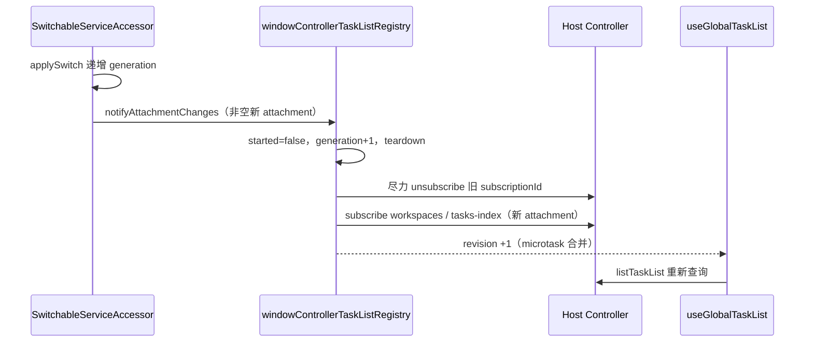

# 侧栏任务列表的传输换代恢复

## 目标与范围

浏览器远控页面的 service facade 在 WSS 与 WebRTC DataChannel 之间换代时，侧栏任务列表（时间线、置顶、归档、活动）必须自动恢复，不能停在“暂无任务”。

覆盖范围：

- `packages/ui/src/v4/windowControllerTaskListRegistry.ts` 在底层 attachment 换代后的订阅重建与缓存失效。
- `packages/ui/src/hooks/useGlobalTaskList.ts` 通过 registry revision 触发的自动重查。

不覆盖：Host 侧 Controller 投影、任务查询语义、workspace identity、连接选择器本身。连接代次由 `packages/web/src/connection/switchableServiceAccessor.ts` 拥有，见 `mobile-remote-webrtc.md`。

## 产品规则

- `windowControllerTaskListRegistry` 是 Controller tasks-index 订阅、查询缓存与 revision 的唯一所有者，每个 Controller facade 一个实例；列表 hook 只消费 revision，不各自维护订阅。
- 新非空 attachment 就绪时执行一次换代重启：
  - 丢弃旧代的 cursor、查询缓存与 tasks-index 行缓存；
  - 对旧 `subscriptionId` 尽力 `unsubscribeControllerV4`，失败忽略；
  - 在新 attachment 上重新订阅 `CONTROLLER_WORKSPACES_TOPIC` 与 `CONTROLLER_TASKS_INDEX_TOPIC`；
  - 递增 revision，让所有消费方重查。
- Host 侧订阅编号只存在于旧 attachment；它们不会随 transport 迁移。因此换代后必须在本端重建订阅，不能假设旧订阅仍然有效。
- 断开（`getAttachment()` 返回 null）不触发重启，也不当作业务失败：结果未知时保持既有 query 语义，等待下一个非空 attachment。
- 同一 attachment 的重复通知不重复重启；重启期间新注册的连接监听只绑定一次。
- 不重放在途命令，不做页面重挂载，不改变 query 语义、分页语义与 workspace identity（仍为 `workspaceIdentity?.trim() || workspacePath`）。
- 没有连接端口（桌面端普通 service）时视为固定 attachment，行为与现状一致，不抛错。

## 状态所有者与边界

- 连接代次的唯一 owner 是 `SwitchableServiceAccessor`；registry 只观察“新 attachment 已就绪”事件。
- registry 是 tasks-index 订阅与缓存代次的唯一 owner；hook 不绕过 registry 直接复订阅。
- 旧代 frame 通过代际守卫丢弃；`notifyOnce` 仍按微任务合并。
- 断开事件不写入业务状态；Host 侧订阅清理失败只记录 debug/warn，不影响下一次换代重建。

## 验收与证据

自动化测试位于 `packages/ui/test/windowControllerTaskListRegistry.test.ts`：

1. WSS → RTC：新非空 attachment 通知后，旧两个 subscriptionId 被退订，两个 topic 在新 attachment 上重新订阅，`getRevision()` 在微任务后 +1。
2. 同一 query/version 在换代后再次 `list()` 会重新调用 `listTaskList`（旧缓存已清）。
3. RTC → WSS 回退与重连：再次出现新非空 attachment 时同样重启；断开（null）不触发重启。
4. 最后一个 listener 退订后，连接通知不再触发任何重新订阅。
5. 无连接端口（桌面端）时行为与现状一致，不抛错。

同时更新 `mobile-remote-webrtc.md` 验收第 6 条，明确任务列表订阅必须在新 attachment 上重建。

## 非目标

不改变 Controller 协议、topic、snapshot/cursor 语义与 Host 投影；不新增重试队列或自动重放；不调整列表 UI 的“暂无任务”文案与显示条件；不改变断线期间的已有失败展示。
