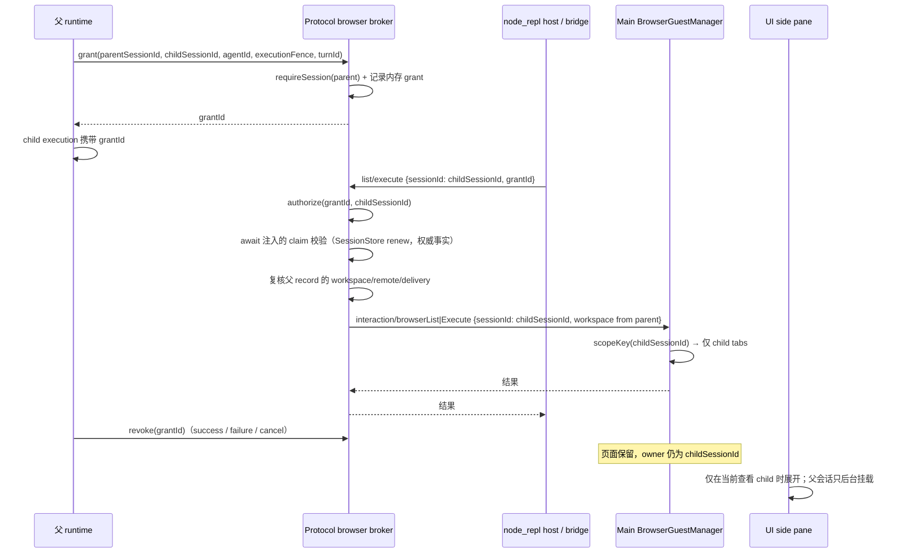

# 子代理受限 Browser Use 授权

## 目标

在父会话已启用 Browser Use、且父子都处于完全访问权限时，允许 `general-purpose` 和符合有效工具/权限的自定义 Agent 在**自己的执行范围内**使用 Browser Use 的 `own-tabs` 能力。

本 spec 只定义授权、页面归属、生命周期和验收边界；不把共享浏览器分区包装成安全沙箱，也不新增持久 lease、tab registry 或第二套页面状态。own-tabs 只是平台 API 的控制边界，不构成对“完全访问、可执行任意代码”的子代理的 OS 安全沙箱。

## 非目标

- 不向 `Explore`、`Ask`、`Plan` 子代理开放 Browser Use。
- 不允许子代理访问父会话或其他子代理创建的页面，不允许 `user.openTabs` / `claimTab`，不允许强制 `visibility.set` 或抢焦点。
- 不新增 Electron partition，不为子代理提供独立登录态；首版共享现有 cookie、localStorage、sessionStorage 和 IndexedDB。
- 不新增持久执行 lease、页面注册表、跨进程 grant 存储或后台子代理语义。
- 不改变父会话自身的 Browser Use、tab claim、lifecycle 和 UI 行为。
- 不把 MCP 工具可见、`tools[*]` 出现或 `session_id` 元数据本身当作授权。

## 现状事实（以当前检出源码为准）

| 事实                                                                                                 | 证据                                                                                                                                    |
| ---------------------------------------------------------------------------------------------------- | --------------------------------------------------------------------------------------------------------------------------------------- |
| 子 runtime 由父 runtime 在同一 App 内创建，`taskType` 为 `subagent_child`，`subagents.enabled=false` | `apps/zcode-cli/packages/core/src/runtime/methods/subagent.ts`                                                                          |
| 子 runtime 当前不继承 `runtimeFeatures`，也不传 `browserControlPort`                                 | 同上；见 `buildInheritedSubagentRuntimeConfig`                                                                                          |
| 父 runtime 已持有宿主注入的 `BrowserControlPort`                                                     | `apps/zcode-cli/packages/bootstrap/src/app/create-app.ts`                                                                               |
| Protocol broker 的 `requireSession` 只查顶层 active session，child session 不在其中                  | `apps/zcode-cli/packages/bootstrap/src/zcode-protocol/server-types.ts`                                                                  |
| node_repl 的浏览器 bridge 与 bootstrap broker 当前都硬拒 `runtime_scope=subagent`                    | `apps/zcode-cli/packages/node-repl-host/src/browser-bridge.ts`、`apps/zcode-cli/packages/bootstrap/src/app/node-repl-browser-broker.ts` |
| `mcp__node_repl__js` 的 MCP 请求元数据由 adapter 从执行上下文注入，不从模型参数读取                  | `apps/zcode-cli/packages/adapters/src/mcp/index.ts` 的 `mcpRequestMeta`                                                                 |
| Main 的页面 scope 已按 browser/generation/window/workspace/remote/session/clientMode 严格隔离        | `packages/desktop/src/main/browserView/browserGuestManager.ts` 的 `scopeKey`、`sameScope`、`ownedTabs`、`canClaimUserTab`               |
| Main 的 popup 通过 guest owner 反查，保留原 session scope                                            | `packages/desktop/src/main/desktopWindowChrome.ts`、`packages/desktop/src/main/index.ts`                                                |
| UI 已支持 `activate:false` 后台挂载，并按 workspace/session scope 决定是否展开                       | `packages/ui/src/lib/workspaceSidePane.ts`、`packages/ui/src/hooks/useAppPanels.ts`                                                     |
| 子代理仍只能前台执行，`run_in_background` 被拒绝                                                     | `docs/specs/subagent-foreground-only.md`                                                                                                |

结论：页面隔离不需要 Main 新增“子代理”概念。只要协议请求的 `sessionId` 是 child session，Main 现有的 `scopeKey`/`sameScope` 就会让 child 只看到自己的页面。真正缺口是**执行级授权**和**从 child session 到 parent session 的可信路由**，不是页面管理器。

## 产品规则

### 授权矩阵

只有以下条件同时满足，父 runtime 才可签发一次执行级 Browser Use grant：

| 条件                              | 说明                                                                                                                                                                                            |
| --------------------------------- | ----------------------------------------------------------------------------------------------------------------------------------------------------------------------------------------------- |
| 父会话 Browser Use 已启用         | `runtimeFeatures.browserUse === true`                                                                                                                                                           |
| 父宿主提供授权端口                | `BrowserControlPort.subagentDelegation` 存在，且 SessionStore 提供 `renewSubagentExecutionClaim` 作为 broker 的权威 fence 校验；缺少时只能回退内存校验，不签发                                  |
| 父会话为完全访问                  | 有效权限档为 `yolo` 或 `team`；`plan`/`readonly` 一律拒绝                                                                                                                                       |
| 子代理不是内置 Explore            | `isBuiltInExploreAgentProfile(request.profile) === false`                                                                                                                                       |
| 子代理自身没有受限档              | profile `permissionMode` 不是 `plan`，也不是 `readonly`；`undefined`、`auto`、`yolo` 可继续判断                                                                                                 |
| 子代理有效权限为完全访问          | `resolveSubagentPermissionMode(...) === "yolo"`                                                                                                                                                 |
| 前台执行                          | `request.background !== true`，不引入后台 child                                                                                                                                                 |
| 当前 execution 有执行 fence       | `request.executionFence` 存在（SessionStore 的 `childSessionId/fencingEpoch/ownerRuntimeId`）；无 fence 不签发                                                                                  |
| 有效工具面包含宿主 node_repl `js` | child 借用父启动快照后的 MCP descriptor 中存在真实 `serverName=node_repl`、`toolName=js`，且最终注册的 `childToolAllowlist` 精确包含 `mcp__node_repl__js`；仅通配 selector 或同名自定义工具不算 |
| 父 session 当前 active            | grant 创建时 `requireSession(parentSessionId)` 成功                                                                                                                                             |

“工具可见”只是必要条件，不是授权。即使 `mcp__node_repl__js` 出现在子代理工具面，没有有效 grant 时也必须拒绝浏览器操作。

工具条件只认“父启动快照里真实的 MCP descriptor + 最终注册的精确工具名”，不按名称代理授权。当前 MCP 工具框架不会为 `tools`/`disallowedTools` 展开自定义 selector（例如 `mcp__node_repl__*`），所以 spec 不再承诺 selector 匹配，也不为授权去扩展引擎的 selector 语义。

`general-purpose` 默认满足工具条件；自定义 Agent 只有在最终工具白名单实际保留精确工具名 `mcp__node_repl__js` 时才可授权。`Explore` 不因名字相同而被当作内置 Explore；判断必须使用 `isBuiltInExploreAgentProfile` 的内置来源语义。

### 页面权限

子代理只能操作 owner 为 `childSessionId` 的页面：

| 能力                                   | 子代理                                                              |
| -------------------------------------- | ------------------------------------------------------------------- |
| `list` / `tabs.list`                   | 仅同 scope 的 child tabs                                            |
| `newTab`                               | 允许，owner 为 child                                                |
| 导航、点击、输入、截图、脚本、viewport | 仅 child 自己的 tab                                                 |
| `activateTab`                          | 仅 child 自己的 tab；不得切换父会话可见 tab 或系统焦点              |
| `close`                                | 仅 child 自己的 tab；这是模型显式关闭，不等于执行结束自动关页       |
| `listUserTabs`                         | 拒绝                                                                |
| `claimTab`                             | 拒绝                                                                |
| `browserVisibilitySet`                 | 拒绝                                                                |
| `turnEnded` / `closeSession`           | 拒绝；子执行不拥有浏览器生命周期                                    |
| 父会话或其他 child 的 tab              | Main 按 scope 自然不可见；broker 仍应在命令进入 Main 前拒绝越权命令 |

`browserVisibilityGet` 可以保留为只读查询，但它不能成为展开父会话或抢焦点的信号。popup / `window.open` 的新页面由 Main 按源 tab owner 继承，归同一个 child scope。

### 执行生命周期

- 每次 child execution（首次 `Agent` 或同 `agentId` 的 `SendMessage` 续跑）单独签发 grant；每次执行结束、失败或取消都必须立即撤销。
- 撤销只使 grant 失效，**不关闭 child 已创建的页面**。
- 同一 `agentId` 的新 execution 重新签发 grant，并复用仍归 `childSessionId` 的页面。
- 旧 execution 的 grant 在新 grant 签发后不得继续有效；旧请求携带旧 `grantId` 必须被拒绝。
- 进程重启后没有任何持久 grant；旧 child 在重新执行前调用浏览器必须被拒绝。
- 不新增持久 lease。grant 只存在于当前 App 进程内；执行 fence 继续由现有 SessionStore 唯一拥有。
- 同一 child 的 `fencingEpoch` 按 SessionStore claim 单调递增。broker 保留每个 child 已见过的最高代际（内存水位）只用于签发顺序：旧执行在被接管后迟到签发较旧 fence 的 grant 会被拒绝，不会顶掉新 grant；水位本身不是授权事实。
- 水位不能覆盖“新 epoch 已接管、但新执行尚未签发 grant”的窗口：此时旧 grant 仍在内存表里。因此 broker 在每次带 grant 的 `list`/`execute` 触达 Main 前，必须 await 父 runtime 注入的权威 claim 校验（SessionStore `renewSubagentExecutionClaim`，与消息持久化同一口径）；返回 false 或抛错都按“浏览器不可用”拒绝并删除 grant，不新建 lease/counter。工具 dispatch 的其余路径仍不在本 spec 范围。
- 父会话 close、turn end 或 UI 关闭 side pane 都不等价于撤销 child grant；grant 的撤销只由对应 child execution 的终态触发。

## 状态所有权

| 事实                                                           | 唯一 owner                                       | 不负责                                             |
| -------------------------------------------------------------- | ------------------------------------------------ | -------------------------------------------------- |
| 是否允许 child 使用浏览器、grant 的签发与撤销                  | 父 runtime                                       | 不保存页面、不直接操作 Main                        |
| grant 的当前有效集合与 `parentSessionId → childSessionId` 校验 | 当前 App 的 Protocol browser broker（内存表）    | 不持久化、不跨进程、不拥有页面                     |
| 执行代际与旧执行防护                                           | 现有 SessionStore `SubagentExecutionFence`       | 不保存浏览器 grant；broker 每次请求前 await 它复核 |
| 页面 owner、tab 生命周期、CDP 资源                             | Main `BrowserGuestManager`                       | 不判断父/子业务授权                                |
| workspace / remote / delivery 事实                             | 父顶层 active session 的 Protocol session record | 不从模型参数或 child 元数据重建                    |
| UI 侧栏 tab 与展开状态                                         | 现有 side pane projection                        | 不成为授权来源，不新建状态                         |

`workspaceKey` 统一使用 `workspaceIdentity?.trim() || workspacePath`。远程链路继续携带 `remoteSessionId`；child 页面使用父 session record 的 workspace/remote，但 `sessionId` 使用 child。

grant 表、每个 child 的 fence 水位与 grant 绑定的权威校验回调以 Protocol context 为 key 存放于 `WeakMap`；校验回调随 grant 删除/覆盖/撤销一并删除，context 释放后一并回收，不留下全局强引用，也不跨进程。

## 事件顺序



失败路径：

- grant 创建失败（父 session 不 active、父 record 不完整）：本轮 child 不获得浏览器能力；已运行的非浏览器 child 工作不受影响。
- 请求缺少 grantId、grant 已撤销、grant 的 child 不匹配、父 record 的 workspace/remote 与 grant 快照不一致：返回稳定的“浏览器不可用”错误，不回落父权限。
- 新 epoch 接管但新执行尚未签发 grant：旧 grant 仍在内存表中，list/execute 前的权威 claim 校验返回 false，旧请求被拒绝并删除 grant；不能只依赖 broker 水位（水位只在成功签发后推进）。
- claim 已终态 release、已过期或校验器抛错：同样按拒绝处理（fail-closed），不回落内存授权。
- 异步校验窗口内的竞态：校验 pending 时 grant 被撤销、被新 grant 替换或父 record 快照变化，即使校验随后返回 true，重新同步 `authorize` 也会拒绝；signal 在窗口内 abort 时原 command 不派发。
- 子执行取消：父 signal 继续取消在途 MCP 调用；finally 撤销 grant；不调用 child 的 `closeSession`，不关闭页面。
- 旧请求晚到：旧 grantId 已撤销，broker 拒绝；即使同一 child 已有新 grant，也不得用新 grant 接受旧请求。
- 旧执行迟到签发：fence 比该 child 已见过的最高代际旧时，broker 拒绝 grant；即使新 grant 已被撤销，水位也不会回退去接受旧 grant。

## 最小公用契约

以下接口放在 `apps/zcode-cli/packages/contracts/src/interfaces/browser-control.port.ts`，作为浏览器控制契约的单一所有者；只允许一个实现者同时修改该文件和 `packages/shared/src/browser-use/nodeReplBroker.ts` 中的对应 schema。

```ts
export interface SubagentBrowserDelegationGrant {
  grantId: string;
  parentSessionId: string;
  childSessionId: string;
  agentId: string;
  executionFence: SubagentExecutionFence;
  parentTurnId?: string;
  workspaceKey: string;
  workspacePath: string;
  workspaceIdentity?: string;
  remoteSessionId?: string;
  clientMode: BrowserClientMode;
  issuedAt: number;
}

export interface SubagentBrowserDelegationPort {
  grant(input: {
    parentSessionId: string;
    childSessionId: string;
    agentId: string;
    executionFence: SubagentExecutionFence;
    parentTurnId?: string;
    /** 可信父 runtime 注入；broker 在每次 list/execute 前 await，不新建 lease。 */
    validateExecutionFence?: (fence: SubagentExecutionFence) => Promise<boolean>;
  }): SubagentBrowserDelegationGrant;

  revoke(input: {
    grantId: string;
    childSessionId: string;
    executionFence: SubagentExecutionFence;
  }): void;

  authorize(input: {
    grantId: string;
    childSessionId: string;
  }): SubagentBrowserDelegationGrant | undefined;
}

export interface BrowserControlPort {
  // ...existing methods
  readonly subagentDelegation?: SubagentBrowserDelegationPort;
}
```

`BrowserControlListInput` 和 `BrowserControlExecuteInput` 各增加可选 `delegationGrantId?: string`。NodeRepl broker 把它传给 `BrowserControlPort`；Protocol broker 用它在 grant 表中查找并校验。

约束：

- `grant` 内由 broker 读取父 active record，填充 workspace/remote/clientMode；父 runtime 不传这些字段，避免第二份事实。
- `grant` 对同一 child 只接受不低于已签发最高 `fencingEpoch` 的 fence；同代际必须同 `ownerRuntimeId`，否则拒绝。较旧的迟到签发不能顶掉或取代较新的 grant。
- `revoke` 必须幂等，并且只删除 `grantId + childSessionId + executionFence` 完全匹配的 grant；旧执行的迟到 revoke 不能删除新 grant。
- `authorize` 必须同时匹配 `grantId` 与 `childSessionId`；找不到、已撤销或父 record 不存在时返回 `undefined`。
- `authorize` 保持同步供 broker 内部与 bridge 语义复用；broker 在 `list`/`execute` 触达 Main 前额外 await grant 携带的 `validateExecutionFence`。该校验由可信父 runtime 注入，失败即删除 grant 并拒绝。
- await 校验期间 grant 可能被撤销、被同一 child 的新 grant 替换，或父 record 的 workspace/remote/delivery 变化；校验通过后必须在派发前再次同步 `authorize`，且返回的必须是同一个 grant 对象（不能只校验 grantId 仍存在于表中），父 record 也重新读取。期间 signal 已 abort 时直接抛出，不派发原 command。
- grant 的 `executionFence` 直接取 `request.executionFence`，broker 不复制 SessionStore 的 claim 生命周期、不新建 lease；没有 fence 的 child 执行不签发浏览器 grant。权威有效性只在每次浏览器请求前通过注入回调读取。
- `grantId` 由可信父 runtime 注入，不能通过工具入参改写；它不是保密令牌，也不是模型代码不可观察的边界（见“授权边界不是 OS 安全沙箱”）。
- 日志与模型可见文本不写入 `grantId`、`executionFence` 或父 session ID。这不是保密承诺，而是避免把授权凭证扩散到会话事件、UI 与日志。

### 从 child 到 broker 的可信传递

grantId 不由工具入参或模型可控的 `_meta` 字段选择。它沿现有 adapter 注入链从执行上下文传递；注入后的 request metadata 对 sandbox 脚本可观察，因此它只是 broker 授权表的键值，不是保密凭证。

1. 父 runtime 签发 grant 后，把 `grantId` 放入 child runtime 的 `AgentRuntimeDeps.subagentBrowserGrantId`（仅本次 execution）。
2. `ToolExecutionContext` 增加同名字段，`createToolExecutionContext` 从 deps 复制；`McpCallToolRequest` 增加该字段。
3. `adapters/src/mcp/index.ts` 的 `mcpRequestMeta` 写入 `subagent_browser_grant`，与现有 `runtime_scope`、`session_id` 同一层；写入前按 `serverName=node_repl`、`toolName=js` 过滤，第三方 MCP server 不接收该键。core 侧生成 `McpCallToolRequest` 时做同口径收窄，adapter 过滤是第二道最小暴露面，不承担授权判断。
4. `node-repl-host` 从请求元数据读取该键，放入现有 broker socket payload；`nodeReplBrokerRequestSchema` 增加 `grantId`。
5. `node-repl-browser-broker` 只做传输 token 校验，并把 `grantId` 交给 `BrowserControlPort`；真正的授权判断在 Protocol broker。

`browser-bridge` 的规则改为：`runtime_scope=subagent` 且存在 grantId 时允许构建请求；缺少 grantId 时继续抛出稳定的“子代理不可用浏览器”错误。bridge 不自己判断 grant 是否有效，避免在 Host 进程中复制授权状态。Host 对 delegated child 做接口收敛：`list` 返回的 descriptor 通过既有 `apiSupportOverrides` 隐藏 `Browser.user`、`BrowserUser.openTabs`、`BrowserUser.claimTab`，并移除 `visibility` capability；`execute` 在进入 broker 前拒绝 `listUserTabs`、`claimTab`、`browserVisibilitySet`、`turnEnded`、`closeSession`。这些是 early deny，不是授权判断，后端仍必须硬拒。

ZCode Protocol 的 `interaction/browserList` / `interaction/browserExecute` 参数保持不变；`sessionId` 的语义是**页面 owner session**，因此子代理请求传 `childSessionId`。Protocol broker 只在内部用 `grant.parentSessionId` 调用 `requireSession`，再用父 record 填充 workspace/remote/clientMode。

### Desktop / Host 边界

- Host bridge 只转发协议参数，不解析 grant，不判断父子关系。
- Main 只做原生资源、tab 生命周期和 `sameScope` 检查；child 页面靠 `sessionId=childSessionId` 与父/其他 child 隔离。
- Main 不新增“subagent”分支。`runBrowserCommandOnView`、`BrowserGuestManager`、popup owner 继承和 UI side pane 继续使用现有 session scope。
- 不为 child 注入 `turnEnded` / `closeSession`；这两个生命周期方法只属于父会话。

## 共享浏览器存储不是安全沙箱

首版 child 与父会话共享 `persist:zcode-embedded-browser`：

- 登录态、cookie、localStorage、sessionStorage、IndexedDB、下载和权限状态都可能被 child 页面复用或观察。
- 这不是安全隔离。子代理仍受页面 scope 限制，但同一站点上的已登录会话不是“子代理专用身份”。
- 不新增 partition、不复制 profile、不把共享存储描述为隔离边界。需要真正隔离时必须另立 spec。

## 授权边界不是 OS 安全沙箱

reviewer 已确认：node_repl 的 `requestMeta` 对模型脚本可见，`process.env` 也会向模型沙箱暴露 broker socket/token。由此：

- grantId 由可信 runtime 注入，防的是“模型通过工具参数自行选择或伪造授权”；它不是保密令牌，metadata 可观察不影响 broker 以 grant 表 + child session 做授权判断。
- own-tabs 是平台 API 的控制边界：broker 只接受带本次 execution 有效 grant 的官方 bridge 请求，越界命令在进入 Main 前拒绝。
- 脚本仍必须通过官方 browser bridge 发起浏览器操作；直接连接 broker socket 属于既有 Node 全权限信任边界，本 spec 不改变、也不声称已隔离。
- 对完全访问、可执行任意代码的子代理，不宣称形成 OS 级安全沙箱；页面 scope 限制的是官方 API 的页面可见性，不是同进程任意代码。

## 实施切片与文件边界

| 切片                    | 文件                                                                                                                                                                                               | 责任                                                                                                     |
| ----------------------- | -------------------------------------------------------------------------------------------------------------------------------------------------------------------------------------------------- | -------------------------------------------------------------------------------------------------------- |
| A. 公用契约（单 owner） | `apps/zcode-cli/packages/contracts/src/interfaces/browser-control.port.ts`、`.../mcp.port.ts`、`packages/shared/src/browser-use/nodeReplBroker.ts`                                                 | grant/port 类型、MCP meta 键、socket schema                                                              |
| B. 父 runtime           | `core/src/runtime/methods/subagent.ts`、`core/src/runtime/types.ts`、`core/src/tool/executor/call-runner.ts`、`core/src/tool/executor/types.ts`、`core/src/tool/types.ts`、`core/src/mcp/index.ts` | 资格判断、grant/revoke 生命周期、grantId 传递                                                            |
| C. Bootstrap broker     | `bootstrap/src/zcode-protocol/browser-control-broker.ts`、`bootstrap/src/app/node-repl-browser-broker.ts`                                                                                          | 内存 grant 表、父 record 路由、命令限制、socket 转发                                                     |
| D. node_repl host       | `node-repl-host/src/browser-bridge.ts`（必要时 `server.ts`）、browser-use 插件技能与文档                                                                                                           | 接受带 grant 的 subagent 请求，缺 grant 继续拒绝；用既有 capability/override 隐藏 user tab 与 visibility |
| E. Adapter meta         | `adapters/src/mcp/index.ts`                                                                                                                                                                        | 把 grantId 写入可信 request context                                                                      |
| F. 验证                 | 对应 `test/*.test.ts`；Desktop/UI 只做 scope 回归                                                                                                                                                  | 授权矩阵、生命周期、命令限制、UI 后台挂载                                                                |

A 必须先落地；B–E 依赖 A。A 未合并前不要各自复制一份 grant 类型。Desktop/Main 预期无需业务代码改动；若验证发现 `sessionId=child` 的协议/路由假设不成立，应先回到 spec 对齐，不要在 Main 增加子代理分支。

## 验收场景

1. 父 `yolo`、`general-purpose`、Browser Use 开启、node_repl 工具可见：child 可 `newTab`、导航、截图，`tabs.list` 只返回自己的 tab。
2. 父 `plan` 或 `readonly`：不签发 grant；child 调用 `mcp__node_repl__js` 的浏览器 API 得到稳定不可用错误，不降级为只读或父权限。
3. 内置 `Explore`：即使父完全访问且工具面包含 node_repl，也不签发 grant。
4. 自定义 Agent 的 profile `permissionMode=plan` 或 `readonly`：不签发 grant；`undefined`、`auto`、`yolo` 且工具面保留 `js` 时可签发。
5. 自定义 Agent 的 `tools`/`disallowedTools` 过滤掉 node_repl `js`：不签发 grant；仅工具可见但无 grant 时调用浏览器仍失败。
6. child 调用 `listUserTabs`、`claimTab`、`browserVisibilitySet`、`turnEnded`、`closeSession`：得到稳定拒绝，不触达父页面。
7. child 尝试操作父 tab 或其他 child tab：Main `sameScope` 拒绝；broker 不把父 session 当作 child owner。
8. child 执行成功、失败、取消后 grant 立即失效；页面不关闭，owner 仍为 child，下一次同一 `agentId` 续跑可重新 `list` 到这些页面。
9. 同一 `agentId` 的 `SendMessage` 续跑签发新 grant；旧 grant 的迟到请求被拒绝，即使新 grant 已存在。
10. 进程重启后旧 child 直接调用浏览器被拒绝；重新以前台方式执行后才恢复。
11. 两个 child 并发：各自只能看到自己的 tab；交叉操作被 scope 拒绝。
12. child 页面触发 popup：新页面 owner 是同一 child；父会话 side pane 不展开，查看 child 时才出现。
13. 父会话查看自己的页面时，child 的 `newTab`/`activateTab` 不会切换父会话当前 tab 或展开父 side pane。
14. 远程 workspace：child 页面携带父 record 的 `workspaceIdentity` 与 `remoteSessionId`；workspace 不同或 remote 不匹配时 grant 校验失败。
15. child 与父共享同一登录态；不宣称该共享是安全沙箱。

## 自动化验证边界

已自动执行的模拟链路（无桌面、无浏览器、无 YCode 进程操作）：

- `apps/zcode-cli/packages/browser-use-plugin/test/browserUseDelegationE2E.test.ts` 使用实际 MCP Client/Server
  (`InMemoryTransport`)、实际 `createNodeReplMcpRuntime`/`createInProcessNodeReplExecutor`、实际本地 socket
  broker 与 Protocol browser broker；只有 Protocol `requestClient` 的页面 backend 是替身。
- 覆盖：main 保持父 session 且不受受限命令影响；child 带 grant 时保留 `sessionId=child` 并携带父 workspace
  快照；revoke、未知 grant、grant/child 不匹配均被 Protocol broker 拒绝且不触达 backend；受限命令在 Host
  层稳定拒绝；缺少 grant 或只把 grant 放在顶层 MCP `_meta` 时稳定不可用。
- 真实 GUI E2E（实际桌面窗口、side pane、popup owner、焦点）仍为**未执行**，不得声称已跑；Popup/`sameScope`
  场景暂无可直接复用的 public `BrowserGuestManager` 测试 fixture，需要另行构造 Main 级测试环境。

## 待验证风险

- `mcp__node_repl__js` 的 grantId 传递已由上述模拟 MCP 链路覆盖；真实 YCode desktop/CLI 进程内的 adapter
  注入仍需在允许操作运行中 YCode 时单独验证。
- 已确认（reviewer）：node_repl 的 `requestMeta` 对模型脚本可见，`process.env` 暴露 broker socket/token。grantId 因此不是保密令牌，只作为 broker 授权表键值；这是既有 Node 全权限边界，改变它需要另立安全评估。
- 浏览器授权路径已在每次 `list`/`execute` 前复核 SessionStore claim；普通工具 dispatch 仍没有逐次 claim 校验，属于既有行为，本 spec 不扩展。
- Main 以 `sessionId=child` 作为页面 owner 后，Desktop Host、renderer 事件和 mobile/remote attachment 是否都只按 owner scope 消费，需要在两种 delivery 语义下回归。
- child 页面在父会话关闭、窗口关闭、child 被删除后的保留策略沿用 Main 现有 tab 生命周期；是否需要显式清理不在本 spec 范围。
- 现有测试体系没有统一的 CLI `test` script；新增测试要按 `node:test` + `tsx` 的实际入口接入，否则会出现“测试文件存在但无人执行”。

## 参考

- [`subagent-foreground-only.md`](./subagent-foreground-only.md)
- [`subagent-fork-isolation.md`](./subagent-fork-isolation.md)
- [`agent-mode-axis.md`](./agent-mode-axis.md)
