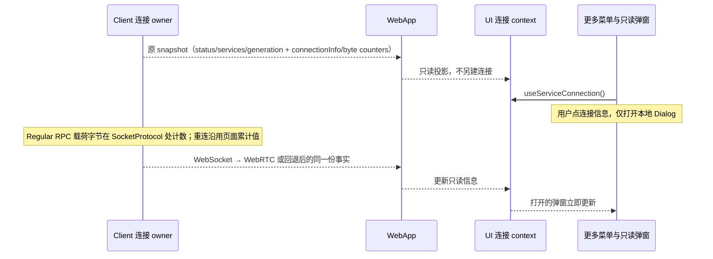

# Web 连接信息

## 目标与范围

Web 应用在侧栏底部「更多」菜单中提供「连接信息」，位置对应桌面端的「手机远控」。点击打开只读对话框，用户可确认当前业务是否使用 WebRTC 直连，以及直连尝试失败后是否仍通过 WebSocket 提供服务。桌面手机远控入口、远控 Host 与设备计数不变。

本功能适用于已有 WebApp 外壳中的普通 Server、桌面手机远控与 `?remote=` 页面；没有该外壳的分享页、资源管理器窗口不增加入口。宽屏、窄屏抽屉、有项目与空项目外壳复用同一菜单。不新增设置、连接、测速、重试按钮或外部网络请求。

## 产品规则

- Web 的「更多」在语言菜单之前显示「连接信息」。入口不依赖 `mobileRemoteControlService`；Desktop 不显示此项。
- 点击只打开对话框，不切主视图、不导航、不收起窄屏侧栏抽屉。对话框支持关闭按钮、Esc 和点外部关闭，并使用既有 Dialog、主题与 `text-ui-*` 字号。
- 对话框只保留标题与五项事实字段：连接状态、当前业务通道、WebRTC 直连状态、累计发送量、累计接收量。标题下不显示描述，字段下方不显示解释性提示；字段文案本身表达完整状态。所有文案提供中文和英文。流量值采用既有 `resourceUsageView.formatBytes` 字节格式化规则。
- 连接状态复用既有 `connecting / connected / reconnecting / closed` 事实，不新增一份连接状态。
- 当前业务通道为 `websocket / webrtc / null`，分别显示「WebSocket」「WebRTC 直连」「暂无活动连接」。只描述当前发布 services 所使用的 RPC 数据通道。
- WebRTC 直连状态为 `disabled / waiting / connecting / connected / fallback`，分别表示本连接未启用直连、等待基础连接、正在尝试直连、已直连、直连未建立或已中断。`fallback` 文案不得暗示基础 WebSocket 一定仍可用；基础连接断开后显示 `waiting`。
- 纯 WebSocket 连接的直连状态为 `disabled`。不按域名、HTTP/HTTPS、是否同一 Wi-Fi 或浏览器有无某 API 猜测当前通道，也不把所有 WebSocket 都称为公网隧道。
- WebRTC 只有在 DataChannel 与 ChannelClient Initialize 都完成、选择器实际发布该 services 时，才能显示 `webrtc / connected`。协商期间业务仍显示 WebSocket。
- 不新增 WebRTC/WebSocket 传输机制或其他解释性说明。`transport` 与 `directState` 的既有文案独立描述当前通道与直连诊断状态，不因精简弹窗而合并、隐藏或改写。
- 标题是对话框的可访问名称；去掉可见描述后，Dialog 显式设置 `aria-describedby={undefined}`，避免 Radix 在开发环境提示缺少 Description，并保留无描述对话框的无障碍语义。
- 不展示服务地址、原始错误、SDP、ICE 候选、内部重试次数或连接代次。
- 对话框打开时继续订阅原连接快照，升级、回退、重连与关闭立即更新，不弹切换 toast。连接详情变化不得触发新连接、业务重放、services 换代或 Root 重挂载。

## 唯一所有者与接口

`@zcode/shared` 提供纯类型 `WebConnectionInfo`，不增加网络协议或持久化 schema：

```ts
interface WebConnectionInfo {
  readonly transport: "websocket" | "webrtc" | null;
  readonly directState: "disabled" | "waiting" | "connecting" | "connected" | "fallback";
}
```

- `@zcode/client` 的 `WebSocketConnectionSnapshot.connectionInfo?` 由连接 owner 发布；可选字段兼容既有快照构造者。生产 managed WebSocket 与 WebRTC 选择器始终提供此信息。
- managed WebSocket 是 WebSocket 流量累计值的唯一 owner，WebRTC selector 是 RTC 流量累计值的唯一 owner。每次 `SocketProtocol` 接受发送 Regular RPC 载荷、或接收完整 Regular 载荷时，以 `Uint8Array.byteLength` 累计对应方向字节。计量包含 Initialize、UTF-8 序列化及二进制 RPC 载荷，不含 SocketProtocol 帧头、KeepAlive、WebRTC 信令、WebSocket/TLS/HTTP 开销；写入抛错或未作为完整 Regular 消息派发的字节不计。发送量表示本地传输接受的载荷，不表示对端已确认收到。
- 同一页面内 WebSocket generation 重连不清零累计值；WebRTC selector 将 fallback 已累计值与自身 RTC 累计值相加，覆盖协商期间 Initialize、活动通道及切换时仍在途的 RPC 载荷，每个物理通道只计一次。协商失败时已经完成的 RPC 载荷仍属于页面累计值；传输切换或 dispose 不清零、不重复计数。页面刷新/重新加载创建新连接 owner，计数从零开始；不持久化、不跨页面恢复。
- 载荷到达时同步累计；仅流量变化的快照通知按 250 ms 合并，避免流式 RPC 逐条触发整个 WebApp 刷新。连接状态变化及 dispose 立即发布最新累计值并取消待发布通知；迟到旧通道事件不得修改最终值。仅流量变化时保留连接信息、services 与 generation，不触发直连选择或业务重放。
- WebRTC 选择器在原 `publishComposed` 内，按同一 services 选择分支发布 transport、directState 与累计计数；不另建状态机、第二套 services 或轮询 `getStats`。
- `WebSocketConnectionSnapshot.traffic?` 与 `ServiceConnectionState.traffic?` 均为只读 `{ sentBytes: number; receivedBytes: number }`，可选字段兼容既有快照构造者，缺省显示零。WebApp 只把 `connectionInfo` 与 `traffic` 投影到现有 `ServiceConnectionState`，沿 Root → ServiceProvider → `useServiceConnection()` 传递。共享 UI 不依赖 client 包，不直接访问浏览器 WebSocket、RTC、Host 或 `window.zcode`。UI 只格式化并显示 owner 发布的计数，不维护副本。
- 菜单与 Dialog 只持有本地开合状态，连接信息没有写入接口或存储。`generation`、attempt、admission、身份 key、owner/lease、stale run 与在途命令语义不变。



Desktop 继续使用 `desktop-continuous`；手机 Web 保持 `web-remote-replayable`，不改变快照/重放、CommandInbox 或工作区隔离。

## 验收场景

先补自动化测试，再实现行为。命令以当前 package.json 与实际测试入口为准。

1. 普通 WebSocket Initialize 完成后为 `websocket / disabled`；重连或关闭后活动 transport 为 null。
2. fallback ready、RTC 协商及 DataChannel open 但 Initialize 未完成时为 `websocket / connecting`，服务代次不因信息更新而额外增加。
3. RTC Initialize 完成后同一次发布 `webrtc / connected`；RTC 失败后为 `websocket / fallback`，新 fallback generation 清除旧失败并重新尝试。旧 RTC 迟到回调不得覆盖新信息。
4. 无 peer/API/安全随机 ID 时为 `disabled`，不会额外建连；fallback 断开时为 `waiting` 且 transport 为 null；dispose 后不能保留活动 transport 或直连成功状态。
5. Web 菜单第一组显示「连接信息」，不依赖远控管理服务；Desktop 仅保留既有远控入口。点击接到 Dialog open，关闭接到既有 onOpenChange；不改主视图或抽屉状态。
6. Dialog 内容可独立渲染测试，覆盖四种连接状态、三种业务通道、五种直连状态和中英文文案；同时断言不再渲染标题下描述、底部传输说明与服务入口，`webConnectionInfo.description` / `webConnectionInfo.hint.*` / `webConnectionInfo.endpoint*` 文案已移除。发送/接收计数按字节显示，包含多字节 UTF-8 与二进制载荷，断言不包含 RPC 帧头、KeepAlive 或信令；同页重连及 WebRTC/WSS 切换不清零、不重复计数，流量通知合并后仍保留最终值，刷新新 owner 从零开始。Dialog 源码测试确认无 `DialogDescription` 且设置 `aria-describedby={undefined}`。打开时快照换代后的内容投影即时更新。
7. E2E 场景：宽屏与手机窄屏分别打开「更多 → 连接信息」，检查 Dialog 可见、窄屏抽屉仍打开；依次模拟 WSS → RTC → WSS → reconnecting，验证通道与状态随连接变化、页面工作区和会话不丢失；Esc/关闭按钮/外部点击均可关闭，Desktop 不出现该项。遵守工作区约束：未经明确授权不操作运行中的 YCode、不使用 CDP/DevTools/UI 自动化；无法执行时如实记录未执行，不把源码断言或 SSR 测试称作浏览器 E2E。
8. 执行 `pnpm typecheck`、`pnpm lint`、`pnpm architecture:check --changed`；只提交本任务改动，不修改无关本地文件或运行中的应用。

## 非目标

不提供 ICE IP、局域网拓扑、延迟/吞吐统计、候选对详情或故障恢复操作；字节计数仅表示页面 RPC 业务载荷累计值，不代表链路层网络用量；不新增 RTC 失败原因协议、持久化状态或诊断日志；不改现有鉴权、信令、peer 生命周期与远控能力开关。
