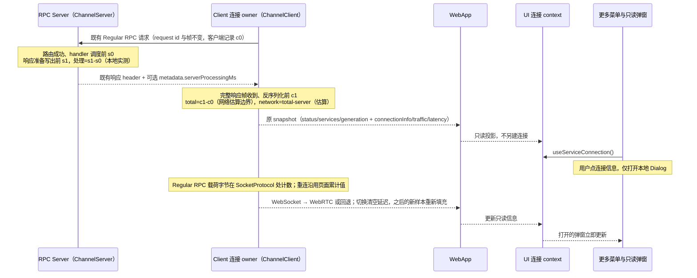

# Web 连接信息

## 目标与范围

Web 应用在侧栏底部「更多」菜单中提供「连接信息」，位置对应桌面端的「手机远控」。点击打开只读对话框，用户可确认当前业务是否使用 WebRTC 直连、直连尝试失败后是否仍通过 WebSocket 提供服务，以及最近一次业务 RPC 的网络往返估算与服务端处理耗时。桌面手机远控入口、远控 Host 与设备计数不变。

本功能适用于已有 WebApp 外壳中的普通 Server、桌面手机远控与 `?remote=` 页面；没有该外壳的分享页、资源管理器窗口不增加入口。宽屏、窄屏抽屉、有项目与空项目外壳复用同一菜单。不新增设置、连接、测速、重试按钮或外部网络请求。两个延迟指标只被动复用既有业务 RPC 的请求/响应配对，不发测速请求、不增加事件或心跳。

## 产品规则

- Web 的「更多」在语言菜单之前显示「连接信息」。入口不依赖 `mobileRemoteControlService`；Desktop 不显示此项。
- 点击只打开对话框，不切主视图、不导航、不收起窄屏侧栏抽屉。对话框支持关闭按钮、Esc 和点外部关闭，并使用既有 Dialog、主题与 `text-ui-*` 字号。
- 对话框只保留标题与七项事实字段：连接状态、当前业务通道、WebRTC 直连状态、网络往返（估算）、服务端处理、累计发送量、累计接收量。标题下不显示描述，字段下方不显示解释性提示；字段文案本身表达完整状态。所有文案提供中文和英文。流量值采用既有 `resourceUsageView.formatBytes` 字节格式化规则；延迟值按整数毫秒加 `ms` 单位展示，缺失时统一显示「—」。
- 新增事实行使用稳定标识 `TID_WEB_CONNECTION_INFO_NETWORK_RTT = "web-connection-info-network-rtt"` 与 `TID_WEB_CONNECTION_INFO_SERVER_PROCESSING = "web-connection-info-server-processing"`；文案键为 `webConnectionInfo.networkRoundTrip`、`webConnectionInfo.serverProcessing`、`webConnectionInfo.latencyUnavailable`，中文分别为「网络往返（估算）」「服务端处理」「—」，英文分别为「Network round trip (estimated)」「Server processing」「—」。标签保持精简，最近样本语义由产品规则约束，不强制 title。
- 连接状态复用既有 `connecting / connected / reconnecting / closed` 事实，不新增一份连接状态。
- 延迟字段只描述最近一次已完成且 metadata 合法的请求/响应样本，不是持续测速、平均值、P95 或实时网络质量。字段文案不得使用「实时」「平均」「当前速度」等持续或统计措辞。
- 网络往返与服务端处理来自同一次完整请求样本。服务端处理耗时是服务端本地单调时钟的实测差值，不是估算；网络往返是 `total - serverProcessingMs` 的估算值，包含采样边界外的本地缓冲、编解码与调度，不代表链路层 RTT、建连耗时或持续网络质量。
- 没有合法 metadata、请求被取消、请求完成前断线，或样本属于已失效连接/代次时，不更新延迟；不得把缺失值伪装成 `0 ms`。合法的真实 `0 ms` 样本照常显示。
- owner 只保留最近一次有效样本。该样本完成 60 秒后仍没有新的有效样本时，owner 将延迟置为无数据并发布快照；UI 只读，不自行测速或补样本。
- 当前业务通道为 `websocket / webrtc / null`，分别显示「WebSocket」「WebRTC 直连」「暂无活动连接」。只描述当前发布 services 所使用的 RPC 数据通道。
- WebRTC 直连状态为 `disabled / waiting / connecting / connected / fallback`，分别表示本连接未启用直连、等待基础连接、正在尝试直连、已直连、直连未建立或已中断。`fallback` 文案不得暗示基础 WebSocket 一定仍可用；基础连接断开后显示 `waiting`。
- 纯 WebSocket 连接的直连状态为 `disabled`。不按域名、HTTP/HTTPS、是否同一 Wi-Fi 或浏览器有无某 API 猜测当前通道，也不把所有 WebSocket 都称为公网隧道。
- WebRTC 只有在 DataChannel 与 ChannelClient Initialize 都完成、选择器实际发布该 services 时，才能显示 `webrtc / connected`。协商期间业务仍显示 WebSocket。
- 不新增 WebRTC/WebSocket 传输机制或其他解释性说明。`transport` 与 `directState` 的既有文案独立描述当前通道与直连诊断状态，不因精简弹窗而合并、隐藏或改写。
- 标题是对话框的可访问名称；去掉可见描述后，Dialog 显式设置 `aria-describedby={undefined}`，避免 Radix 在开发环境提示缺少 Description，并保留无描述对话框的无障碍语义。
- 不展示服务地址、原始错误、SDP、ICE 候选、内部重试次数或连接代次。
- 对话框打开时继续订阅原连接快照，升级、回退、重连与关闭立即更新，不弹切换 toast。连接详情变化不得触发新连接、业务重放、services 换代或 Root 重挂载。

## 唯一所有者与接口

`@zcode/shared` 提供纯类型 `WebConnectionInfo` 与 `WebConnectionLatency`，不增加网络协议或持久化 schema：

```ts
interface WebConnectionInfo {
  readonly transport: "websocket" | "webrtc" | null;
  readonly directState: "disabled" | "waiting" | "connecting" | "connected" | "fallback";
}

interface WebConnectionLatency {
  readonly networkRoundTripMs: number;
  readonly serverProcessingMs: number;
}
```

### RPC metadata 与采样接口

`@zcode/rpc` 在 `channels.shared.ts` 增加以下类型；`ChannelClient`/`ChannelServer` 的现有构造调用保持兼容：

```ts
/** 响应 header 第 3 项的可选 metadata；旧对端忽略未知尾项。 */
interface IRawResponseMetadata {
  readonly serverProcessingMs: number;
}

interface ChannelRequestLatencySample {
  readonly totalMs: number;
  readonly serverProcessingMs: number;
  readonly networkRoundTripMs: number;
}

interface ChannelClientOptions {
  /** 单调时钟，默认 performance.now()。 */
  readonly now?: () => number;
  /** 每个通过校验的完整请求/响应样本回调一次；回调异常不得影响 RPC。 */
  readonly onRequestLatencySample?: (sample: ChannelRequestLatencySample) => void;
}

interface ChannelServerOptions {
  /** 单调时钟，默认 performance.now()。 */
  readonly now?: () => number;
}

class ChannelClient {
  constructor(protocol: IMessagePassingProtocol, options?: ChannelClientOptions);
}

class ChannelServer<TContext = string> {
  constructor(
    protocol: IMessagePassingProtocol,
    ctx: TContext,
    timeoutDelay?: number,
    deferInit?: boolean,
    options?: ChannelServerOptions,
  );
}
```

- 响应 header 只从 `[type, id]` 扩展为 `[type, id, metadata?]`，`metadata` 仅含 `{ serverProcessingMs }`。只在 `PromiseSuccess / PromiseError / PromiseErrorObj` 且耗时为有限非负值时追加；`Initialize`、`EventFire` 与未知 channel 超时错误不追加。
- 不新增 RequestType/ResponseType、消息、帧、心跳、ACK 或逐 event 回执；metadata 随原响应一次性写出。
- 旧客户端读取 `header[0]/header[1]`，忽略尾项；旧服务端不发送时新客户端把 `header[2]` 视为缺失。两端可独立升级，互不要求同时更新。
- 客户端 `totalMs`：在请求序列化完成后、调用 `protocol.send` 前取 c0，在收到同一 id 的完整响应帧、反序列化前取 c1，`totalMs = c1 - c0`。服务端 `serverProcessingMs`：channel 路由成功后、调用 handler 前取 s0，在响应准备写出（调用 `sendResponse`）前取 s1，`serverProcessingMs = s1 - s0`。两侧只使用各自单调时钟差值，c0/c1 与 s0/s1 不在同一时钟域。
- `networkRoundTripMs = totalMs - serverProcessingMs`，仅估算，包含采样边界外的本地缓冲、编解码与调度，不拆解 DNS/TCP/TLS/隧道/网络抖动，也不代表持续网络质量。
- metadata 缺失、非对象、`serverProcessingMs` 非有限或为负、`totalMs` 非有限或为负、或 `serverProcessingMs > totalMs` 时丢弃整个样本；不 clamp 为 0，不覆盖上一条有效值。
- 请求被取消、请求完成前断线、连接已 dispose、响应属于已失效代次或重复响应时不采样。`EventListen / EventFire` 不是请求/响应样本，不采样。

### 快照与 owner

- `WebSocketConnectionSnapshot.connectionInfo?`、`WebSocketConnectionSnapshot.traffic?` 与新增的 `WebSocketConnectionSnapshot.latency?: WebConnectionLatency` 均由连接 owner 发布；可选字段兼容既有快照构造者。`ServiceConnectionState.latency?: WebConnectionLatency` 与 `traffic` 并列，沿用同一只读投影链路。
- `ChannelClient` 只产生并回调原始样本，不持有 UI 状态。managed WebSocket 是其物理 WSS 延迟样本的唯一 owner；WebRTC selector 是其 RTC 样本与组合快照的唯一 owner。
- owner 只保留最近一次合法样本，直接替换，不计算平均、P95、累计或混用 WSS 与 RTC 样本。WebApp 只把 `latency` 与 `connectionInfo`、`traffic` 一起投影到 `ServiceConnectionState`；共享 UI 不依赖 client 包，不直接访问浏览器 WebSocket、RTC、Host 或 `window.zcode`。
- 新 WSS generation（含重连与前台强制重建）、dispose、closed 时立即清空 `latency` 并取消过期定时器；旧 generation 的迟到样本必须被丢弃。
- RTC/WSS 选择每次 target 或代次变化（RTC 建立、回退、重新选择）立即清空 `latency`；只接受切换完成后在新活动通道完成的样本，禁止显示切换前旧通道的样本。
- 样本完成 60 秒后仍无新的合法样本，owner 置 `latency = undefined` 并发布快照。只用本地定时器，不发包、不测速、不重试；`WebSocketConnectionOptions.latencyStaleMs?: number` 可注入（默认 `60_000`），测试可用更短值。
- 仅延迟变化的快照通知与既有流量通知共享 250 ms 合并，避免每个流式 RPC 触发整个 WebApp 刷新；连接状态变化、通道切换、清除和过期立即发布。没有新 RPC 时不产生任何网络帧。
- `WebSocketConnectionSnapshot.traffic?` 与 `ServiceConnectionState.traffic?` 均为只读 `{ sentBytes: number; receivedBytes: number }`，可选字段兼容既有快照构造者，缺省显示零。managed WebSocket 是 WebSocket 流量累计值的唯一 owner，WebRTC selector 是 RTC 流量累计值的唯一 owner。每次 `SocketProtocol` 接受发送 Regular RPC 载荷、或接收完整 Regular 载荷时，以 `Uint8Array.byteLength` 累计对应方向字节。计量包含 Initialize、UTF-8 序列化及二进制 RPC 载荷，不含 SocketProtocol 帧头、KeepAlive、WebRTC 信令、WebSocket/TLS/HTTP 开销；写入抛错或未作为完整 Regular 消息派发的字节不计。发送量表示本地传输接受的载荷，不表示对端已确认收到。
- 同一页面内 WebSocket generation 重连不清零累计值；WebRTC selector 将 fallback 已累计值与自身 RTC 累计值相加，覆盖协商期间 Initialize、活动通道及切换时仍在途的 RPC 载荷，每个物理通道只计一次。协商失败时已经完成的 RPC 载荷仍属于页面累计值；传输切换或 dispose 不清零、不重复计数。页面刷新/重新加载创建新连接 owner，计数从零开始；不持久化、不跨页面恢复。
- 载荷到达时同步累计；仅流量变化的快照通知按 250 ms 合并。连接状态变化及 dispose 立即发布最新累计值并取消待发布通知；迟到旧通道事件不得修改最终值。仅流量变化时保留连接信息、services 与 generation，不触发直连选择或业务重放。
- WebRTC 选择器在原 `publishComposed` 内，按同一 services 选择分支发布 transport、directState、延迟样本与累计计数；不另建状态机、第二套 services 或轮询 `getStats`。
- 菜单与 Dialog 只持有本地开合状态，连接信息没有写入接口或存储。`generation`、attempt、admission、身份 key、owner/lease、stale run 与在途命令语义不变。



Desktop 继续使用 `desktop-continuous`；手机 Web 保持 `web-remote-replayable`，不改变快照/重放、CommandInbox 或工作区隔离。

## 兼容、错误与无额外帧约束

| 场景                              | 行为                                                     |
| --------------------------------- | -------------------------------------------------------- |
| 新客户端 + 旧服务端               | 响应无 `metadata`，不采样；显示「—」，不报错             |
| 旧客户端 + 新服务端               | 旧客户端忽略 header 尾项；请求、响应与业务行为不变       |
| 新客户端 + 新服务端               | 成功、`PromiseError`、`PromiseErrorObj` 均按同一样本采样 |
| metadata 缺失或非法               | 丢弃该样本；保留上一条未过期有效值，不写 `0`             |
| 请求取消                          | 客户端删除待处理 id，迟到响应不采样                      |
| 响应前断线/dispose                | Promise 按既有语义失败，不采样；owner 清空延迟           |
| 重复或重放响应                    | 首个响应消费 id 后删除，后续同 id 不再采样               |
| 连接/代次/RTC↔WSS 切换            | 立即清空；只接受切换后新通道完成的新样本                 |
| `Initialize`/`EventFire`/事件监听 | 不是请求/响应样本，不带 metadata，不采样                 |
| 未知 channel 超时错误             | 属于路由错误，不附带处理耗时，不采样                     |

- 不新增任何帧：metadata 只增加在既有响应 payload 内。一次普通 call 的协议帧数量与升级前一致，仅响应 payload 略增；没有额外请求、事件、心跳、ACK 或定时探测。
- 非法 metadata 不得被当作 `0 ms`，也不得重置 60 秒过期计时；只有新的合法样本才刷新过期时间。
- 服务端处理耗时不能包含 channel 注册等待、未知 channel 超时与传输写入；客户端总耗时不能包含请求序列化与响应反序列化。两端边界不一致的部分留在网络往返估算中，不伪造拆分。

## 验收场景

先补自动化测试，再实现行为。命令以当前 package.json 与实际测试入口为准。

1. 普通 WebSocket Initialize 完成后为 `websocket / disabled`；重连或关闭后活动 transport 为 null。
2. fallback ready、RTC 协商及 DataChannel open 但 Initialize 未完成时为 `websocket / connecting`，服务代次不因信息更新而额外增加。
3. RTC Initialize 完成后同一次发布 `webrtc / connected`；RTC 失败后为 `websocket / fallback`，新 fallback generation 清除旧失败并重新尝试。旧 RTC 迟到回调不得覆盖新信息。
4. 无 peer/API/安全随机 ID 时为 `disabled`，不会额外建连；fallback 断开时为 `waiting` 且 transport 为 null；dispose 后不能保留活动 transport 或直连成功状态。
5. Web 菜单第一组显示「连接信息」，不依赖远控管理服务；Desktop 仅保留既有远控入口。点击接到 Dialog open，关闭接到既有 onOpenChange；不改主视图或抽屉状态。
6. Dialog 内容可独立渲染测试，覆盖四种连接状态、三种业务通道、五种直连状态、七项字段和中英文文案；无 `latency` 时「网络往返（估算）」「服务端处理」两行显示「—」，合法 `0 ms` 样本显示 `0 ms`，小数样本按整数毫秒显示，断言不出现「实时」「平均」等持续性措辞，且打开弹窗不发起请求。同时断言不再渲染标题下描述、底部传输说明与服务入口，`webConnectionInfo.description` / `webConnectionInfo.hint.*` / `webConnectionInfo.endpoint*` 文案已移除。发送/接收计数按字节显示，包含多字节 UTF-8 与二进制载荷，断言不包含 RPC 帧头、KeepAlive 或信令；同页重连及 WebRTC/WSS 切换不清零、不重复计数，流量通知合并后仍保留最终值，刷新新 owner 从零开始。Dialog 源码测试确认无 `DialogDescription` 且设置 `aria-describedby={undefined}`。打开时快照换代后的内容投影即时更新。
7. RPC 层测试：成功、`PromiseError`、`PromiseErrorObj` 的原响应 header 第 3 项携带合法 `serverProcessingMs`；旧服务端无 metadata 时不采样；`Initialize`、`EventFire`、未知 channel 超时错误不带 metadata；缺字段、NaN、Infinity、负值、`serverProcessingMs > totalMs` 的样本不回调且不覆盖上一条有效值；取消、断线、重复响应不重复采样；一次 call 的协议帧数量不增加，仅响应 payload 变大。
8. 连接 owner 测试：`connected` 后既有业务 RPC 产生最近一次样本，无新 RPC 时不产生样本或网络帧；新 generation、dispose、closed 立即清空，旧代迟到回调不能写回；`latencyStaleMs` 到期后 `latency` 变为 undefined 并发布快照，且无网络帧，新合法样本重置过期计时；RTC 建立、回退及再次选择时组合快照立即清空，切换后只接受新活动通道样本，WSS 与 RTC 样本不混用、不求平均。
9. Web 投影测试：`projectServiceConnection` 与 WebApp 只读传递 `latency`，缺失保持缺失；`ServiceConnectionState` 不新增第二份状态或写入接口；`connectionInfo`、`traffic` 与 `latency` 更新不改变 generation、services 或触发重放。
10. E2E 场景：宽屏与手机窄屏分别打开「更多 → 连接信息」，检查 Dialog 可见、窄屏抽屉仍打开；依次模拟 WSS → RTC → WSS → reconnecting，验证通道、状态与延迟字段随连接变化且切换后不显示旧通道样本，页面工作区和会话不丢失；Esc/关闭按钮/外部点击均可关闭，Desktop 不出现该项。遵守工作区约束：未经明确授权不操作运行中的 YCode、不使用 CDP/DevTools/UI 自动化；无法执行时如实记录未执行，不把源码断言或 SSR 测试称作浏览器 E2E。
11. 执行 `pnpm typecheck`、`pnpm lint`、`pnpm architecture:check --changed`；只提交本任务改动，不修改无关本地文件或运行中的应用。

## 非目标

不提供 ICE IP、局域网拓扑、吞吐/带宽统计、持续测速、候选对详情或故障恢复操作；字节计数仅表示页面 RPC 业务载荷累计值，不代表链路层网络用量；延迟仅是最近一次完整 RPC 样本的估算，不等于链路层 RTT、DNS/TCP/TLS 建连耗时或服务端完整端到端延迟；不新增测速请求、事件、心跳、ACK、RTC 失败原因协议、持久化状态或诊断日志；不改现有鉴权、信令、peer 生命周期与远控能力开关。
